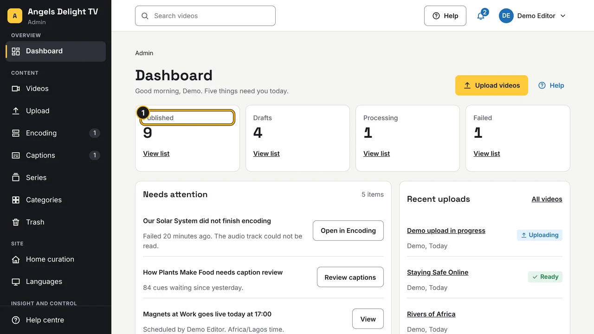
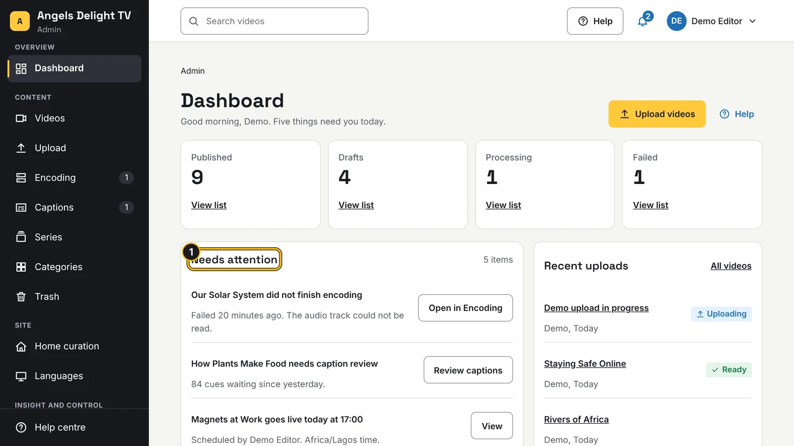
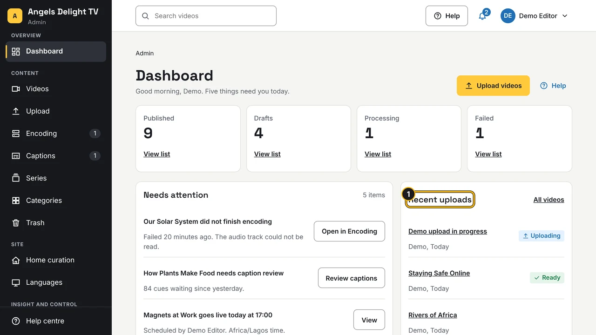
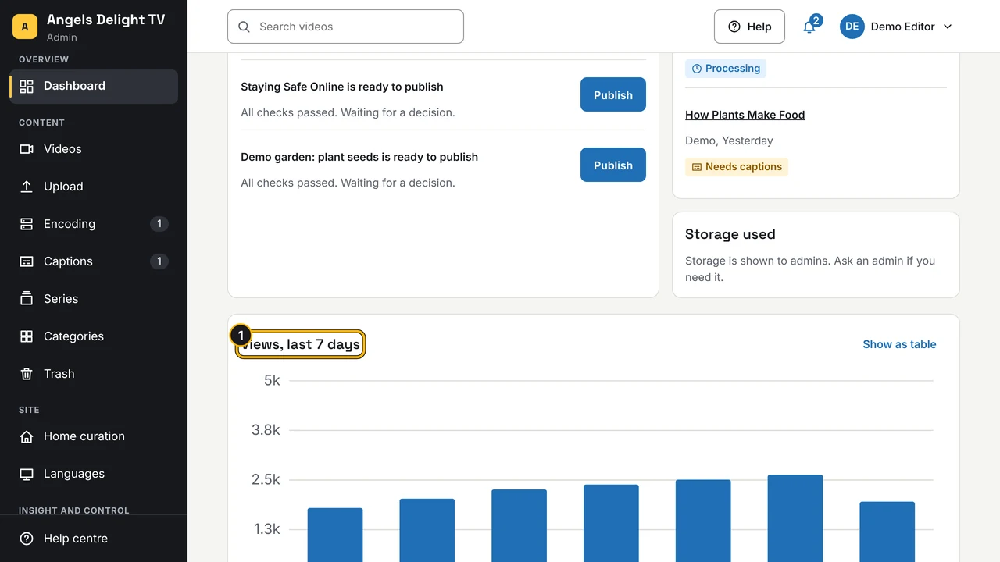
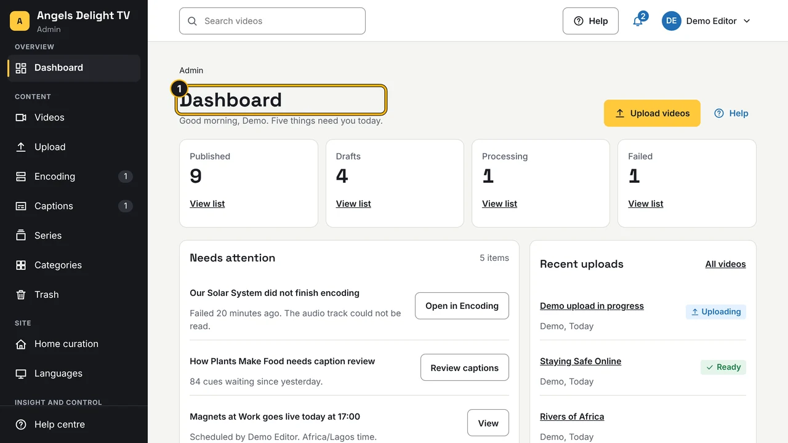

## What you will do
Read the [Dashboard](glossary:dashboard) from top to bottom. You end knowing which videos wait for you and how the site is doing this week.

## Before you start
- **Who can do this:** every staff member. Admins also see the storage numbers.
- **Time:** about 2 minutes.
- Sign in first. Read [Find your way around](help:S04) if the side menu is new to you.

## Steps
<!-- kb:steps D01 -->
1. Check that the **Published** tile counts the videos viewers can watch.
   
2. Check that the **Needs attention** card lists what waits for you.
   
3. Scroll to **Recent uploads**.
   
4. Scroll to **Storage used**.
   Admins see the numbers here. Editors see a note that says to ask an Admin.
5. Scroll to **Views, last 7 days**.
   
6. Click **Open in Encoding** to go straight to a video that needs you.
7. Choose **Dashboard** in the side menu to come back.
   
<!-- /kb:steps -->

## What you should see
You are back on the Dashboard. Each part tells you something:

- **Published**, **Drafts**, **Processing** and **Failed** count your videos. Each tile has a link that opens the matching list.
- **Needs attention** lists what waits for you, such as a failed video or captions to review. When it is empty it says "All clear."
- **Recent uploads** shows the newest videos and their status.
- **Storage used** shows how much space is used. Editors see a note that says to ask an Admin.
- **Views, last 7 days** shows how many people watched each day.

> [!TIP]
> Open the Dashboard first every morning. It is the quickest way to see what needs doing.

## If something goes wrong
- **A tile says it could not load a number.** Your videos are safe. Choose **Retry** on the tile.
- **The Dashboard shows a card called Start here.** You have no videos yet. Follow its three steps, beginning with [Upload one video](help:D02).
