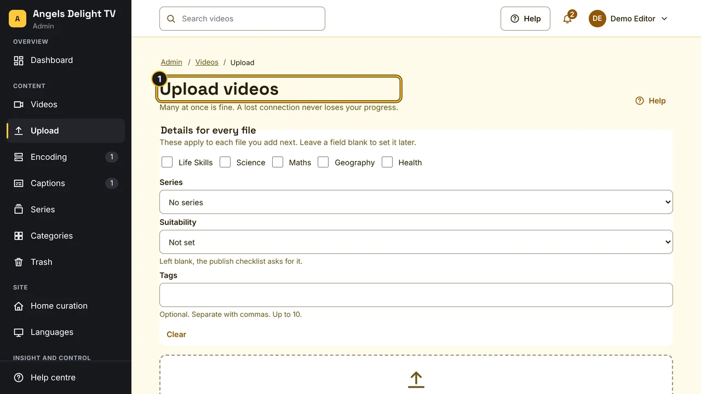
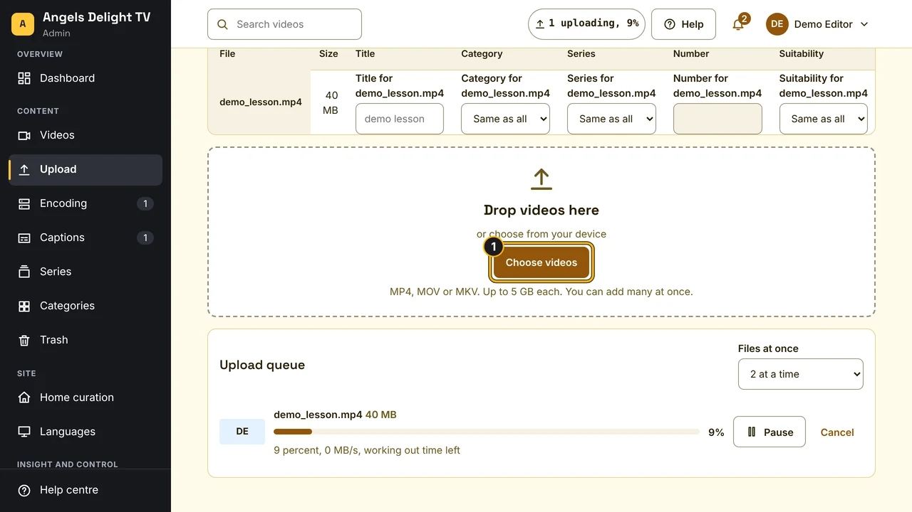
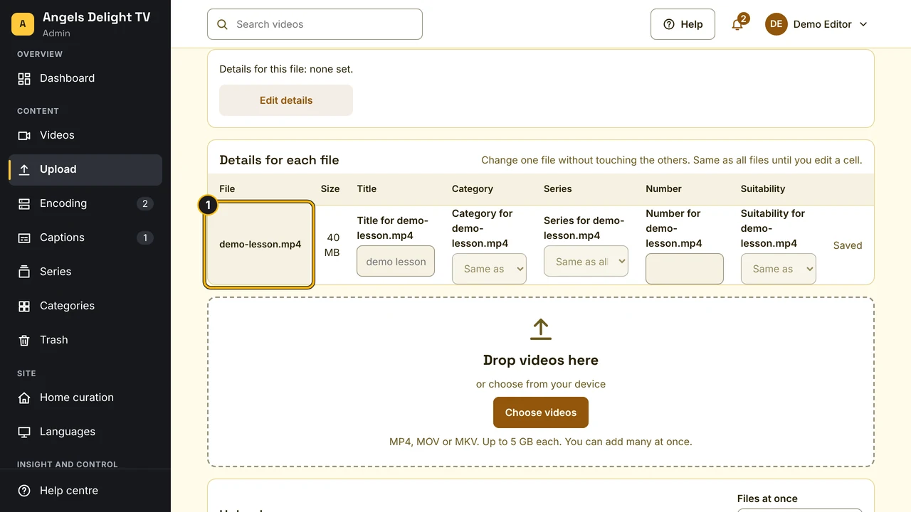
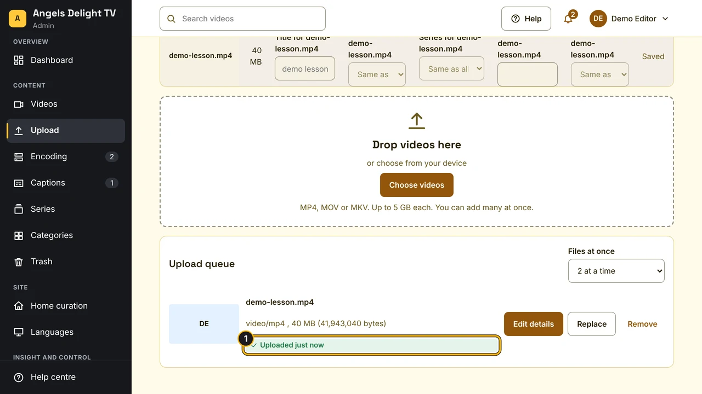
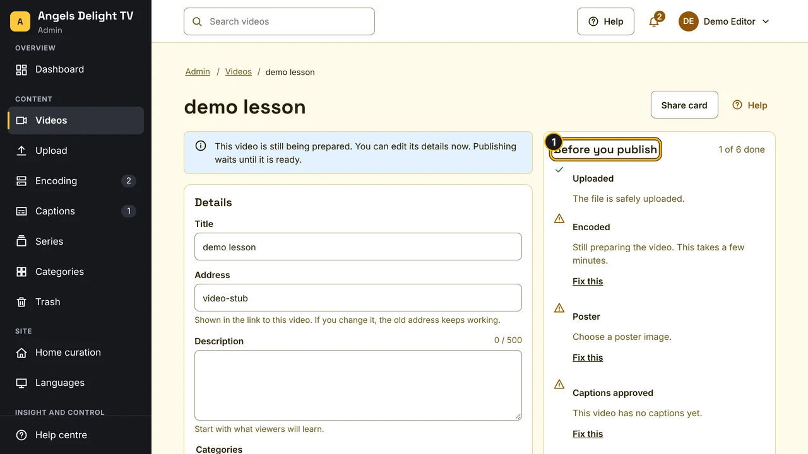

## What you will do
Add one video file to the platform. You end with a [draft](glossary:draft) video that you can edit.

## Before you start
- **Who can do this:** Editors, Admins and Super admins.
- **Time:** about 4 minutes, plus the time your connection needs to send the file.
- You need a video file on your computer, in MP4, MOV or MKV format. The page says the largest size it accepts.
- Read [Find your way around](help:S04) if you have not yet.

## Steps
<!-- kb:steps D02 -->
1. Choose **Upload** in the side menu.
   
2. Click **Choose videos**.
   
3. Choose a file from your computer.
   A box from your computer opens. Pick one MP4, MOV or MKV file.
   
4. Wait until you see **Uploaded just now**.
   Keep this page open until then. Closing it can stop the upload.
   
5. Click **Edit details for demo_lesson.mp4**.
   The name on this button is the name of your own file.
6. Wait until you see **Before you publish**.
   Your video is now a draft. Nobody can watch it yet.
   
<!-- /kb:steps -->

## What you should see
The row for your file says **Uploaded just now** and has an **Edit details** button. The video is now in [Videos](/admin/videos) as a draft. Nobody can watch it yet.

> [!CAREFUL]
> Keep the page open until the row says Uploaded just now. If your connection drops, the saved part is kept and the upload carries on by itself.

## If something goes wrong
- **The bar stops, or the row says Paused or Failed.** Check your internet connection, then choose **Retry** on the row.
- **The file is not accepted.** Check that it is an MP4, MOV or MKV file and not larger than the limit shown on the page.
- **You uploaded the wrong file.** Choose **Remove** on its row before you add details, or move the video to Trash later. Still stuck? [What to send ARKDEV](help:T11)
