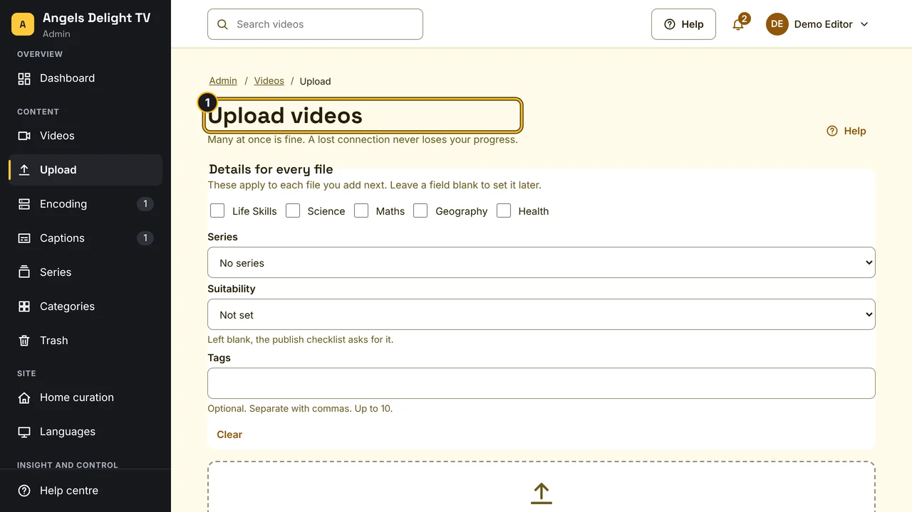
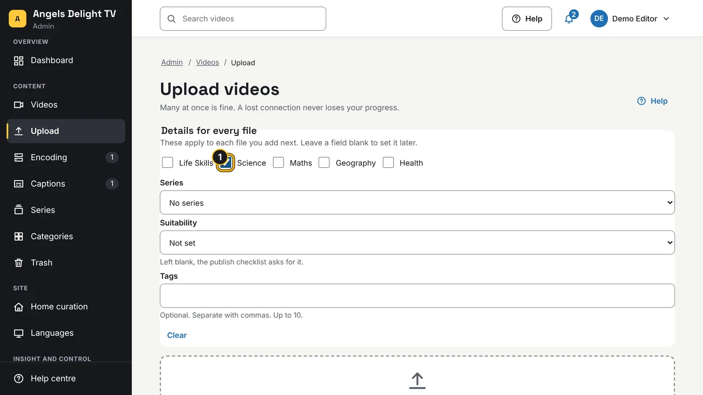
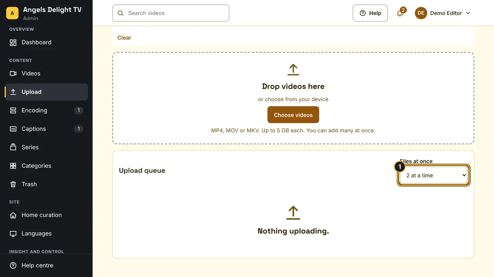
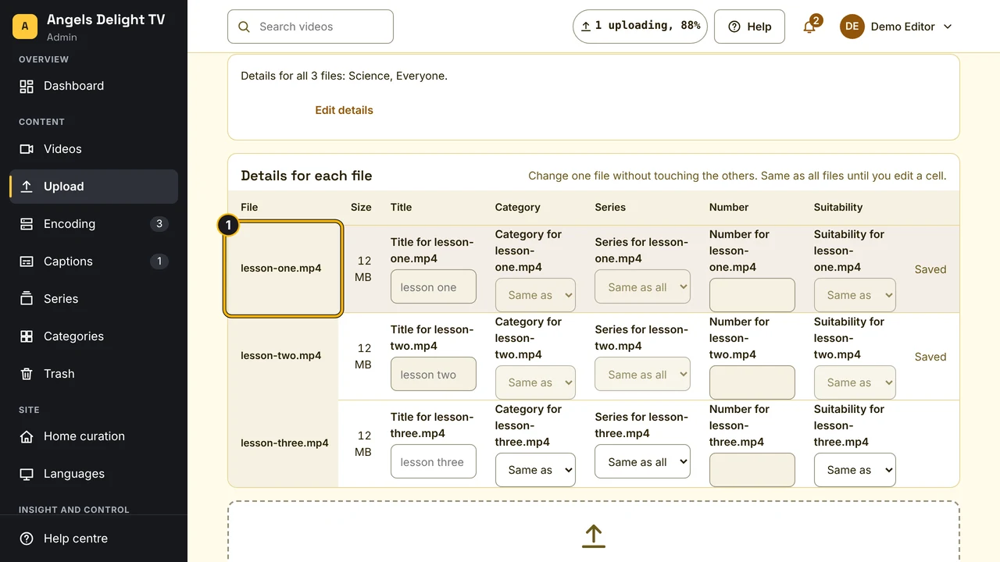
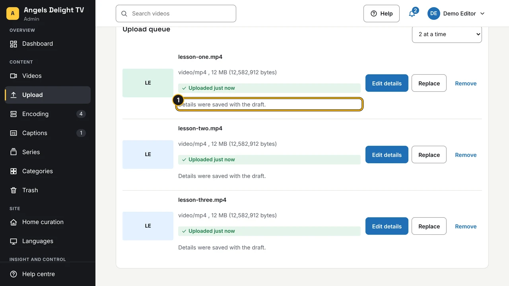

## What you will do
Upload several videos together and give every file the same category and suitability before you add them. You end with all files uploaded as drafts.

## Before you start
- **Who can do this:** Editors, Admins and Super admins.
- **Time:** about 4 minutes, plus the time your connection needs.
- Have your video files ready in one folder. Read [Upload one video](help:D02) first.
- Details you set before adding files apply to every file you add after. Files you added earlier keep what they had.

## Steps
<!-- kb:steps D03 -->
1. Choose **Upload** in the side menu.
   
2. Tick **Science** to give every file this category.
   
3. Select **Everyone** from the **Suitability** list.
4. Select **2 at a time** from the **Files at once** list.
   Sending two files at once is faster. Use 1 at a time on a slow connection.
   
5. Click **Choose videos**.
6. Choose a file from your computer.
   Hold the Ctrl key to pick more than one file. The files upload side by side.
   
7. Wait until you see **Uploaded just now**.
8. Check that **Details were saved with the draft**.
   
<!-- /kb:steps -->

## What you should see
Every file has its own row and its own progress bar. When a row is done, the note **Details were saved with the draft** shows. The videos are in [Videos](/admin/videos) as drafts.

> [!TIP]
> The card **Details for every file** shows a short summary after you add files. Choose **Edit details** to change it for the next files. A table lets you change one file only.

## If something goes wrong
- **One file fails and the others carry on.** Each file is its own lane. Choose **Retry** on the failed row. See [Fix an upload that stopped or failed](help:D04).
- **A file is not added.** It is not an MP4, MOV or MKV file, or it is larger than the limit shown on the page.
- **Everything goes slowly.** Choose **1 at a time** in the **Files at once** list. Many files at once can slow a weak connection.
