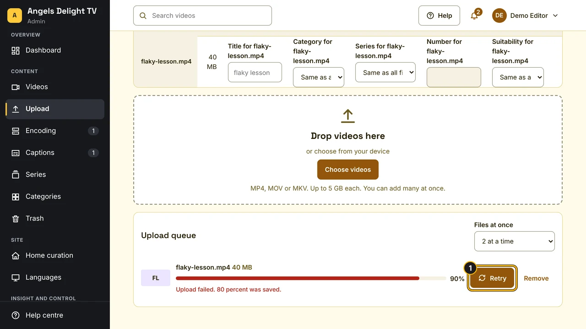
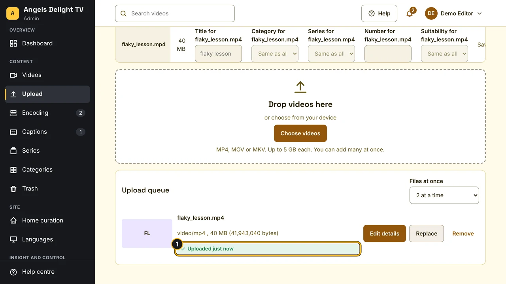

## What you will do
Carry on with an upload that stopped. The part already sent is kept, so Retry sends only what is missing.

## Before you start
- **Who can do this:** Editors, Admins and Super admins.
- **Time:** about 3 minutes.
- Check that your internet connection works. Keep the Upload page open.
- On the practice site that made the video, a file with the word flaky in its name loses its last part once. That is how the failure is shown. On your real site a failure looks the same.

## Steps
<!-- kb:steps D04 -->
1. Choose **Upload** in the side menu.
2. Click **Choose videos**.
3. Choose a file from your computer, named "flaky_lesson.mp4".
   To practise, give your file a name with the word flaky in it. On your real site, any file can fail when the connection drops.
4. Wait until you see **Retry**.
   The row shows why it stopped. The part that was sent is kept.
   
5. Click **Retry flaky_lesson.mp4**.
6. Wait until you see **Uploaded just now**.
   
<!-- /kb:steps -->

## What you should see
The row says **Uploaded just now**. You did not have to choose the file again.

> [!NOTE]
> If you close the page, come back to **Upload** and choose the same file again. The upload carries on from where it stopped.

## If something goes wrong
- **Retry fails again.** Check your connection. Try one file alone, not many. On mobile data, wait for a better signal.
- **The row says Paused.** Choose **Resume** on the row.
- **You do not want this file.** Choose **Cancel** or **Remove** on the row and start again with the right file.
