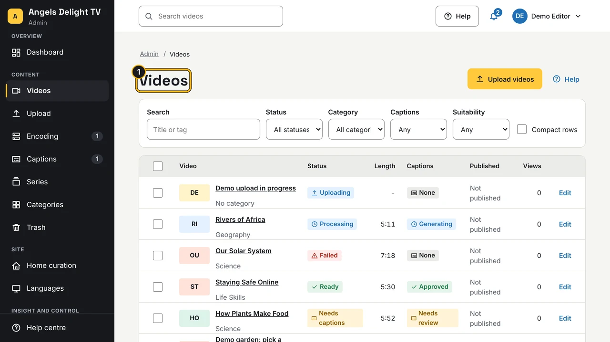
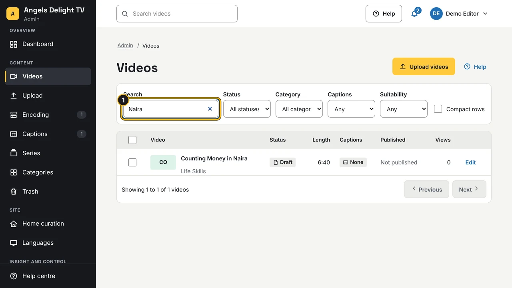
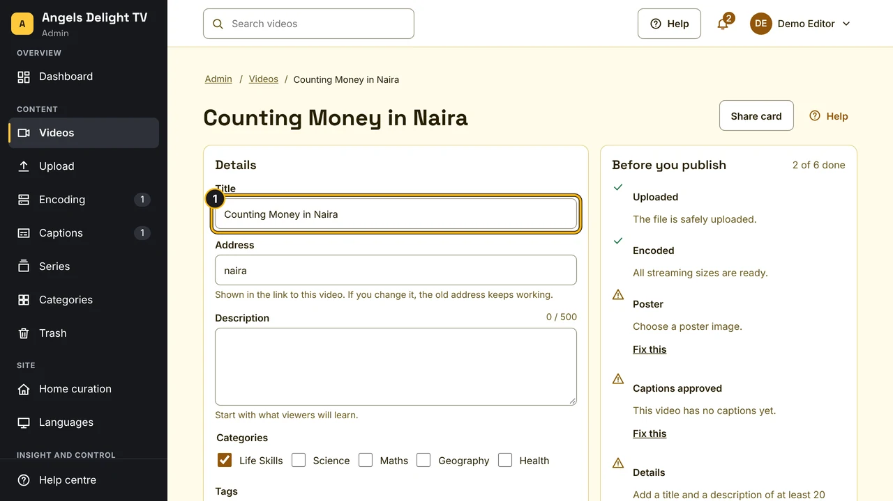
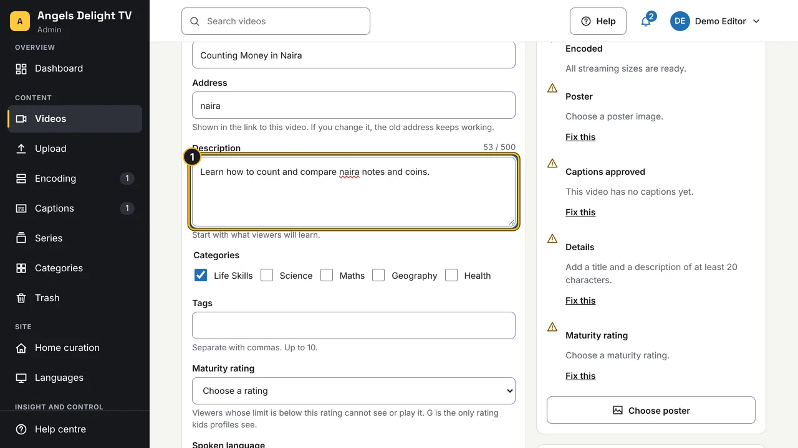
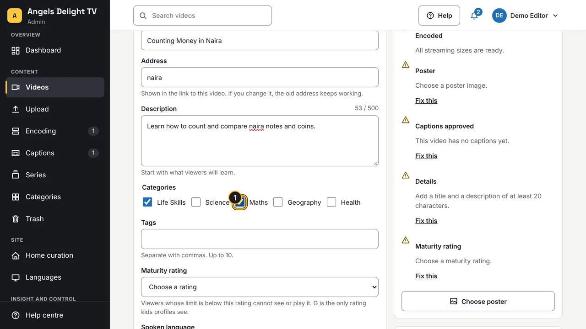
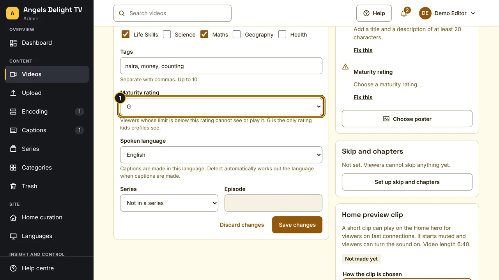
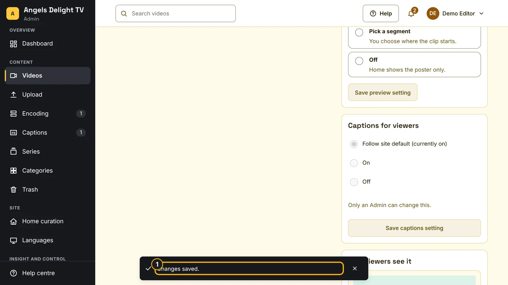

## What you will do
Fill in the details of a video: its description, [categories](glossary:category), tags and [maturity rating](glossary:maturity-rating). You end with the details saved.

## Before you start
- **Who can do this:** Editors, Admins and Super admins.
- **Time:** about 4 minutes.
- The video must already be uploaded. Read [Upload one video](help:D02) first.
- Write a title that says what viewers will learn. Start the description with a verb, such as "Learn" or "See".

## Steps
<!-- kb:steps D05 -->
1. Choose **Videos** in the side menu.
   
2. Type "Naira" in the **Search** box.
   The list narrows as you type, so your video is easy to find.
   
3. Click **Edit Counting Money in Naira**.
4. Check that the **Title** says what viewers will learn.
   
5. Type "Learn to count and compare naira." in the **Description** box.
   Start with what viewers will learn. The counter shows how many characters you may use.
   
6. Tick **Maths**.
   A video can have more than one category. Viewers find it in each one.
   
7. Type "naira, money, counting" in the **Tags** box.
   Separate tags with commas. You can add up to 10.
8. Select **G** from the **Maturity rating** list.
   G is the only rating that Kids profiles see.
   
9. Click **Save changes**.
10. Wait until you see **Changes saved**.
   
<!-- /kb:steps -->

## What you should see
The message **Changes saved** appears. The card **How viewers see it** shows your title and categories. The checklist **Before you publish** gets shorter.

> [!TIP]
> The **Title** box and **Description** box show a counter. Stay under the limit so the words are not cut off on a phone.

## If something goes wrong
- **Save changes is grey.** Nothing has changed yet. Edit a box and the button turns on.
- **A red message sits under a box.** Read it and fix that box. The page keeps your other changes.
- **You left the page by mistake.** Choose **Discard changes** to go back to the last saved version, or open the video again from Videos.
