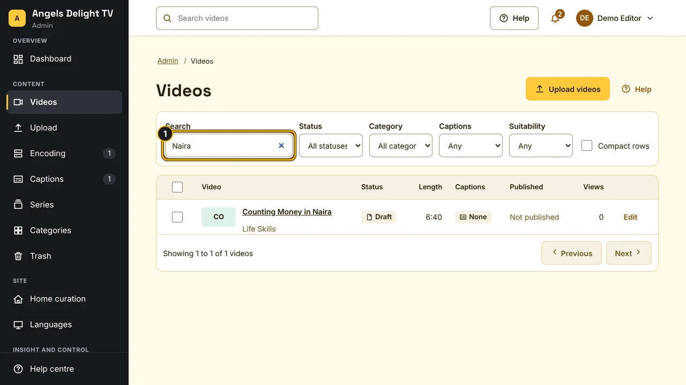
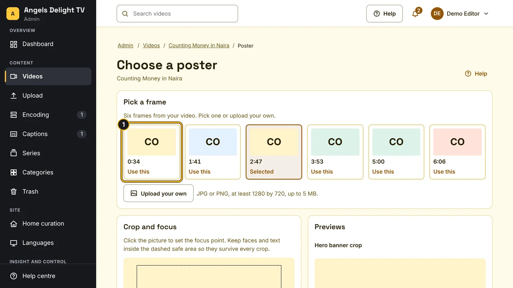
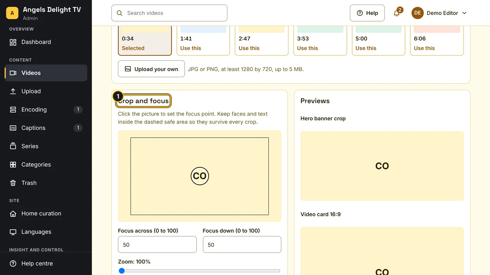
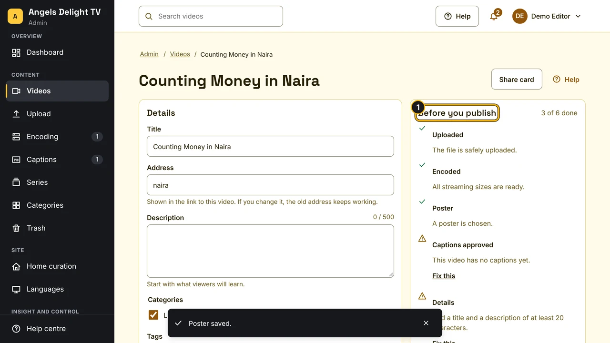

## What you will do
Pick one of six frames from your video as its [poster](glossary:poster), check how it is cropped and save it.

## Before you start
- **Who can do this:** Editors, Admins and Super admins.
- **Time:** about 3 minutes.
- The video must be uploaded and prepared. Read [Add the title, description and categories](help:D05) first.
- To use your own picture, choose **Upload your own**. It must be a JPG or PNG, at least 1280 by 720, up to 5 MB.

## Steps
<!-- kb:steps D06 -->
1. Choose **Videos** in the side menu.
2. Type "Naira" in the **Search** box.
   The list narrows as you type, so your video is easy to find.
   
3. Click **Edit Counting Money in Naira**.
4. Click **Choose poster**.
   
5. Click **0:34 Use this**.
   The time is where in the video the frame comes from.
6. Scroll to **Crop and focus**.
   
7. Type "Naira notes and coins." in the **Poster description (alt text)** box.
   This text is read aloud for people who cannot see the picture.
8. Click **Save poster**.
9. Wait until you see **Before you publish**.
   
<!-- /kb:steps -->

## What you should see
The message **Poster saved** shows and you are back on the video screen. The button now says **Change poster**, and the checklist item for the poster is done.

> [!TIP]
> Pick a frame with a clear picture and no text near the edges. The cards under **Previews** show how it is cropped on Home and on a phone.

## If something goes wrong
- **The frames look dark or blurry.** Choose **Upload your own** and pick a clear picture instead.
- **Save poster does nothing.** A red message may show in the page. Read it and fix that item. The crop must stay inside the picture.
- **The old poster still shows.** The new crop is being applied to the files. Wait a moment and reload the page. Still stuck? [What to send ARKDEV](help:T11)
