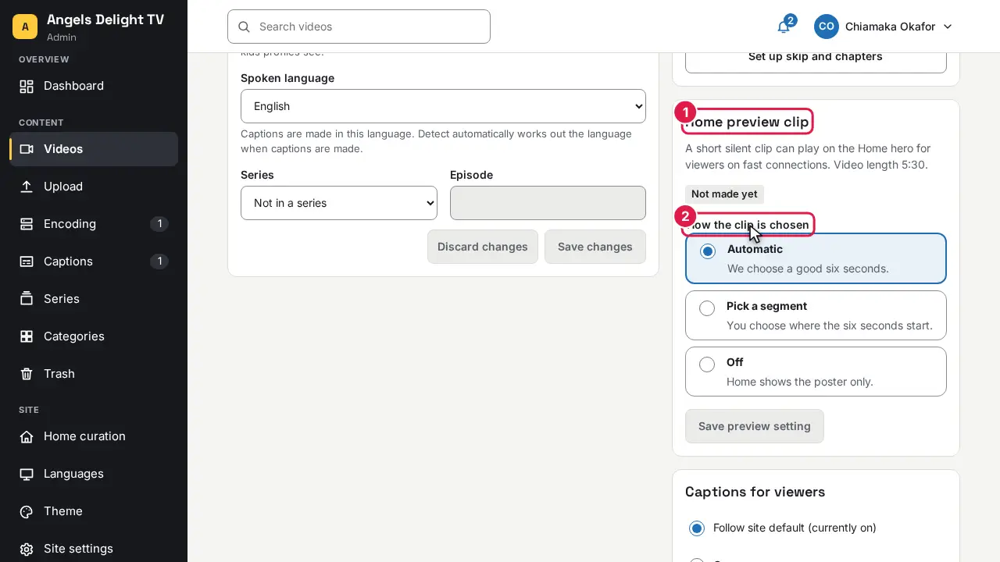

## What you will do
Check the captions made for a new video. You end with the captions approved so viewers can see them.

## Before you start
Upload a video first. Read [Upload one video](help:D02) if you have not yet. Wait until the captions are ready.

## Steps
1. Click **Captions** in the side menu.
   
2. Open a video that says **Needs review**.
3. Play the video and read the captions as they appear.
4. Click a caption line and fix any wrong word.
5. Choose **Approve** when the captions read right.
   > [!NOTE]
   > Only Admins can approve many videos at once.

## What you should see
The state of the captions changes to **Approved**.

## If something goes wrong
- **There are no captions yet.** They take a few minutes. Check **Encoding** and try again later.
- **The Approve button is grey.** Some warnings must be fixed first. Read the message above the list.
