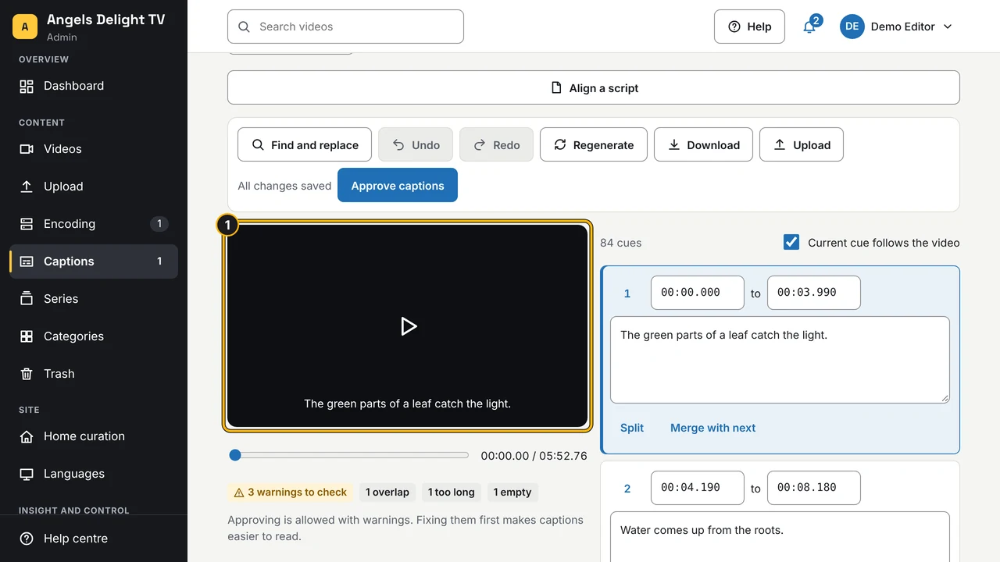
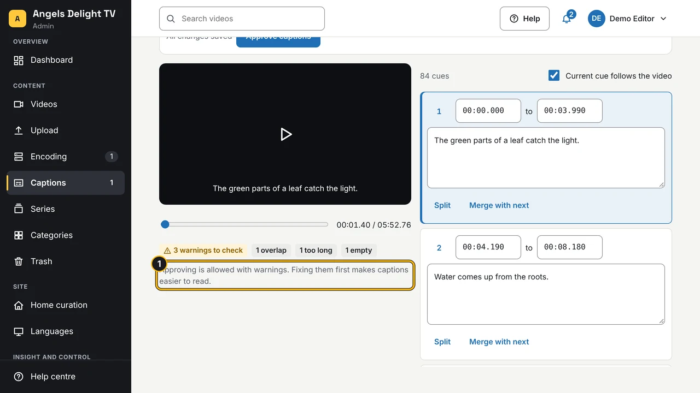
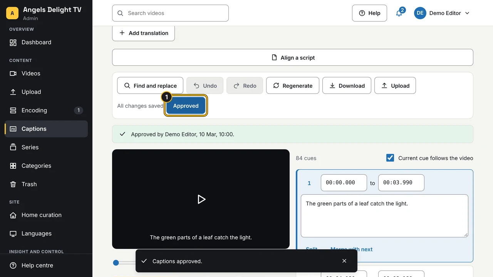
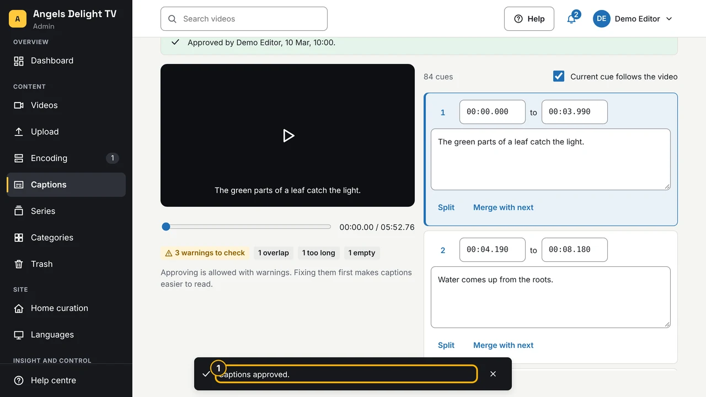

## What you will do
Check the [captions](glossary:caption) made for a new video and approve them. You end with the state **Approved**, so viewers can see the words.

## Before you start
- **Who can do this:** Editors, Admins and Super admins. Only Admins can approve many videos at once.
- **Time:** about 5 minutes for a short video.
- The video must be uploaded and its captions made. The state in the list says **Needs review** when they are ready.
- Read [Upload one video](help:D02) if you have not yet.

## Steps
<!-- kb:steps D07 -->
1. Choose **Captions** in the side menu.
   
2. Click **Review captions for How Plants Make Food**.
   A video that needs a check has a blue Review button.
   
3. Click **Play** to watch the video with its captions.
4. Click **Pause** when you want to read a cue.
5. Check that **Approving is allowed with warnings** shows under the video.
   
6. Click **Approve captions**.
   Approve only when the words match what is said. Anyone can still edit them later.
   
7. Wait until you see **Captions approved**.
   
<!-- /kb:steps -->

## What you should see
A message says **Captions approved**. In the **Captions** list the state of the video is **Approved**, and the number beside **Captions** in the side menu goes down by one.

> [!NOTE]
> Approving is a review, so it has no Undo. You can still change the words later and choose **Approve changes**.

## If something goes wrong
- **The list says No captions waiting.** Nothing needs review. New videos appear here when their captions are ready.
- **A video says Generating.** The captions are still being made. Come back in a few minutes.
- **The words are wrong in many places.** Edit the cues on this screen before you approve. Each cue has its own **Words in cue** box.
