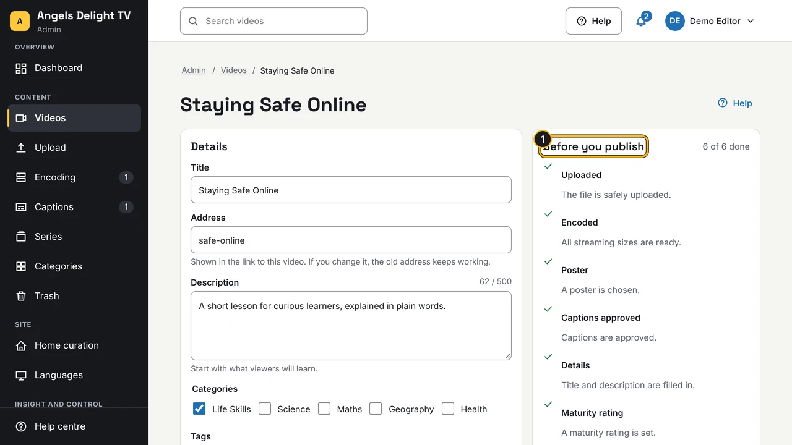
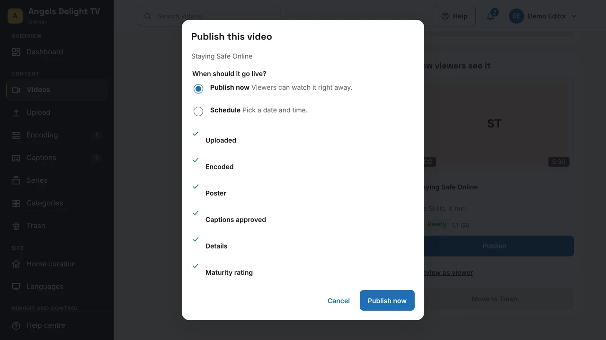
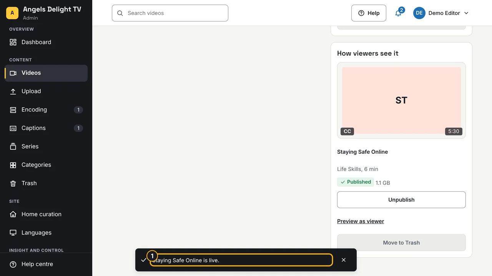
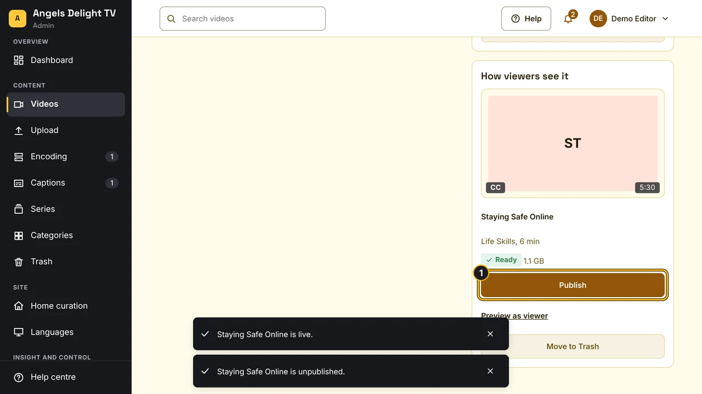

## What you will do
[Publish](glossary:publish) a ready video so viewers can watch it, then [unpublish](glossary:unpublish) it to hide it again.

## Before you start
- **Who can do this:** Editors, Admins and Super admins.
- **Time:** about 3 minutes.
- The card **Before you publish** must show every step done: details, poster, maturity rating and approved captions. See [Review and approve captions](help:D07).
- To publish at a later time, choose **Schedule** in the same box instead of **Publish now**.

## Steps
<!-- kb:steps D08 -->
1. Choose **Videos** in the side menu.
2. Click **Edit Staying Safe Online**.
3. Check that **Before you publish** shows every step done.
   
4. Click **Publish**.
   
5. Click **Publish now**.
6. Wait until you see **is live**.
   
7. Click **Unpublish** to hide the video again.
8. Click **Unpublish** to confirm.
   Viewers can no longer find or watch the video. You can publish it again any time.
9. Wait until you see **is unpublished**.
   
<!-- /kb:steps -->

## What you should see
The video shows the badge **Published** and viewers can find it. After you unpublish, the badge changes and viewers can no longer find or watch the video.

> [!TIP]
> Unpublish does not delete anything. Publish again whenever you are ready.

## If something goes wrong
- **The Publish button is grey.** The video is still getting ready, or it has unsaved changes. Wait, or choose **Save changes** first.
- **The box says steps are not finished.** Open the item in **Before you publish** that is not done and finish it. Captions need approval first.
- **Viewers still see the video after you unpublish.** Ask them to reload the page. It can take a moment to disappear.
