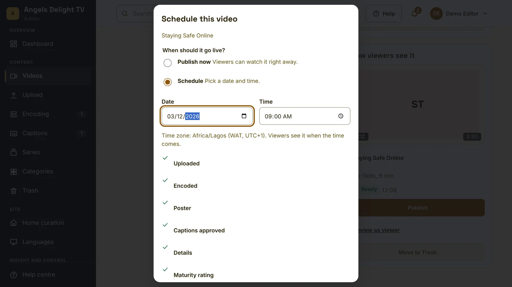
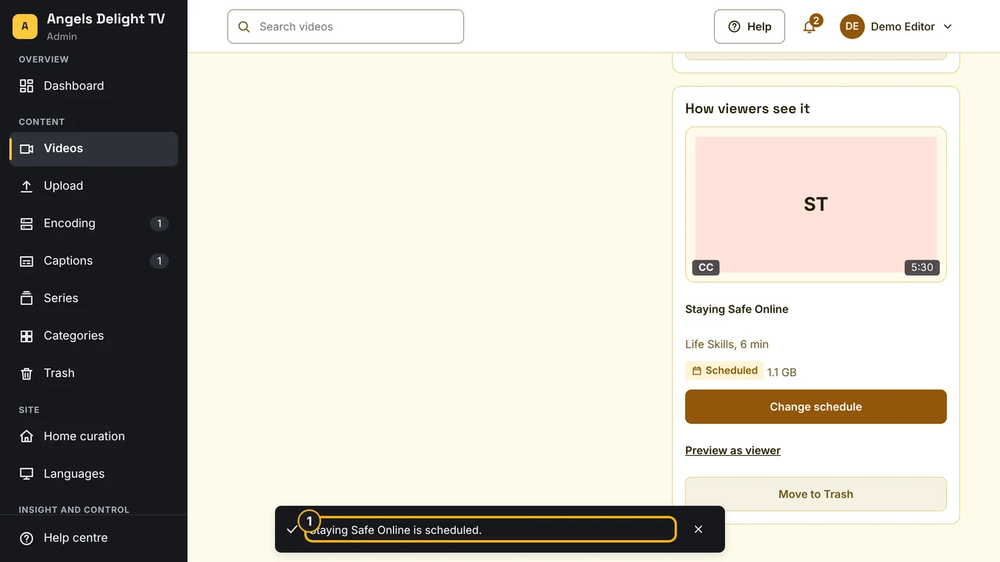

## What you will do
Choose a day and time for a ready video to go live by itself. You end with the video [scheduled](glossary:scheduled).

## Before you start
- **Who can do this:** Editors, Admins and Super admins.
- **Time:** about 3 minutes.
- The checklist **Before you publish** must show every step done. See [Publish or unpublish a video](help:D08).
- All times are Lagos time, all year. The time must be in the future.

## Steps
<!-- kb:steps D09 -->
1. Choose **Videos** in the side menu.
2. Click **Edit Staying Safe Online**.
3. Click **Publish**.
4. Click **Schedule**.
5. Type "03/12/2026" in the **Date** box.
   Times are Lagos time, all year. The order of month and day follows the language of your browser. The practice site clock says it is 10 Mar 2026.
   
6. Click **Schedule for 12 Mar, 9:00**.
   The button names the day and time you chose. The time box starts at 9:00 AM.
7. Wait until you see **is scheduled**.
   
<!-- /kb:steps -->

## What you should see
The message **is scheduled** shows. On the video screen the button says **Change schedule**. The video goes live at the time you chose, and you do not need to be signed in.

> [!TIP]
> To change the time, open the video, choose **Change schedule** and pick a new time.

## If something goes wrong
- **The button says Pick a time in the future.** The time you chose has passed. The box shows the time now in Lagos. Pick a later time.
- **The Publish button is grey.** The video is still getting ready, or it has unsaved changes. Wait, or choose **Save changes**.
- **You want it live now.** Choose **Publish** and **Publish now** instead. See [Publish or unpublish a video](help:D08). Still stuck? [What to send ARKDEV](help:T11)
