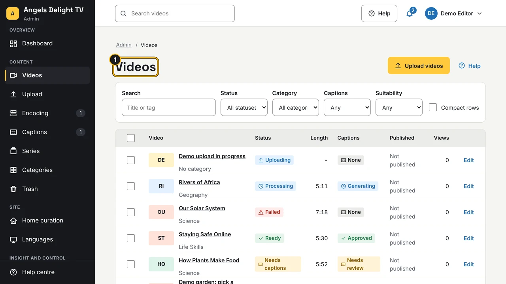
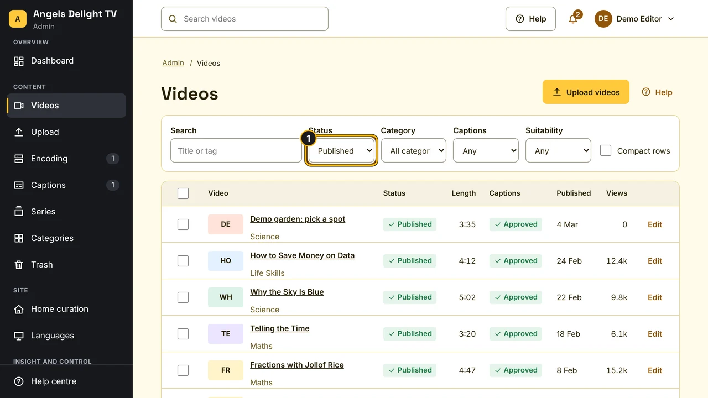
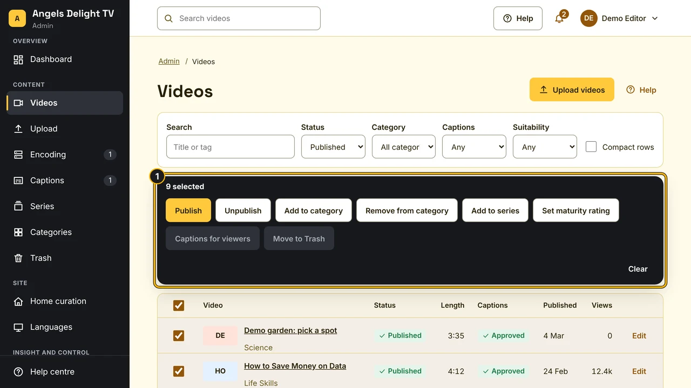
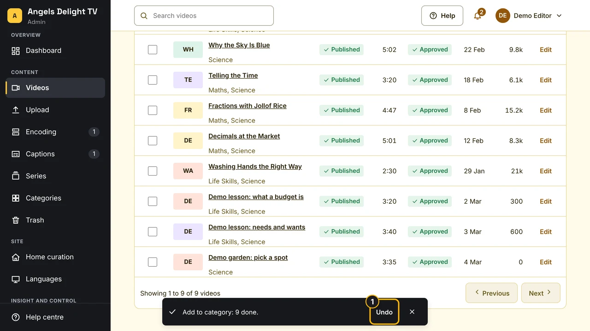

## What you will do
Filter the [Videos](/admin/videos) list, select the rows you want and add them all to a category at once. You can undo it.

## Before you start
- **Who can do this:** Editors, Admins and Super admins. Only Admins can move videos to Trash in bulk.
- **Time:** about 4 minutes.
- Read [Find your way around](help:S04) if you have not yet.
- You can also search by title or tag with the **Search** box, and narrow the list by **Category**, **Captions** and **Suitability**.

## Steps
<!-- kb:steps D10 -->
1. Choose **Videos** in the side menu.
   
2. Select **Published** from the **Status** list.
   
3. Tick **Select all on this page**.
   
4. Click **Add to category**.
5. Select **Science** from the **Category** list.
6. Click **Apply**.
7. Check that **Undo** is shown if you need to go back.
   
<!-- /kb:steps -->

## What you should see
A bar shows how many videos you changed. For a short time it offers **Undo**. The list then shows the new category on each video.

> [!CAREFUL]
> A change to many videos is quick, so read the box before you choose **Apply**. Choose **Undo** straight away if it was a mistake.

## If something goes wrong
- **A video was left out.** The result lists the videos that could not be changed and why. Choose **Retry** on the list of failed ones.
- **The bar says only this page is selected.** Bulk actions work on the rows shown. Change the filter to reach the rest.
- **The Undo button is gone.** It stays for a short time only. Change the category by hand from each video.
