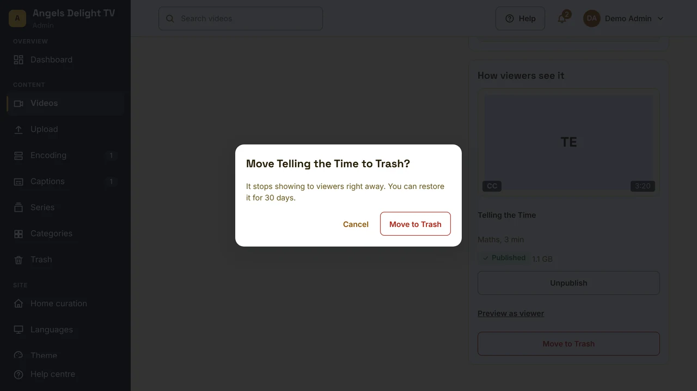
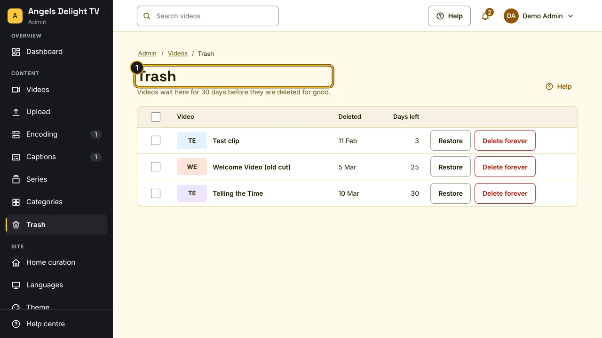
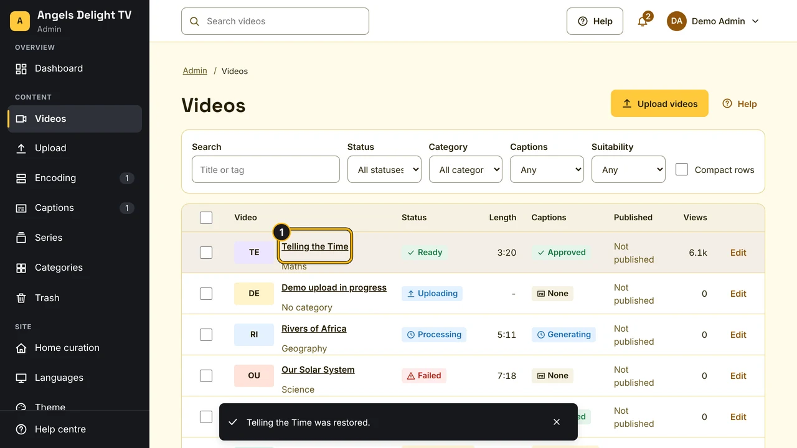

## What you will do
Move a video to [Trash](glossary:trash) and bring it back. A video waits in Trash for 30 days before it is deleted for good.

## Before you start
- **Who can do this:** Admins and Super admins can move a video to Trash. Editors can open Trash and restore videos.
- **Time:** about 3 minutes.
- Read [Find videos and change many at once](help:D10) first if you have not.
- Moving to Trash hides the video from viewers at once.

## Steps
<!-- kb:steps D11 -->
1. Choose **Videos** in the side menu.
2. Click **Edit Telling the Time**.
3. Click **Move to Trash**.
   Only Admins and Super admins can see this button turned on.
   
4. Click **Move to Trash** to confirm.
   The video stops showing to viewers at once. You have 30 days to restore it.
5. Choose **Trash** in the side menu.
   
6. Click **Restore Telling the Time**.
7. Choose **Videos** in the side menu.
8. Check that **Telling the Time** is back in the list.
   
<!-- /kb:steps -->

## What you should see
The video is back in [Videos](/admin/videos) as a draft. Publish it again when you are ready, see [Publish or unpublish a video](help:D08).

> [!CAREFUL]
> **Delete forever** in Trash cannot be undone, and only Admins can use it. Check the title twice.

## If something goes wrong
- **Move to Trash is grey.** Only an Admin can move a video to Trash. Ask an Admin.
- **The video is not in Trash.** It may have been deleted for good after 30 days. Upload it again if you still have the file.
- **You restored the wrong video.** Choose **Undo** in the message, or move the video to Trash again. Still stuck? [What to send ARKDEV](help:T11)
