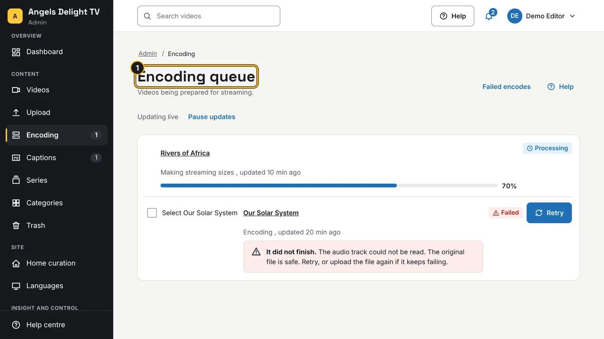
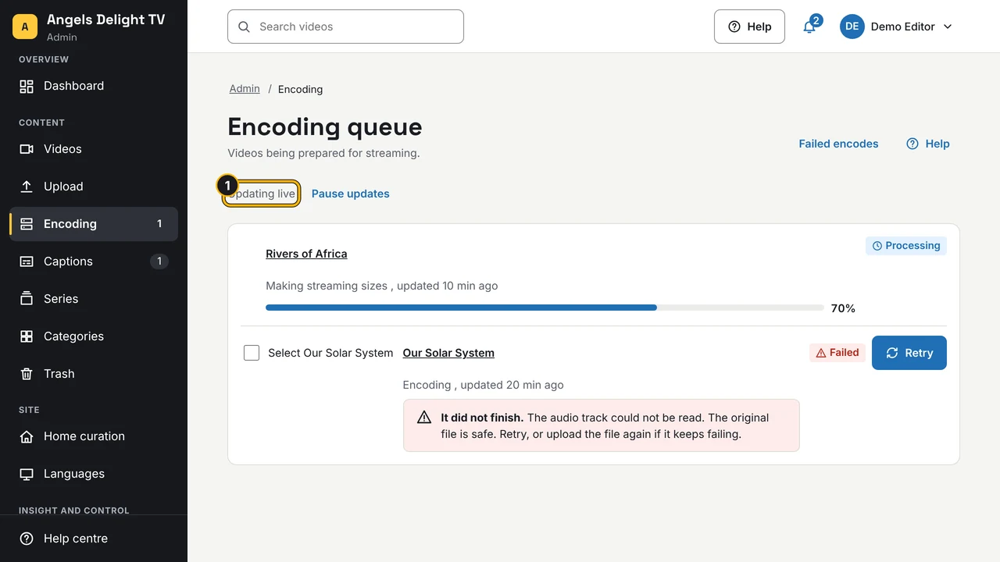
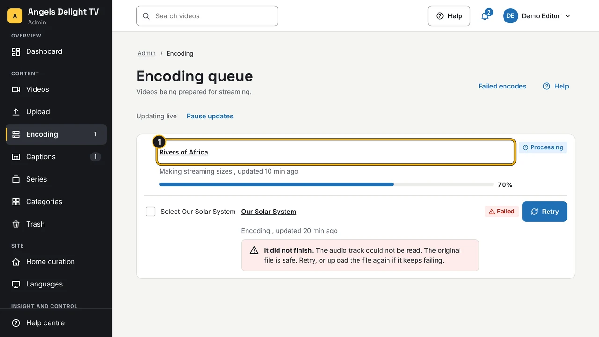
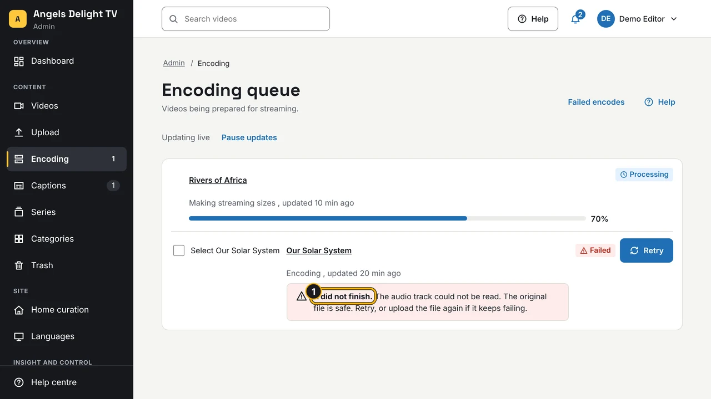
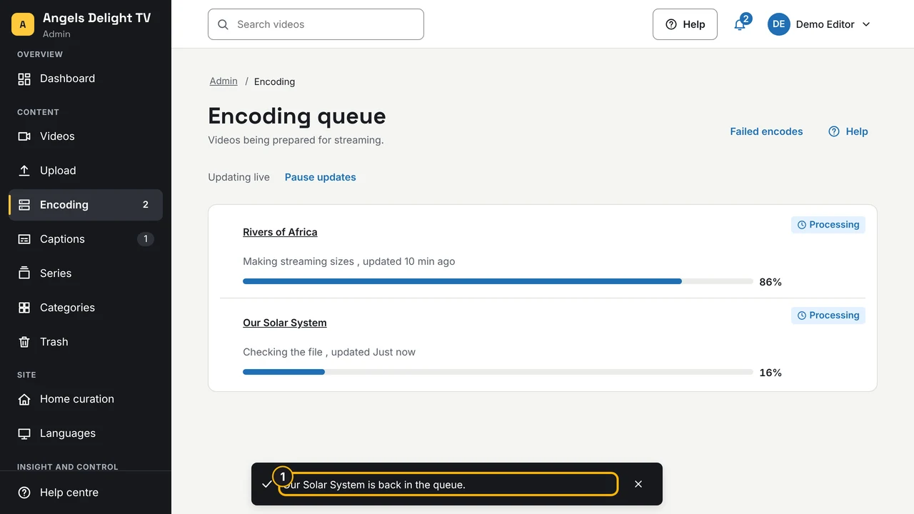

## What you will do
Watch the [Encoding](glossary:encoding) queue and retry a video that did not finish getting ready.

## Before you start
- **Who can do this:** Editors, Admins and Super admins.
- **Time:** about 3 minutes.
- Read [Upload one video](help:D02) first.
- A video is not ready to play until it has finished here. A number beside **Encoding** in the side menu shows how many need you.

## Steps
<!-- kb:steps D12 -->
1. Choose **Encoding** in the side menu.
   
2. Check that **Updating live** is shown.
   
3. Check that **Rivers of Africa** shows its progress.
   
4. Check that **It did not finish** explains why a video failed.
   
5. Click **Retry encoding Our Solar System**.
   The button on your screen carries the name of your own video.
6. Wait until you see **is back in the queue**.
   
<!-- /kb:steps -->

## What you should see
The video is in the queue again. The page updates by itself, so you do not need to reload it. A failed video that works now moves on and its row says **Processing**.

> [!TIP]
> Choose **Failed encodes** at the top of the page to see every failed video in one list. You can retry or clean up several at once there.

## If something goes wrong
- **A video stays on Processing a long time.** Large files take longer. Wait, and look again after a while.
- **Retry fails again.** Read the reason on the row. If it says the file could not be read, upload the file again from [Upload one video](help:D02).
- **The page says Live updates paused.** Choose **Resume updates**. Updates also pause when you are offline.
