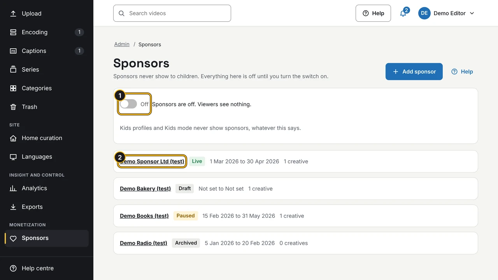
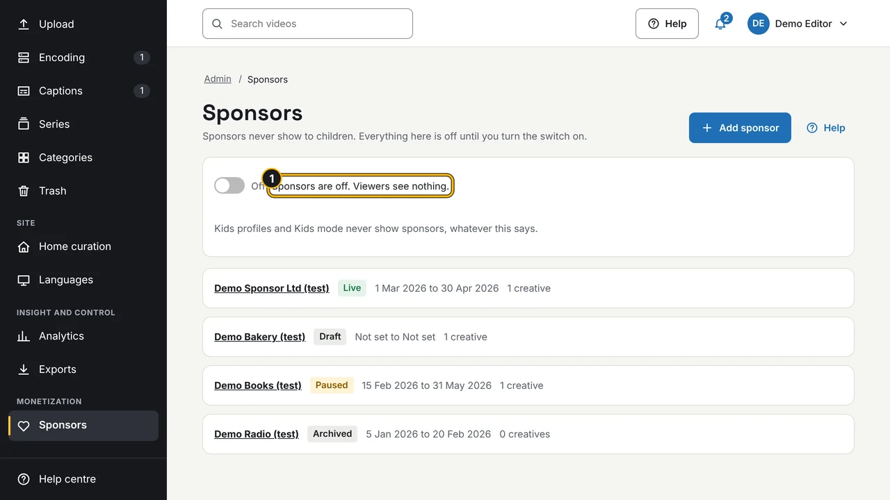
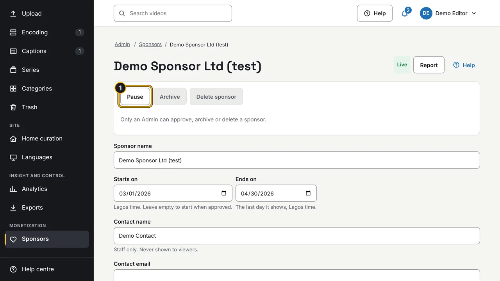
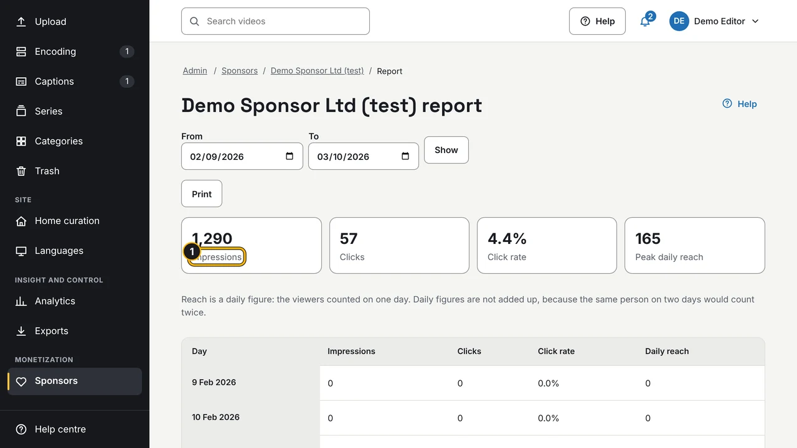

## What you will do
Learn what sponsors and donations are, and where each one lives in the side menu. You end knowing which screen to open for each job.

## Before you start
Editors, Admins and Super admins can open **Sponsors**. Only Admins and Super admins can open **Donations**. Read [Find your way around](help:S04) if you have not yet.

A [sponsor](glossary:sponsor) is a business or person that pays to show a short thank you message or banner beside your videos for a set time. A [donation](glossary:donation) is a gift of money from a viewer, paid on the secure Paystack page.

Both are off until they are switched on. Neither is ever shown to children. Money from sponsors is agreed outside the platform: this site only shows the message and counts the views.

## Steps
<!-- kb:steps M01 -->
1. Choose **Sponsors** in the side menu.
   
2. Check that **Sponsors never show to children** appears under the title.
3. Check that **Sponsors are off. Viewers see nothing.** shows beside the switch.
   
4. Check that **Demo Sponsor Ltd (test)** shows in the list.
5. Click **Demo Sponsor Ltd (test)**.
   
6. Check that **Pause** shows in the status panel.
7. Click **Report**.
   
8. Check that **Impressions** shows at the top of the report.
<!-- /kb:steps -->

## What you should see
The **Sponsors** screen shows a switch that is off, then the list of sponsors with a status badge on each. The sponsor report shows the numbers for one sponsor. Donations has its own screen in the side menu for Admins.

## If something goes wrong
- **You cannot see **Donations** in the side menu.** Only Admins and Super admins can. Ask an Admin to look, or read [Roles and permissions](help:R02).
- **The switch on **Sponsors** is grey.** Only an Admin can change it. [Turn sponsors on](help:M02)
