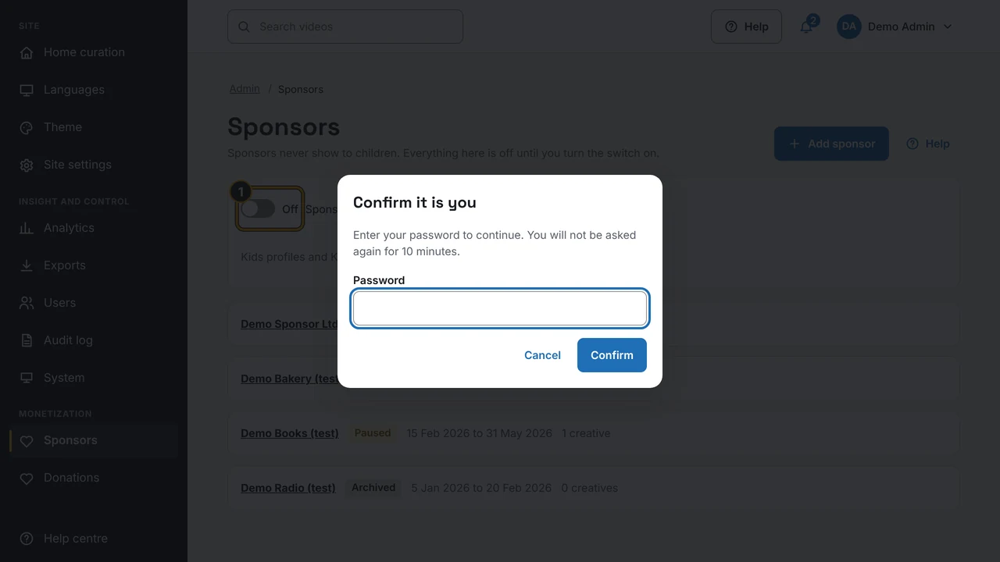
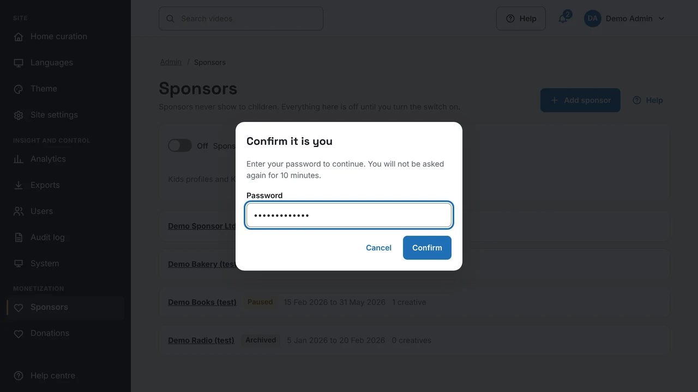
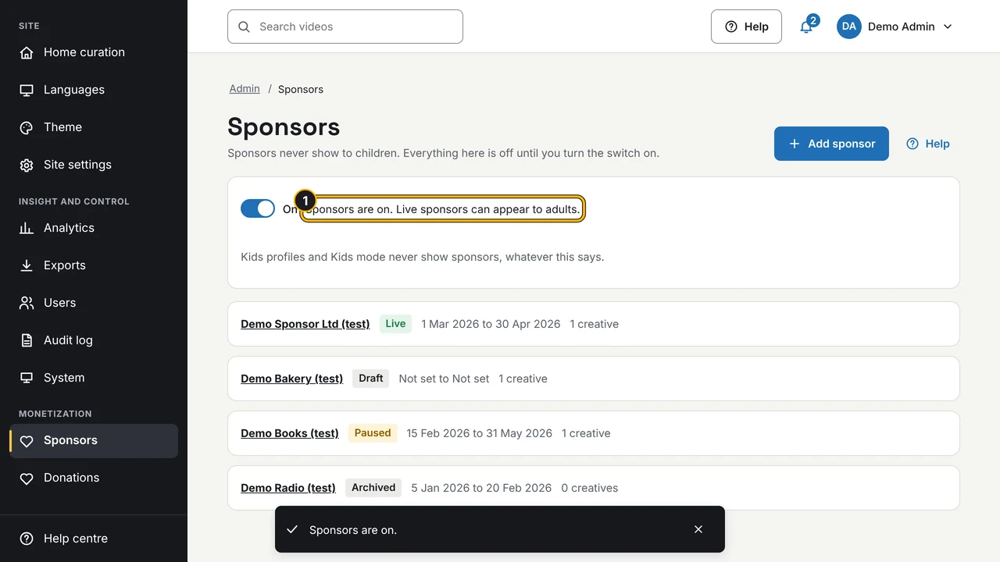

## What you will do
Use the sponsors [master switch](glossary:master-switch) to show or hide every sponsor on the site. You end with the switch showing On, and you also learn how to turn it off.

## Before you start
You need to be an Admin or a Super admin, and you need your own password. Read [How sponsors and donations work](help:M01) first.

The switch is one control for the whole site. Nothing sponsored shows to anyone while it is off, even a sponsor that is Live. Kids profiles and Kids mode never show sponsors, whatever the switch says.

## Steps
<!-- kb:steps M02 -->
1. Choose **Sponsors** in the side menu.
2. Check that **Sponsors are off. Viewers see nothing.** shows beside the switch.
3. Click **Show sponsors on the site**.
   
4. Type "your password" in the **Password** box.
   > [!TIP]
   > Type your own password, not the words in quotes. You are asked again only after 10 minutes.
   
5. Click **Confirm**.
6. Check that **Sponsors are on.** shows beside the switch.
   
7. Click **Show sponsors on the site**.
   > [!NOTE]
   > Turning the switch off works the same way. Live sponsors stay Live, but nobody sees them.
8. Type "your password" in the **Password** box.
9. Click **Confirm**.
10. Check that **Sponsors are off. Viewers see nothing.** shows again.
<!-- /kb:steps -->

## What you should see
The switch shows **On** and the note beside it says **Sponsors are on.** Live sponsors can now appear to adults. Turning it off shows **Sponsors are off.** and viewers see nothing.

## If something goes wrong
- **The password is not accepted.** Check the password you use to sign in to the admin area, then try again. If you forgot it, ask a Super admin to help you.
- **The switch is grey and will not move.** Your role is below Admin. Ask an Admin to switch it. [How sponsors and donations work](help:M01) Still stuck? [What to send ARKDEV](help:T11)
