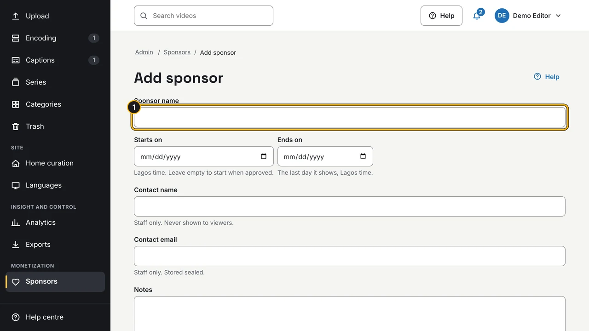
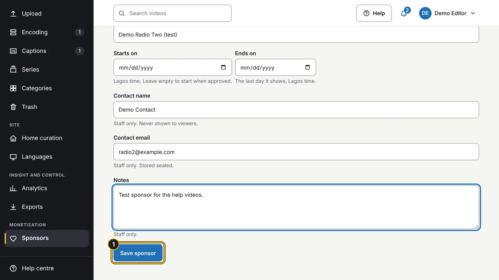
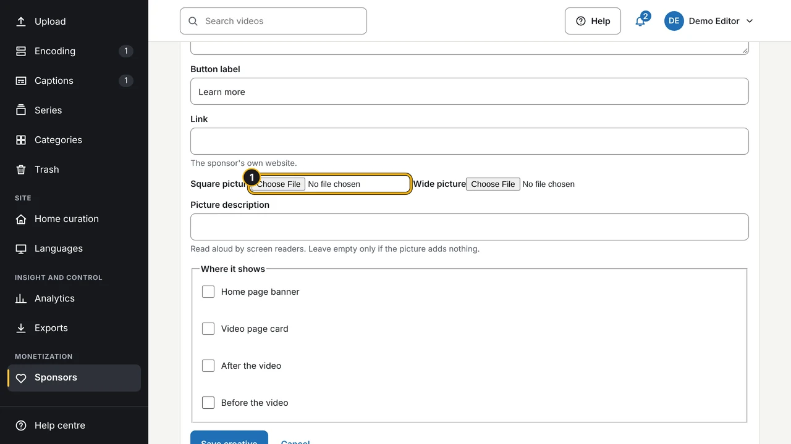
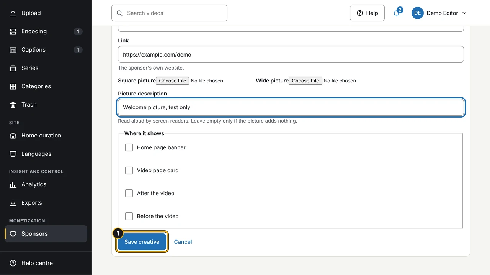
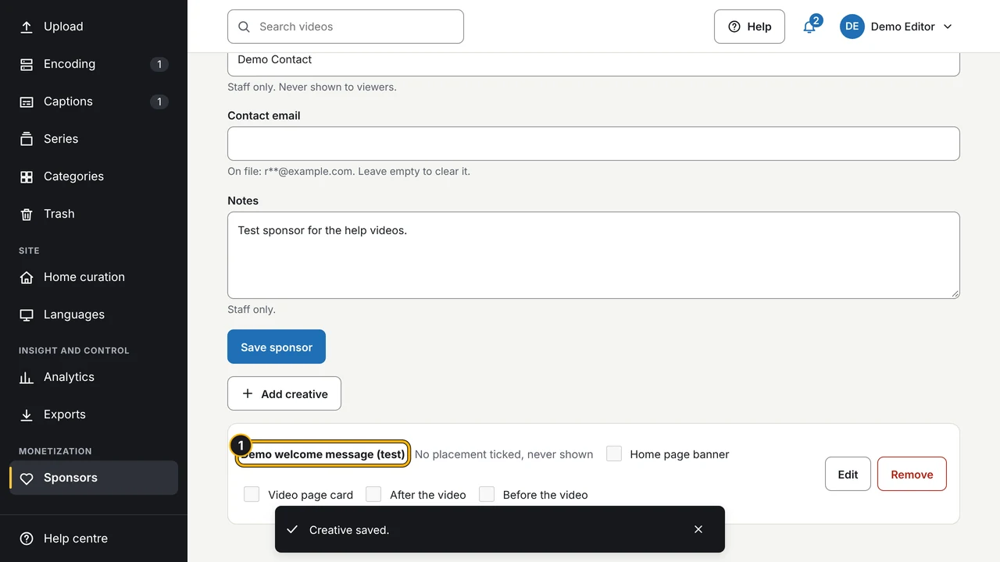

## What you will do
Add a sponsor and give it a message, a link and a picture. You end with a saved sponsor in Draft, ready to place.

## Before you start
You need to be an Editor or above. Have ready the sponsor's name, a contact person, a contact email, and the web address the sponsor wants people to visit. The picture should be a JPG or PNG. Sizes are in [Sponsor pictures: sizes and descriptions](help:M18).

The contact name, contact email and notes are for staff only. They are never shown to viewers. In this guide every name is a made up test sponsor.

## Steps
<!-- kb:steps M03 -->
1. Choose **Sponsors** in the side menu.
2. Click **Add sponsor**.
   
3. Type "Demo Radio Two (test)" in the **Sponsor name** box.
4. Type "Demo Contact" in the **Contact name** box.
5. Type "radio2@example.com" in the **Contact email** box.
   > [!NOTE]
   > Contact details are for staff only and are stored sealed. Viewers never see them.
6. Type "Test sponsor for the help videos." in the **Notes** box.
   
7. Click **Save sponsor**.
8. Check that **Demo Radio Two (test)** shows as the page title.
9. Click **Add creative**.
   
10. Check that **Headline** shows in the new form.
11. Type "Demo welcome message (test)" in the **Headline** box.
12. Type "Welcome to our test sponsor." in the **Short text** box.
13. Type "https://example.com/demo" in the **Link** box.
14. Choose a file for the **Square picture** box.
   > [!TIP]
   > Use a JPG or PNG under 2 MB. The wide picture is optional.
15. Type "Welcome picture, test only" in the **Picture description** box.
   
16. Click **Save creative**.
17. Check that **Demo welcome message (test)** shows in the sponsor page.
   
<!-- /kb:steps -->

## What you should see
The new sponsor opens on its own screen with the **Draft** badge. Your message appears in the list below the sponsor details, with no place ticked yet, so it will not show to anyone.

## If something goes wrong
- **A box shows a red message.** Read it and fix that box. The sponsor link must be the sponsor's own website, not this site. [Where a sponsor shows](help:M04)
- **The picture is refused.** Use a JPG or PNG under 2 MB and at least the size in [Sponsor pictures](help:M18). Still stuck? [What to send ARKDEV](help:T11)
