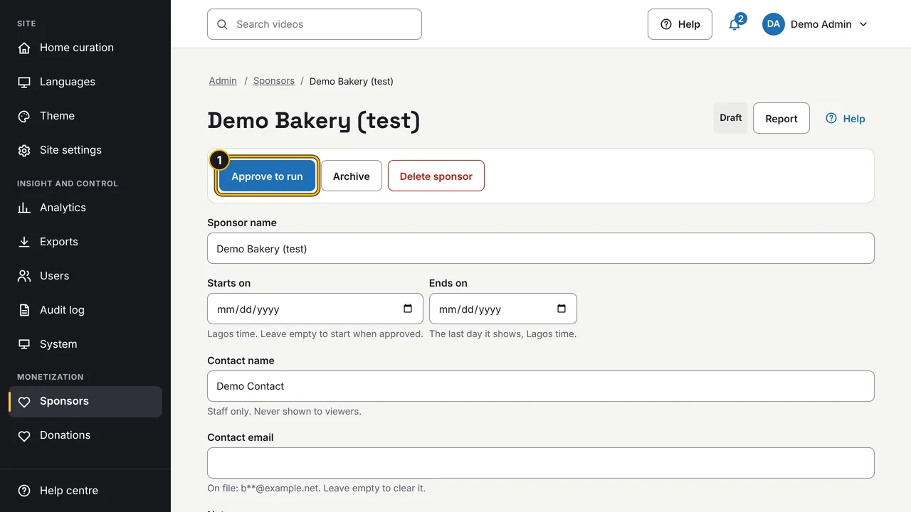
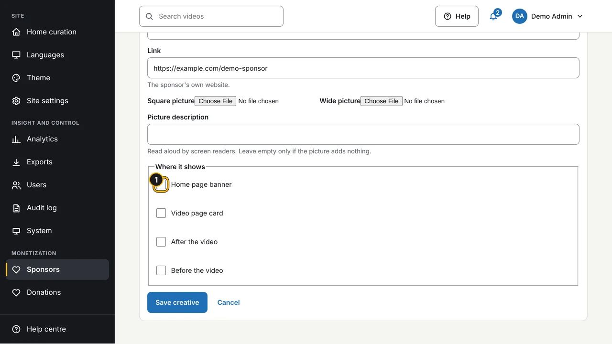
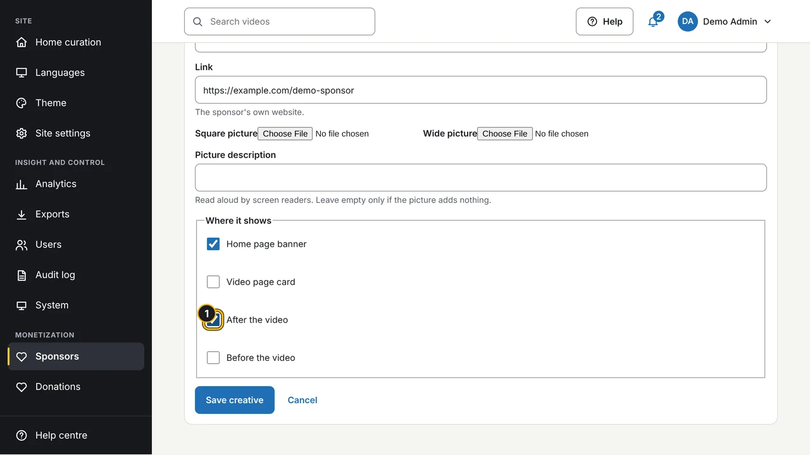
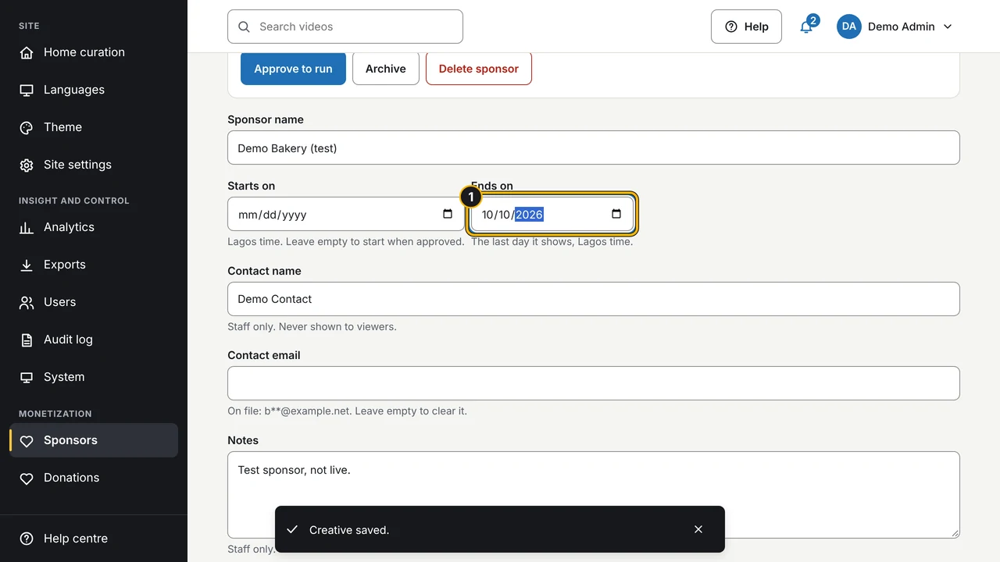
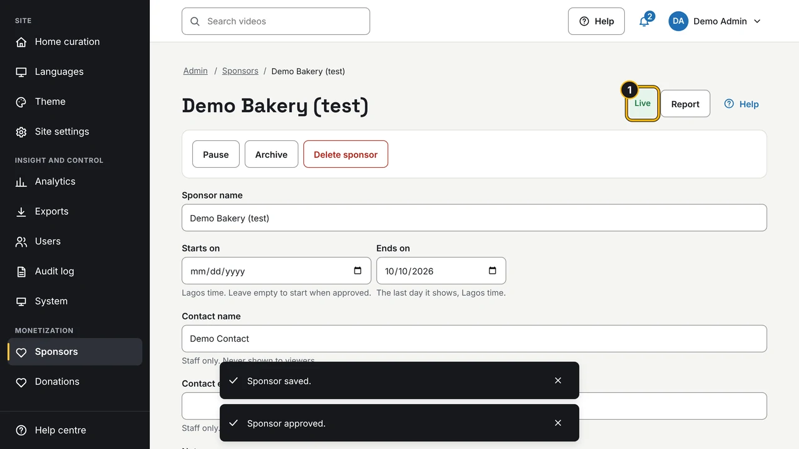

## What you will do
Tick where a sponsor message shows, set the last day, and approve it to run. You end with the sponsor showing as **Live**.

## Before you start
You need to be an Admin to approve a sponsor. An Editor can do every step except **Approve to run**. Read [Add a sponsor and its images](help:M03) first.

A [placement](glossary:placement) is a place on the site. There are four: **Home page banner**, **Video page card**, **After the video** and **Before the video**. A message with no place ticked never shows. Dates use Lagos time. If you leave **Starts on** empty it starts when approved.

## Steps
<!-- kb:steps M04 -->
1. Choose **Sponsors** in the side menu.
2. Click **Demo Bakery (test)**.
   
3. Click **Edit**.
   
4. Tick **Home page banner**.
   > [!TIP]
   > Tick every place the sponsor paid for. A message with no place ticked never shows.
5. Tick **After the video**.
   
6. Click **Save creative**.
7. Type "10102026" in the **Ends on** box.
   > [!NOTE]
   > Type the day, month and year with no spaces, for example 10102026 for 10 Oct 2026. Dates use Lagos time.
   
8. Click **Save sponsor**.
9. Click **Approve to run**.
   > [!CAREFUL]
   > Only Admins can approve. The sponsors master switch must also be on for viewers to see anything.
10. Check that **Live** shows beside the sponsor name.
   
<!-- /kb:steps -->

## What you should see
The sponsor shows a green **Live** badge. The sponsors master switch must also be on for viewers to see anything. [Turn sponsors on](help:M02)

## If something goes wrong
- ****Approve to run** says to add a creative.** Add a message and tick at least one place first, then try again. [Add a sponsor and its images](help:M03)
- **The sponsor is **Scheduled**, not **Live**.** The start day is in the future. It goes Live on that day.
- ****Approve to run** is grey.** Only an Admin can approve. Ask an Admin to do this step. Still stuck? [What to send ARKDEV](help:T11)
