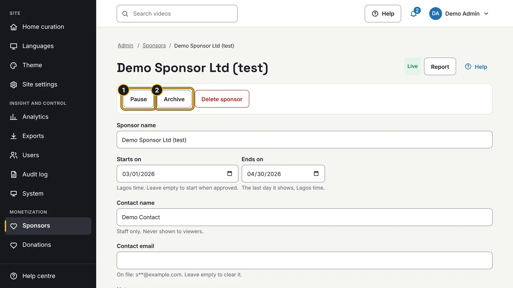
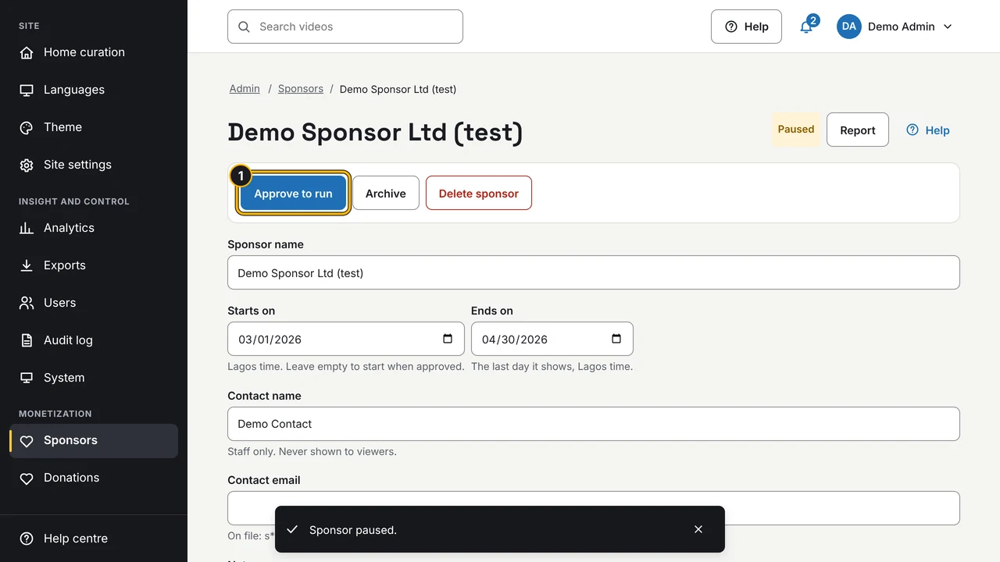
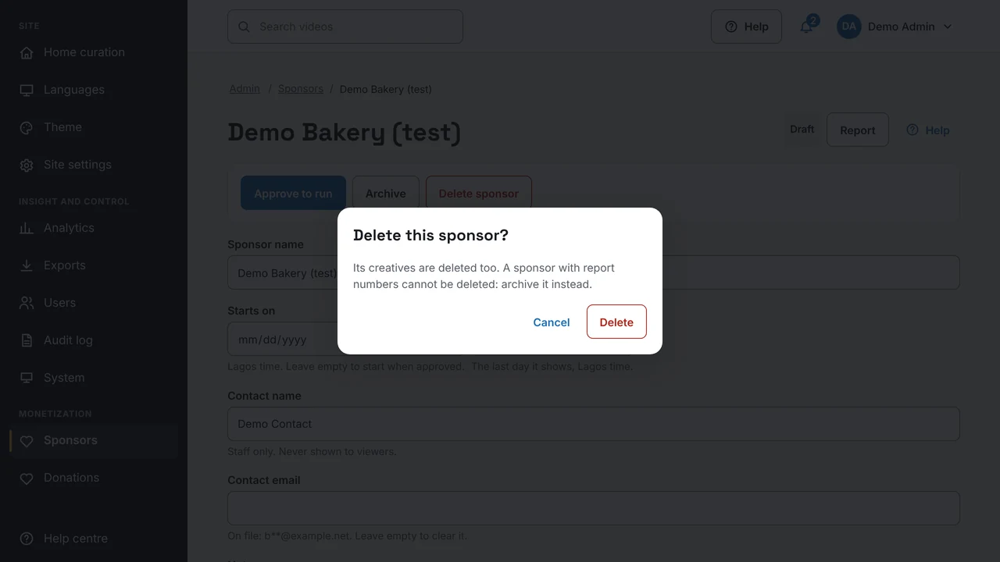

## What you will do
Pause a sponsor, start it again, archive it, and delete a sponsor that was never shown. You end knowing which one to use.

## Before you start
You need to be an Admin for the whole guide. Pause keeps everything and can be undone with **Approve to run**. Archive hides the sponsor for good but keeps its report numbers. **Delete sponsor** removes the sponsor and its messages and cannot be undone.

A sponsor that has report numbers cannot be deleted. Archive it instead.

## Steps
<!-- kb:steps M05 -->
1. Choose **Sponsors** in the side menu.
2. Click **Demo Sponsor Ltd (test)**.
   
3. Click **Pause**.
   > [!NOTE]
   > Pause keeps everything. Use Approve to run to start it again.
4. Check that **Sponsor paused.** shows at the bottom of the screen.
   
5. Click **Approve to run**.
6. Check that **Sponsor approved.** shows at the bottom of the screen.
7. Click **Archive**.
   > [!CAREFUL]
   > Archive hides the sponsor for good, but its report numbers stay.
8. Check that **Sponsor archived.** shows at the bottom of the screen.
9. Click **Sponsors** in the top path.
10. Click **Demo Bakery (test)**.
11. Click **Delete sponsor**.
   > [!CAREFUL]
   > Delete cannot be undone, and it is refused for a sponsor that has report numbers. Archive it instead.
   
12. Click **Delete**.
<!-- /kb:steps -->

## What you should see
After each click a short message appears at the bottom of the screen: **Sponsor paused.**, **Sponsor approved.**, **Sponsor archived.** or **Sponsor deleted.** The badge on the sponsor changes to match.

## If something goes wrong
- **Delete says the sponsor has report numbers.** That is the rule. Choose **Archive** instead. [Read a sponsor report](help:M06)
- ****Archive** and **Delete sponsor** are grey.** Only an Admin can use them.
