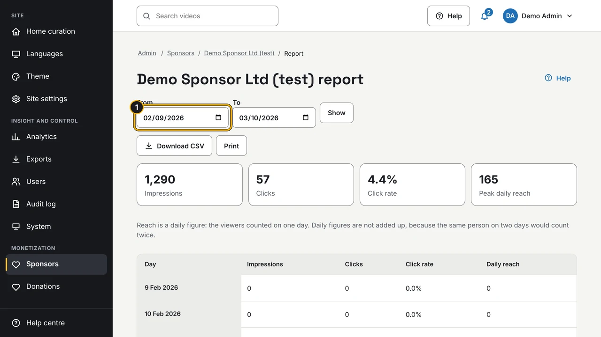
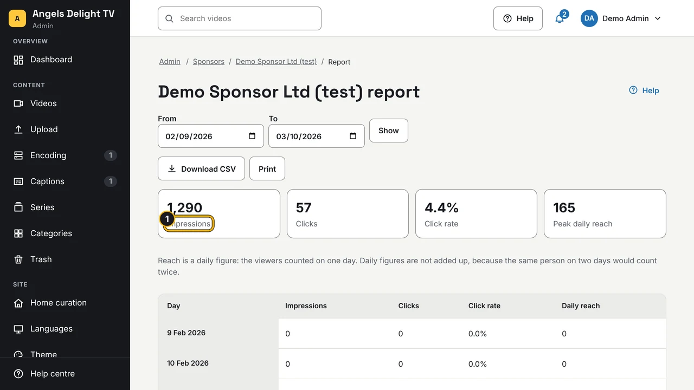
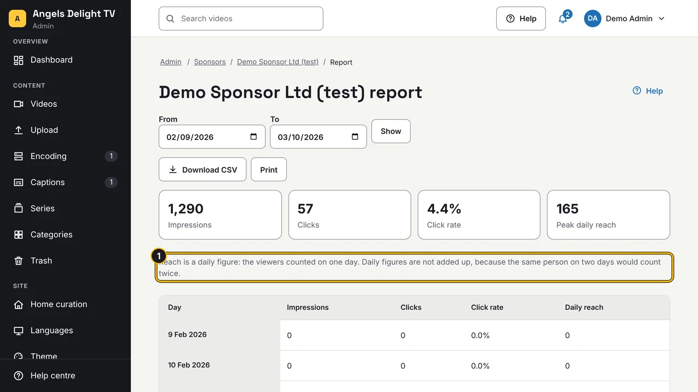
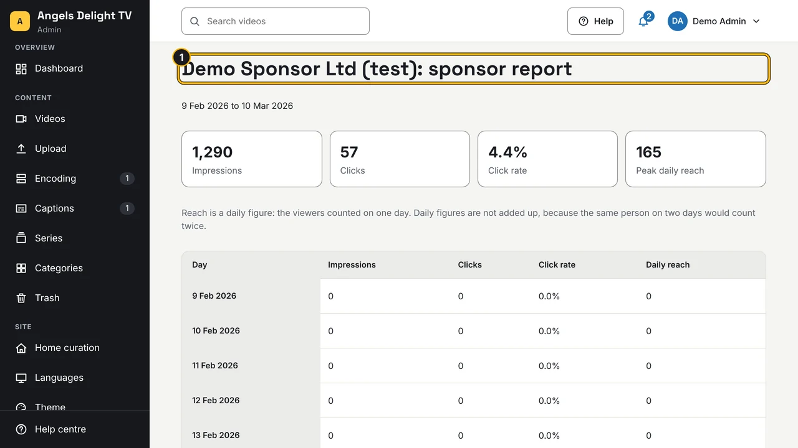

## What you will do
Open the numbers for one sponsor, choose dates, then print the report or download it as a spreadsheet. You end with proof you can give the sponsor.

## Before you start
You need to be an Admin to download the spreadsheet. Read [Choose where a sponsor shows](help:M04) first.

An impression is one time a card was half visible for one second. A click is counted when the link is followed. Reach is a daily figure: the viewers counted on one day. Daily reach is not added up, because the same person on two days would be counted twice. Cards shown to children are never counted, and neither are staff previews.

## Steps
<!-- kb:steps M06 -->
1. Choose **Sponsors** in the side menu.
2. Click **Demo Sponsor Ltd (test)**.
3. Click **Report**.
   
4. Type "03032026" in the **From** box.
   > [!NOTE]
   > Type the day, month and year with no spaces, for example 03032026 for 3 Mar 2026. Leave To empty for up to today.
5. Click **Show**.
   
6. Check that **Impressions** shows in the number tiles.
7. Check that **Reach is a daily figure** shows under the tiles.
   
8. Click **Download CSV**.
   > [!NOTE]
   > Only Admins see Download CSV. The file has no personal details.
9. Click **Print**.
   
<!-- /kb:steps -->

## What you should see
The number tiles show **Impressions**, **Clicks**, **Click rate** and **Peak daily reach**. Below them are tables by day, by message and by place. The print page shows the same numbers with the sponsor name and dates and no side menu.

## If something goes wrong
- **The report says **No numbers yet for these dates.**** Numbers appear once a live card has been seen. Check the sponsor is **Live** and sponsors are on. [Turn sponsors on](help:M02)
- ****Download CSV** is missing.** Only Admins see it. Editors can still use **Print**. Still stuck? [What to send ARKDEV](help:T11)
