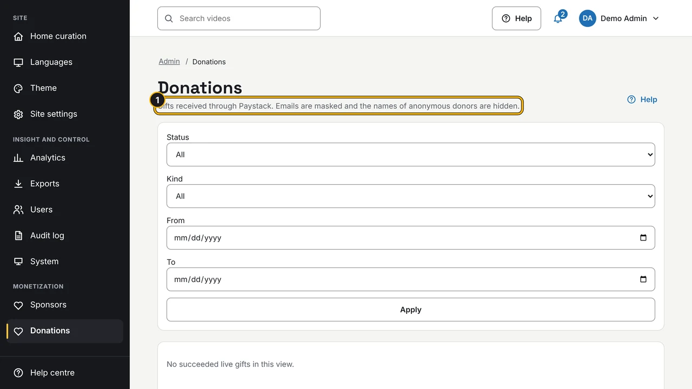
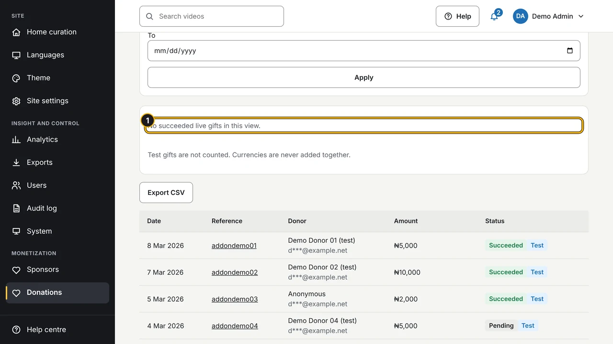

## What you will do
Learn which donation settings are yours to decide and which the developer sets on the server. You end with a list you can send to the developer.

## Before you start
You need to be an Admin. Read [How sponsors and donations work](help:M01) first.

Important: today the donation settings have no screen in this admin area. You decide them, and the developer enters them. This is different from what the plan once said. Nothing on this page lets you turn donations on yourself.

**You decide and send to the developer:**
- The legal name of your organisation, and your registration number if you have one.
- Preset gift amounts in naira, the smallest gift and the largest gift.
- The words on the Donate page and the thank you page. Draft words are already there.
- Whether to offer gifts in US dollars, and whether to offer to cover payment fees.
- The email donors can reply to about a receipt.
- Your bank transfer details, if you want to show them. Bank transfer instructions
- The lines for the transparency page. The transparency page

**The developer sets on the server, never in this site:**
- The Paystack secret key, which has a test version and a live version. It lives only in the server settings. Never paste it in a chat, email, document or screenshot. Where a guide shows it, it is hidden as `********`.
- A second secret that signs the thank you links.
- The switch that turns donations on. It only works once both secrets are in place.

## Steps
<!-- kb:steps M07 -->
1. Choose **Donations** in the side menu.
   
2. Check that **Gifts received through Paystack** shows under the title.
3. Check that **No succeeded live gifts in this view.** appears.
   
4. Check that **Test gifts are not counted.** shows under the totals.
<!-- /kb:steps -->

## What you should see
The **Donations** screen opens. Until the first real gift arrives it says **No succeeded live gifts in this view.** Test gifts are not counted in the totals.

## If something goes wrong
- **There is no **Donations** item in the side menu.** Only Admins and Super admins can open it. [Roles and permissions](help:R02)
- **Viewers cannot find the Donate page.** Donations are off until the developer switches them on and sets the keys. [Check Paystack with a test gift](help:M10)
