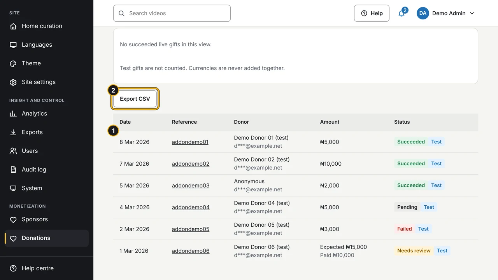
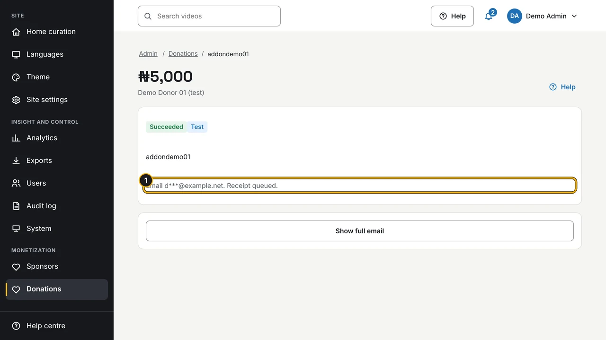

## What you will do
Open the list of gifts, read the totals, download the list and open one gift. You end with a spreadsheet and a gift on screen.

## Before you start
You need to be an Admin. Emails in the list are masked, for example `d***@example.net`, and donors who asked to stay private show as **Anonymous**. To see a full email, read Show a donor email and why it is recorded.

The totals count only succeeded live gifts, one total for each currency. Test gifts are never counted. Currencies are never added together. The spreadsheet has no card details and no full emails, and downloading it is written to the audit log.

## Steps
<!-- kb:steps M08 -->
1. Choose **Donations** in the side menu.
   
2. Check that **Test gifts are not counted.** shows under the totals.
3. Check that **Anonymous** shows for donors who asked to stay private.
4. Click **Export CSV** to download the list.
5. Click **addondemo01**.
   
6. Check that **Receipt queued** shows under the reference.
<!-- /kb:steps -->

## What you should see
The list shows the newest gifts first with date, reference, donor, amount and status. The download starts as a file called `donations` followed by the date. One gift opens on its own screen with its status and receipt line.

## If something goes wrong
- **The totals say **No succeeded live gifts in this view.**** Only live gifts count. Test gifts and gifts still waiting do not. [Test mode and live mode](help:M11)
- **The list is empty.** Clear the filters. Find gifts with the filters
