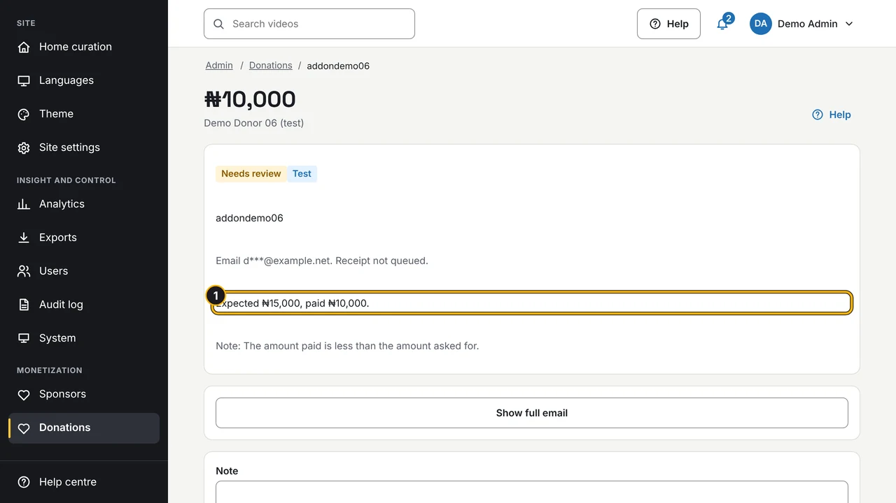
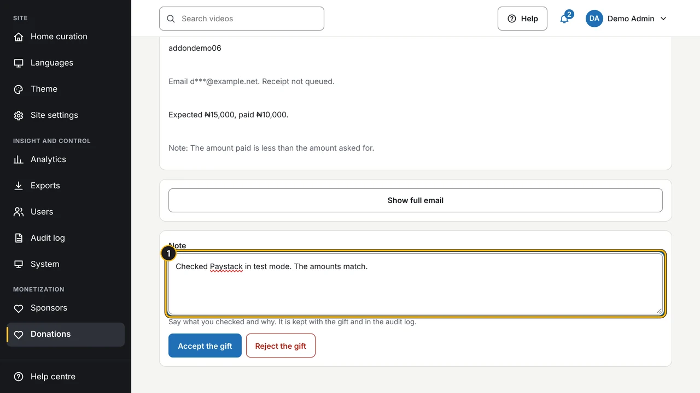

## What you will do
Check a gift marked **Needs review**, write a note, then accept or reject it. You end with the gift settled and your note kept.

## Before you start
You need to be an Admin. A gift is marked **Needs review** when we could not confirm it, for example when the amount paid is different from the amount asked for.

Before you decide, look at the payment in your Paystack dashboard. Accept the gift only if Paystack shows the money was received. Reject it if not. You must write a note that says what you checked. Both buttons stay off until you do. The note is kept with the gift and in the audit log.

## Steps
<!-- kb:steps M09 -->
1. Choose **Donations** in the side menu.
2. Click **addondemo06**.
   
3. Check that **Needs review** shows beside the reference.
4. Check that **Expected ₦15,000, paid ₦10,000.** shows under the reference.
5. Type "Checked Paystack in test mode. The amounts match." in the **Note** box.
   > [!CAREFUL]
   > Accept only if Paystack shows the money arrived. Write what you checked. Rejecting works the same way with Reject the gift.
   
6. Click **Accept the gift**.
7. Check that **Gift accepted** shows at the bottom of the screen.
<!-- /kb:steps -->

## What you should see
A short message says **Gift accepted** or **Gift rejected**. The gift is no longer waiting for review, and your note stays on the gift.

## If something goes wrong
- **The buttons are grey.** Write a note first. Both buttons stay off until you do.
- **The gift does not say **Needs review**.** Only gifts we could not confirm can be settled. [See donations and download the list](help:M08)
