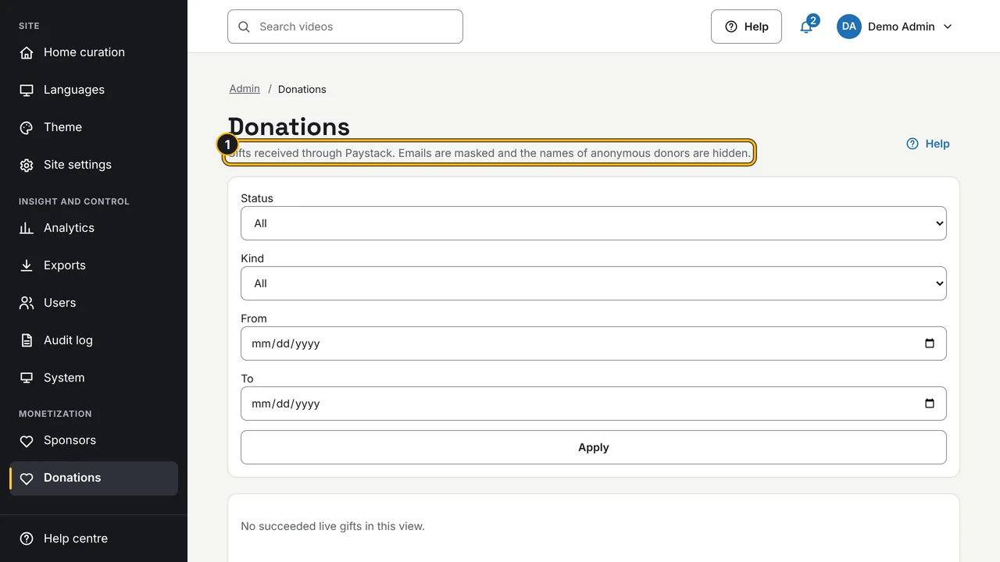
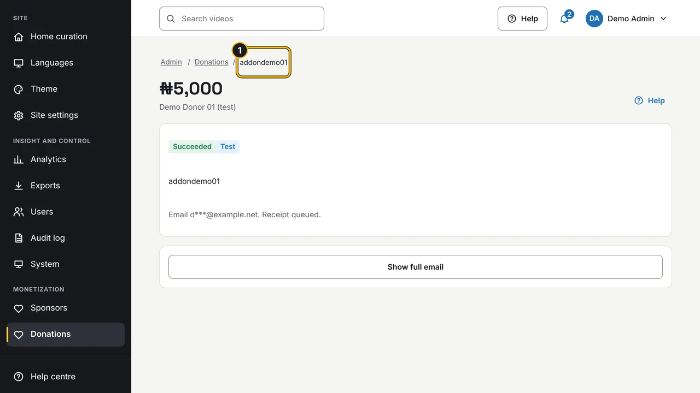

## What you will do
Learn what donors see on the Donate page and which words and amounts can be changed. You end with a list of changes to ask the developer for.

## Before you start
You need to be an Admin. Today these words have no screen in the admin area. You decide them, and the developer changes them.

A donor sees: a title and a short text, a row of preset amounts and an **Other amount** box, a box for the **Email for your receipt**, an optional name, and a button such as **Give ₦1,000 once**. A line says that they pay on the secure Paystack page and that we never see card details. Below it shows who receives the gifts, and your bank details if you chose to show them.

You can change: the page title and text, the thank you title and text, the preset amounts, the smallest and largest gift, and the organisation name. The draft title is **Help keep lessons free**. Kids never see the page. They see **Ask a grown-up**. Words use no dashes and no emojis.

## Steps
<!-- kb:steps M12 -->
1. Choose **Donations** in the side menu.
2. Check that **Gifts received through Paystack** shows under the title.
   
3. Click **addondemo01**.
   
4. Check that **addondemo01** shows as the gift reference.
<!-- /kb:steps -->

## What you should see
The **Donations** screen opens, and a gift made on the Donate page shows in the list with its reference.

## If something goes wrong
- **The Donate page shows a not found message.** Donations are switched off or the server keys are missing. [Set up donations](help:M07)
- **A preset amount is wrong.** Send the developer the amounts in naira. They are stored in kobo, so ₦500 is 50000.
