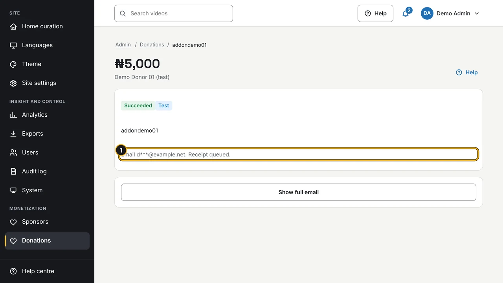
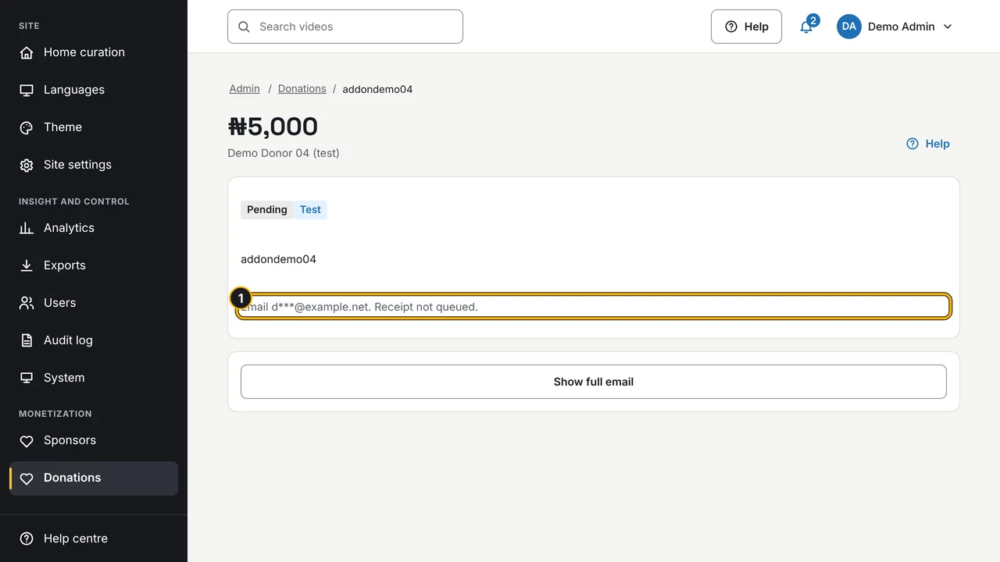

## What you will do
Check whether a receipt was queued for a gift and learn what donors receive. You end knowing why some gifts have no receipt.

## Before you start
You need to be an Admin. When a gift succeeds, an email receipt is queued to the donor. It shows your organisation name, the amount, the date and the gift reference. If the donor gave a name, it is greeted by name.

The receipt makes no tax claim. A tax note is added only when you and an adviser decide the wording and the developer adds it. Taxes and legal notes The receipt reply address is a setting the developer enters. If it is empty, replies go to the support email.

## Steps
<!-- kb:steps M13 -->
1. Choose **Donations** in the side menu.
2. Click **addondemo01**.
3. Check that **Receipt queued** shows under the reference.
   
4. Click **Donations** in the top path.
5. Click **addondemo04**.
6. Check that **Receipt not queued** shows because the gift is still pending.
   
<!-- /kb:steps -->

## What you should see
A succeeded gift says **Receipt queued** under its reference. A gift that is still pending says **Receipt not queued**.

## If something goes wrong
- **A succeeded gift says **Receipt not queued**.** The email may have been refused. Ask the developer to check the mail log.
- **A donor says no email arrived.** Ask them to check their spam folder. The reference on the gift helps the developer find it. Still stuck? [What to send ARKDEV](help:T11)
