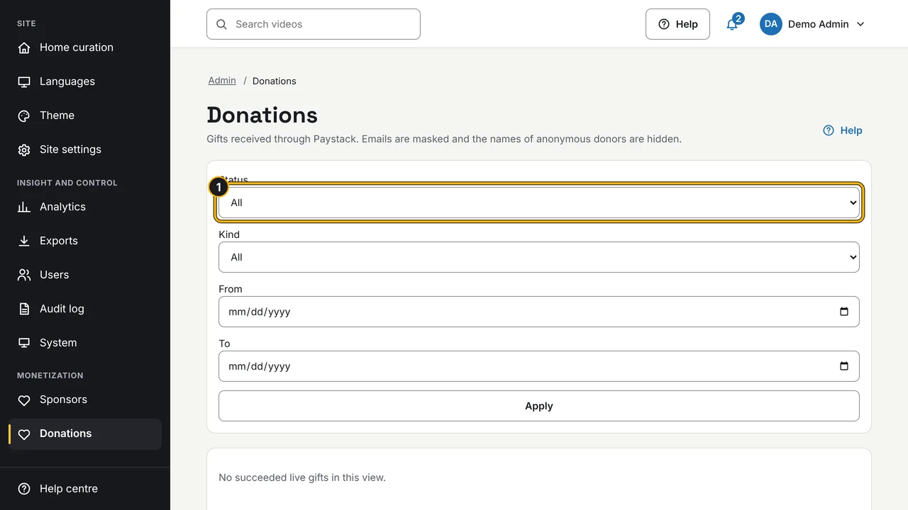
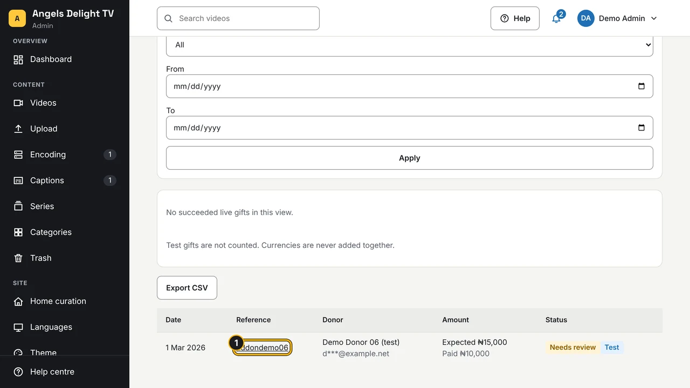
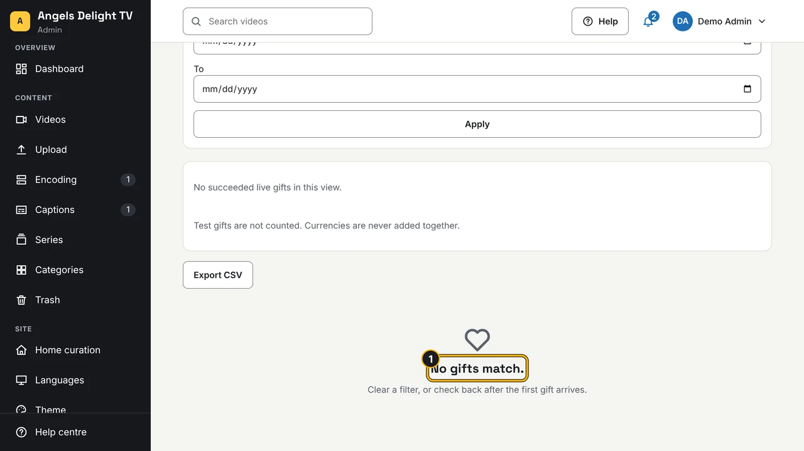

## What you will do
Use the filters above the list to find gifts by status, kind or date. You end with a short list.

## Before you start
You need to be an Admin. Status can be succeeded, pending, failed, abandoned, refunded or needs review. Kind is **One time** or **Monthly**. **From** and **To** use calendar days in Lagos time.

Status words are shown in lower case on the filter list, just as on the screen. Nothing changes until you click **Apply**.

## Steps
<!-- kb:steps M14 -->
1. Choose **Donations** in the side menu.
   
2. Select **needs review** from the **Status** list.
3. Click **Apply**.
   
4. Check that **addondemo06** shows in the list.
5. Select **All** from the **Status** list.
6. Select **Monthly** from the **Kind** list.
7. Click **Apply**.
8. Check that **No gifts match.** shows because no monthly gifts exist yet.
   
9. Select **All** from the **Kind** list.
10. Type "03032026" in the **From** box.
   > [!NOTE]
   > Type the day, month and year with no spaces, for example 03032026 for 3 Mar 2026.
11. Click **Apply**.
12. Check that **addondemo01** shows in the list.
<!-- /kb:steps -->

## What you should see
The list shows only the gifts that match. When nothing matches the screen says **No gifts match.**

## If something goes wrong
- **The list says **No gifts match.**** Clear one filter at a time, or set the list back to **All**.
- **A date box looks empty after you type.** Type the day, month and year with no spaces, for example 03032026. Still stuck? [What to send ARKDEV](help:T11)
