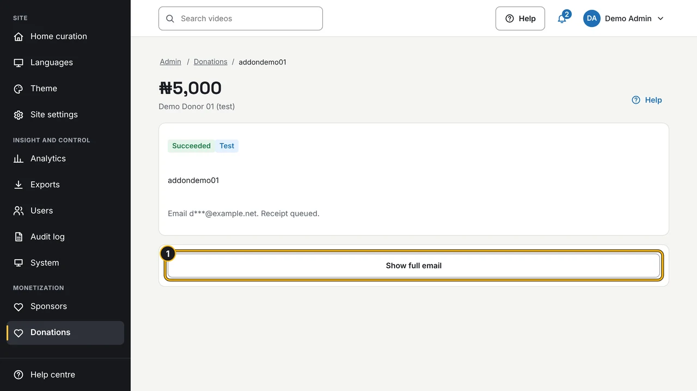
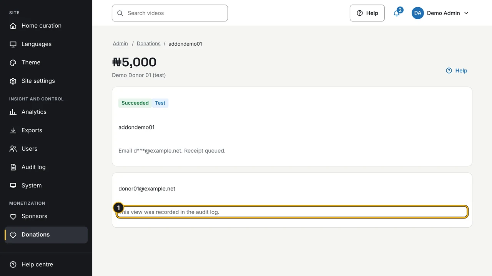

## What you will do
Show the full email of one donor. You end with the email on screen and a record that you looked.

## Before you start
You need to be an Admin. Emails are masked everywhere by default, for example `d***@example.net`, to protect donors. Show the full email only when you have a real reason, such as helping a donor with a receipt.

Every time you click **Show full email**, a line is added to the audit log with your name and the gift. The email itself is not copied into the log. Do not copy emails into chats or documents.

## Steps
<!-- kb:steps M15 -->
1. Choose **Donations** in the side menu.
2. Click **addondemo01**.
   
3. Click **Show full email**.
   > [!CAREFUL]
   > This view is written to the audit log. Show an email only when you need it.
4. Check that **This view was recorded in the audit log.** shows under the email.
   
<!-- /kb:steps -->

## What you should see
The full email appears in place of the button, with the line **This view was recorded in the audit log.**

## If something goes wrong
- **The button says you cannot do this.** Only Admins and Super admins can show an email.
- **You showed the wrong email.** The view is already recorded. Tell the Super admin if it matters.
