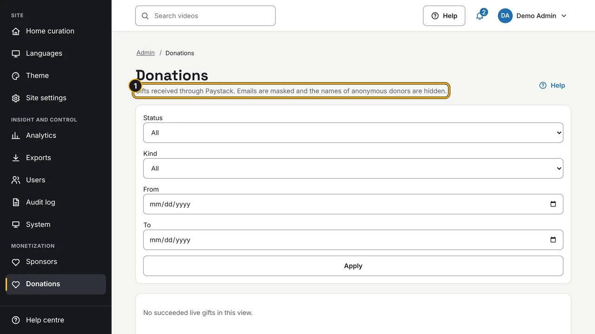
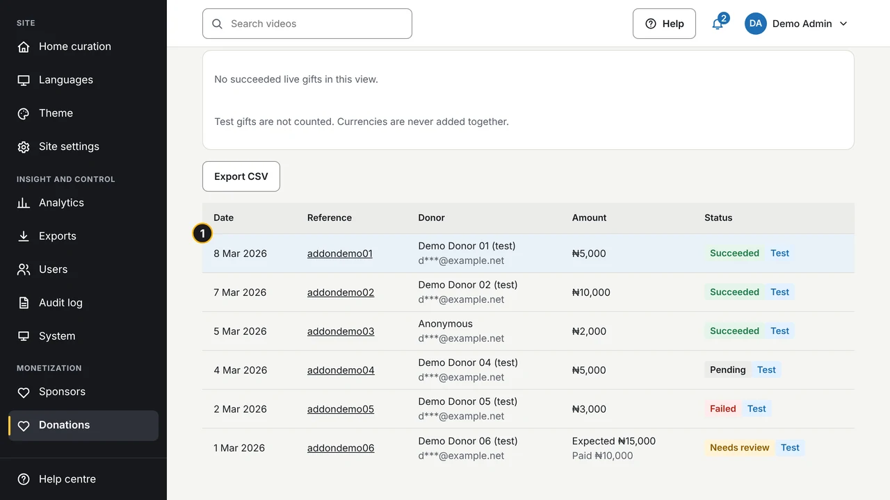

## What you will do
Learn how your bank details can show on the Donate page, and why those gifts are not in the Donations list. You end with the facts to give the developer.

## Before you start
You need to be an Admin. Today the bank transfer words have no screen in the admin area. The developer enters them, once you decide.

When the bank transfer switch is on and there is text, the Donate page shows a section called **Give by bank transfer** with your text. The text is shown exactly as typed, as plain words, so it cannot run code. Keep it short: bank name, account name, account number and a line asking donors to put their name as the reference.

Gifts made by bank transfer do not pass through Paystack. They are not in the **Donations** list, they get no receipt from the site, and the totals do not include them. Record them in your own books. An admin form for entering them by hand has not been built yet. Never put anything private in the text, because anyone can read it.

## Steps
<!-- kb:steps M16 -->
1. Choose **Donations** in the side menu.
2. Check that **Gifts received through Paystack** shows under the title.
   
3. Check that **Donations, newest first** is the list of Paystack gifts.
   
<!-- /kb:steps -->

## What you should see
The **Donations** screen only lists gifts received through Paystack. Bank transfers are not there.

## If something goes wrong
- **A bank transfer gift is missing from the list.** That is expected. Only Paystack gifts appear. [See donations and download the list](help:M08)
- **The bank details do not show on the Donate page.** Both the bank switch and the text must be set. Ask the developer to check. Still stuck? [What to send ARKDEV](help:T11)
