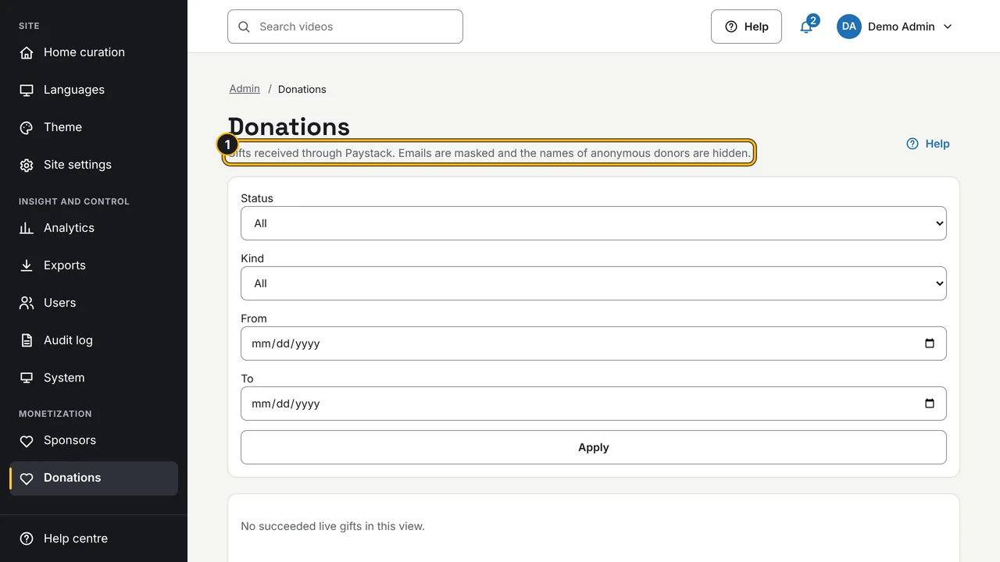

## What you will do
Learn what the transparency page shows and what figures you must supply. You end with the lines to send the developer.

## Before you start
You need to be an Admin. Today the transparency words and lines have no screen in the admin area. The developer enters them from what you decide.

The page is called **How gifts are used** by default. It has a short introduction, then a list of lines. Each line is a label, a note and either a percentage or an amount in naira. Use percentages for every line or amounts for every line, not both. Percentages must add up to 100. A last updated date shows at the bottom.

Use real figures only, and update them when they change. The page shows no donor names or emails. When it is switched off, visitors see a not found page. Kids are asked to find a grown-up.

## Steps
<!-- kb:steps M17 -->
1. Choose **Donations** in the side menu.
2. Check that **Emails are masked** shows under the title.
   
3. Check that **Anonymous** shows instead of a name for private donors.
   
<!-- /kb:steps -->

## What you should see
The **Donations** screen keeps donor names private: names of private donors show as **Anonymous** and emails are masked. The public page has the same privacy.

## If something goes wrong
- **The percentages are refused.** They must add up to exactly 100.
- **The page is not found.** It is off. Ask the developer to switch it on. Still stuck? [What to send ARKDEV](help:T11)
