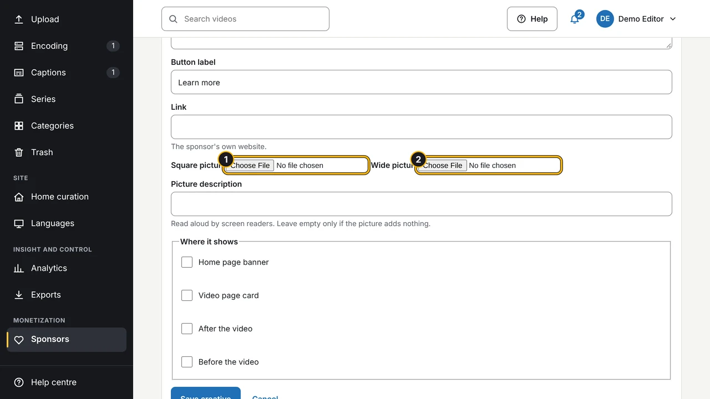
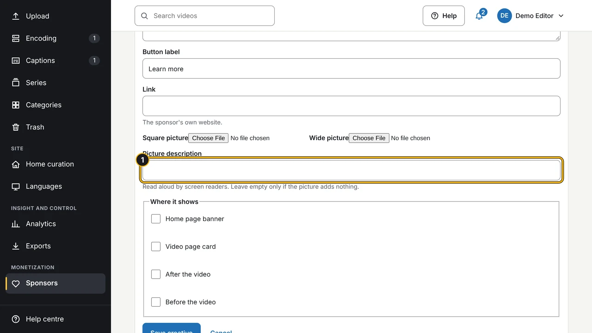

## What you will do
Choose the square and wide pictures for a sponsor message and describe them. You end with pictures people using screen readers can understand.

## Before you start
You need to be an Editor or above. Pictures must be JPG or PNG and under 2 MB. The **Square picture** needs to be at least 400 by 400 pixels. The **Wide picture** needs to be at least 1200 by 400 pixels. A larger picture is fine.

The **Picture description** is read aloud by screen readers. Say what the picture shows in a few words. Leave it empty only if the picture adds nothing. After you choose a picture it is processed in the background, so it may take a moment to appear.

## Steps
<!-- kb:steps M18 -->
1. Choose **Sponsors** in the side menu.
2. Click **Demo Sponsor Ltd (test)**.
3. Click **Add creative**.
   
4. Choose a file for the **Square picture** box.
   > [!NOTE]
   > The square picture must be at least 400 by 400 pixels. The wide picture must be at least 1200 by 400. Both under 2 MB.
5. Choose a file for the **Wide picture** box.
6. Check that **Read aloud by screen readers.** appears under the box.
   
7. Type "A friendly welcome card, test only" in the **Picture description** box.
8. Click **Cancel**.
<!-- /kb:steps -->

## What you should see
The form shows the picture boxes and the **Picture description** box with its hint. Cancel closes the form with nothing saved.

## If something goes wrong
- **The picture is refused as too small.** Use a bigger file. The message tells you the size it needs.
- **The form asks you to describe the picture.** Type a short description. [Add a sponsor and its images](help:M03)
