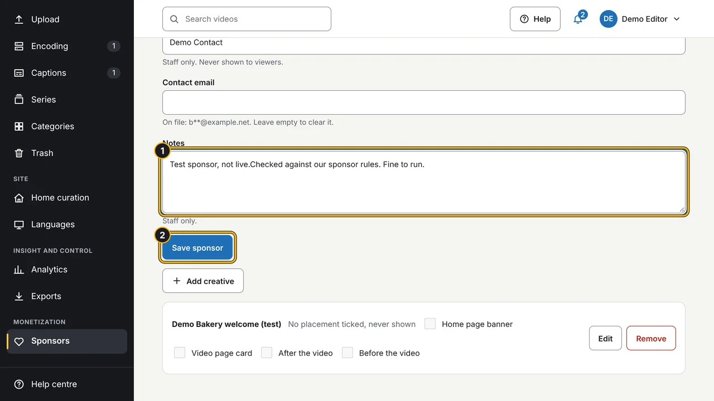

## What you will do
Check a new sponsor against your rules and keep a note of the check. You end with a saved note on the sponsor.

## Before you start
You need to be an Editor or above. The platform does not check what a sponsor sells. The owner decides who may sponsor, and an Admin approves each sponsor to run.

A suggested list of what to refuse for an educational site for young people: tobacco, alcohol, betting and gambling, adult content, political advertising and anything not suitable for children to learn beside. This list is a suggestion for you to confirm with Sister Vanessa. Nothing in the software enforces it. Sponsors are never shown to children, but parents still see them.

Write each check in **Notes**. Notes are for staff only. Put the agreement with the sponsor, the price and the dates in a written agreement outside this site.

## Steps
<!-- kb:steps M19 -->
1. Choose **Sponsors** in the side menu.
2. Click **Demo Bakery (test)**.
3. Type "Checked against our sponsor rules. Fine to run." in the **Notes** box.
   
4. Click **Save sponsor**.
5. Check that **Sponsor saved.** shows at the bottom of the screen.
<!-- /kb:steps -->

## What you should see
A short message says **Sponsor saved.** and your note stays on the sponsor screen.

## If something goes wrong
- **A sponsor does not fit the rules.** Do not approve it. Leave it in Draft or archive it. [Pause, archive or delete a sponsor](help:M05)
- **You are not sure.** Ask an Admin before approving. Approving is what puts a message in front of viewers. Still stuck? [What to send ARKDEV](help:T11)
