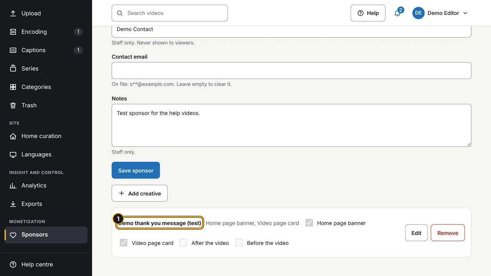
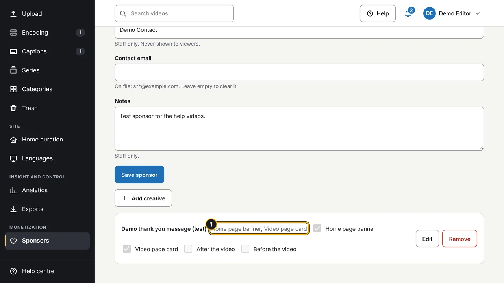

## What you will do
Learn how each placement looks and behaves for adult viewers. You end knowing what you are putting in front of people.

## Before you start
You need to be an Editor or above. This guide has no recording of the viewer side, because the demo stack has no viewer data for sponsors. What follows is how the live site behaves.

Every card carries a label such as **Sponsored**, **Sponsor message** or **In partnership with**. The wording can change but the label can never be removed. Links open the sponsor's own website, in a new tab by default.

- **Home page banner:** one card between rows, never above the second row.
- **Video page card:** one card on a video's page, below the action buttons.
- **After the video:** a still card beside Up next when a video ends.
- **Before the video:** a card before playback with a **Skip** button that is always visible. The video starts by itself after a few seconds, and the player does not start until the card is done.

Each card has a limit on how often one browser sees it, so people are not shown the same message again and again. Rotation shares days evenly or by weight. These limits are settings the developer enters. Nothing sponsored shows while the master switch is off.

## Steps
<!-- kb:steps M20 -->
1. Choose **Sponsors** in the side menu.
2. Click **Demo Sponsor Ltd (test)**.
3. Check that **Demo thank you message (test)** shows as the creative headline.
   
4. Check that **Home page banner** shows as one of its places.
   
<!-- /kb:steps -->

## What you should see
The sponsor screen lists each message with the places it is ticked for. The places ticked are the only places it can appear.

## If something goes wrong
- **A sponsor does not show on the site.** Check the master switch is on, the sponsor is **Live**, a place is ticked and the dates include today. [Choose where a sponsor shows](help:M04)
- **A viewer complains about a sponsor.** Pause it at once. [Pause, archive or delete a sponsor](help:M05)
