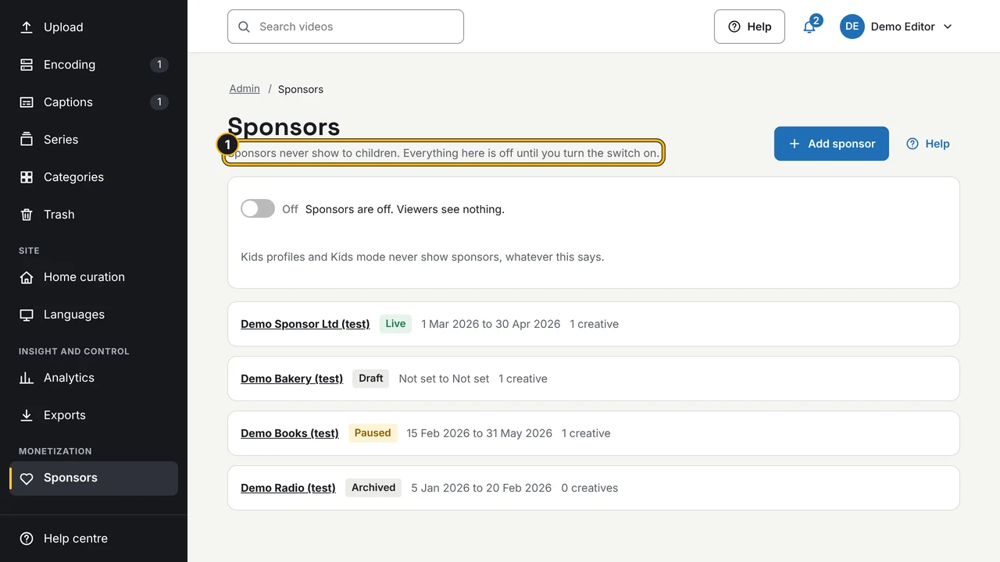
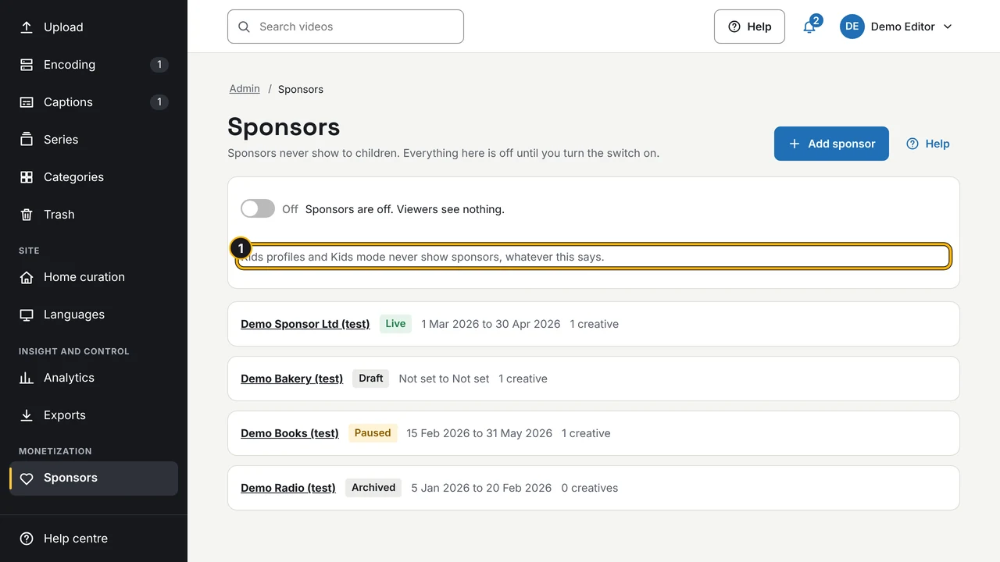

## What you will do
Learn the rules that keep sponsors and the Donate page away from children. You end knowing what is built in and what stays your job.

## Before you start
You need to be an Editor or above. These rules are built into the site and cannot be switched off.

- Sponsors never show on a Kids profile or in Kids mode, whatever the master switch says.
- Cards that would have shown to a child are never counted in sponsor reports.
- The Donate page and the transparency page show kids the words **Ask a grown-up**. Gifts cannot be started from a Kids profile.
- If the site cannot tell who is watching, it treats the viewer as a child.

What stays your job: pick sponsors who suit a family site, and mark videos as Kids safe only when a grown-up would be happy for a child to watch alone. Parents and adults still see sponsors and the Donate page.

## Steps
<!-- kb:steps M21 -->
1. Choose **Sponsors** in the side menu.
2. Check that **Sponsors never show to children** appears under the title.
   
3. Check that **Kids profiles and Kids mode never show sponsors** appears.
   
4. Click **Demo Sponsor Ltd (test)**.
5. Click **Report**.
6. Check that **Cards shown to children are never counted** shows in the report notes.
<!-- /kb:steps -->

## What you should see
The **Sponsors** screen says **Sponsors never show to children** and **Kids profiles and Kids mode never show sponsors**. The report notes say cards shown to children are never counted.

## If something goes wrong
- **A child saw a sponsor.** Pause the sponsor and tell an Admin. [Pause, archive or delete a sponsor](help:M05)
- **You are unsure a video is safe for kids.** Do not mark it Kids safe.
