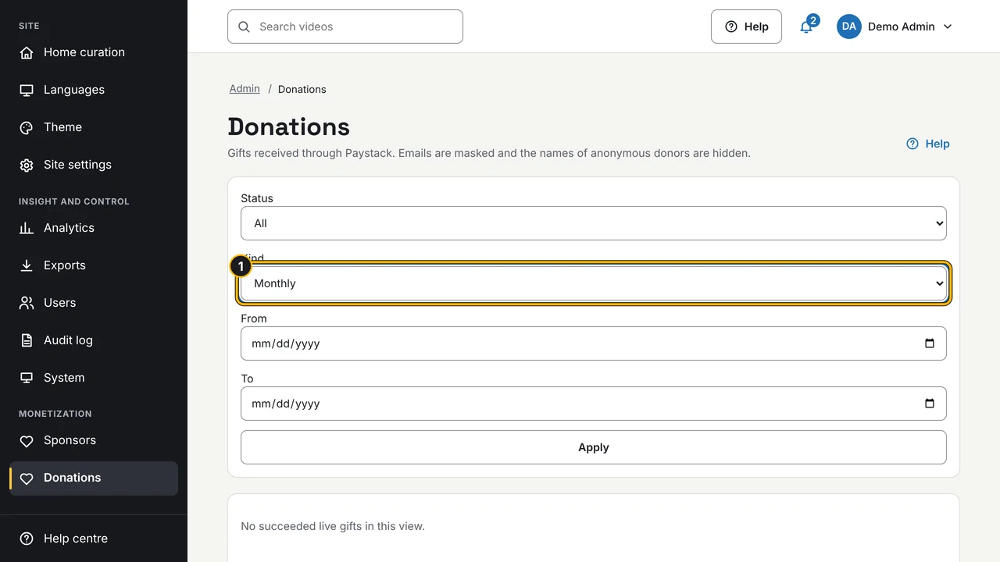
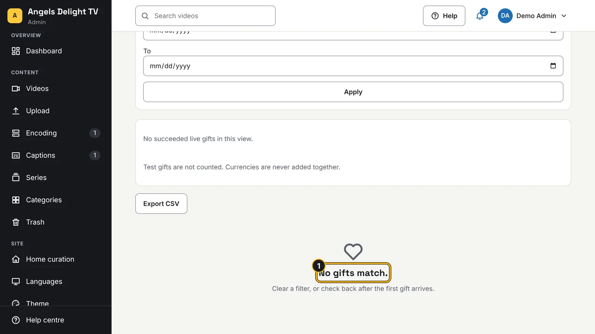

## What you will do
Find out the state of monthly giving. You end knowing it is not available yet and what has to happen first.

## Before you start
You need to be an Admin. Monthly giving is not available yet. Donors can only give once. The screens and settings are in place, but the part that charges a card every month has not been built, and it needs a check of the Paystack account for recurring payments first.

You may see a **Monthly** choice in the **Kind** list. It is only a filter, and it will stay empty until monthly giving is built. Do not promise monthly giving to donors. When it is ready this guide will change.

## Steps
<!-- kb:steps M22 -->
1. Choose **Donations** in the side menu.
2. Select **Monthly** from the **Kind** list.
   
3. Click **Apply**.
4. Check that **No gifts match.** shows because nobody can give monthly yet.
   
<!-- /kb:steps -->

## What you should see
The list is empty and says **No gifts match.** because no monthly gift can exist yet.

## If something goes wrong
- **A donor asks to give every month.** Ask them to give once for now, or to use bank transfer. [Bank transfer instructions](help:M16)
- **A monthly gift appears in the list.** Tell the developer. This should not happen yet. Still stuck? [What to send ARKDEV](help:T11)
