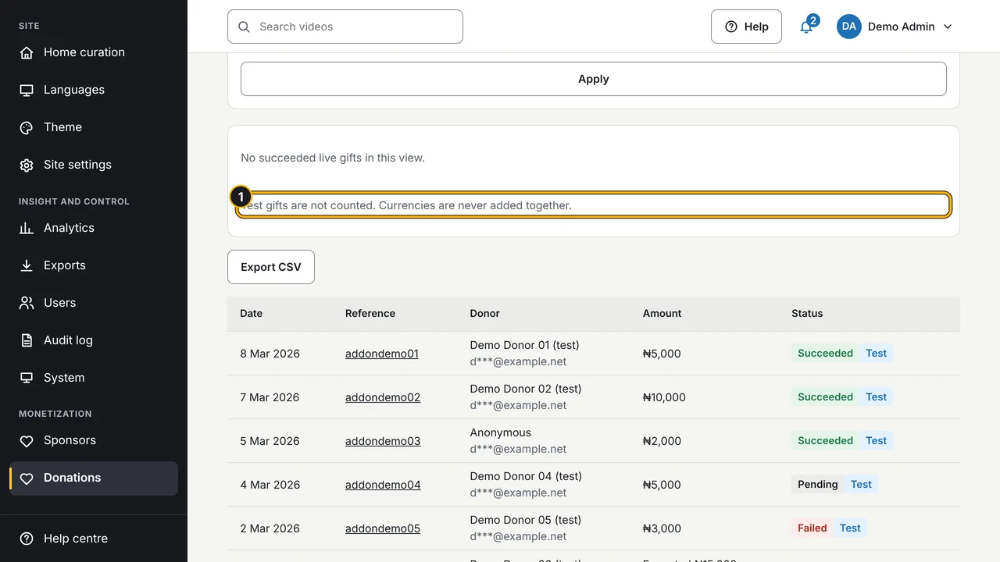
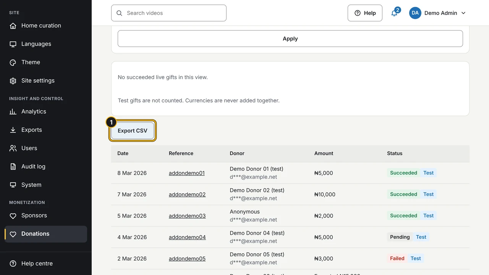

## What you will do
Learn what records the site keeps and what it does not say about tax. You end with a list of questions for a professional.

## Before you start
You need to be an Admin. This guide is plain information, not legal or tax advice. Please ask a lawyer or an accountant who knows Nigerian rules before you decide anything.

What the site does: it keeps each gift with its amount, status, date and reference. You can download the list as a spreadsheet. Totals are per currency and only count live succeeded gifts. Raw payment events are deleted after a set number of days, 90 by default, but the gifts stay.

What the site does not do: it makes no tax claim on receipts, it does not work out tax, and it does not record bank transfers or sponsor payments. Sponsor income is agreed outside the site and must go in your own books.

Questions for a professional: how gifts and sponsor money are taxed for your kind of organisation, whether receipts need a tax note, how long to keep records, and what to say about donor privacy.

## Steps
<!-- kb:steps M23 -->
1. Choose **Donations** in the side menu.
2. Check that **Currencies are never added together.** shows under the totals.
   
3. Click **Export CSV** to keep a record.
   
<!-- /kb:steps -->

## What you should see
The **Donations** screen says **Currencies are never added together.** and the **Export CSV** button gives you a record to share with your accountant.

## If something goes wrong
- **A donor asks for a tax receipt.** Do not promise one. Ask your professional what is allowed first.
- **The totals do not match your bank.** Fees, test gifts and bank transfers explain most gaps. [Test mode and live mode](help:M11) Still stuck? [What to send ARKDEV](help:T11)
