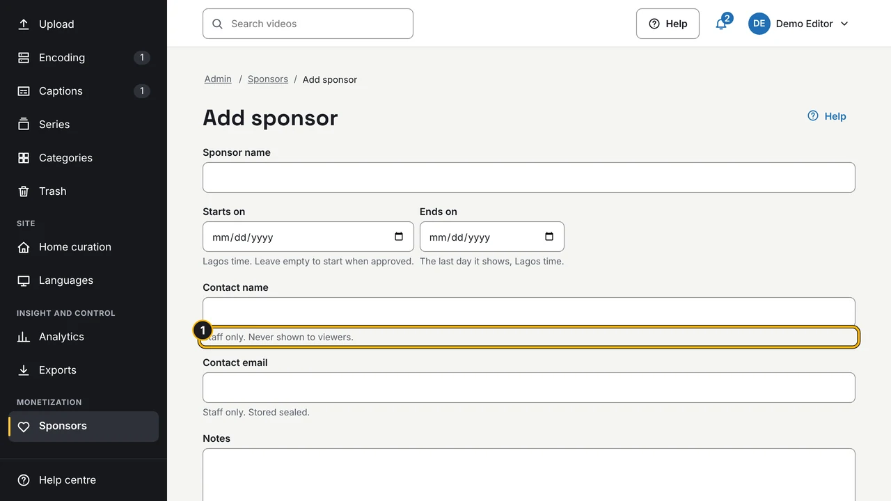

## What you will do
Find quick answers about sponsors and gifts. You end with a short answer and a link to the full guide.

## Before you start
You need to be an Editor or above for sponsors. Donations are for Admins.

**Can I turn on donations myself?** Not today. The developer does. [Set up donations](help:M07)

**Where is the Paystack key?** Only on the server. Never in this site or a chat.

**Can children see sponsors or the Donate page?** No. [Kids safety rules](help:M21)

**Can an Editor approve a sponsor?** No. Editors can add and edit. An Admin approves. [Choose where a sponsor shows](help:M04)

**Who sees a sponsor's contact details?** Staff only. They are stored sealed and never shown to viewers.

**Why can I not delete a sponsor?** It has report numbers. Archive it. [Pause, archive or delete a sponsor](help:M05)

**Where do bank transfer gifts show?** Nowhere in the site. [Bank transfer instructions](help:M16)

**Is monthly giving available?** Not yet. [Monthly giving](help:M22)

**What about tax?** Ask a professional. [Taxes and legal notes](help:M23)

## Steps
<!-- kb:steps M24 -->
1. Choose **Sponsors** in the side menu.
2. Check that **Sponsors are off. Viewers see nothing.** shows beside the switch.
3. Click **Add sponsor**.
4. Check that **Staff only. Never shown to viewers.** shows under the contact name.
   
<!-- /kb:steps -->

## What you should see
The **Sponsors** screen opens, and the staff only hints under the contact boxes remind you that contact details never reach viewers.

## If something goes wrong
- **Your question is not here.** Ask your Admin or the developer.
- **A screen looks different from the guide.** Tell the developer. The guides are checked against the screens, but a change may be new. Still stuck? [What to send ARKDEV](help:T11)
