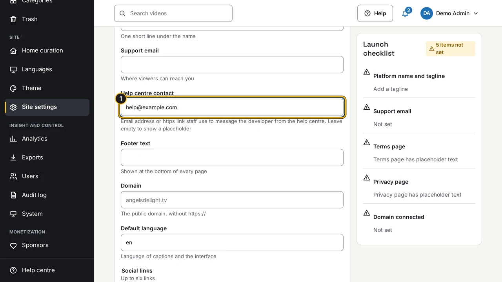
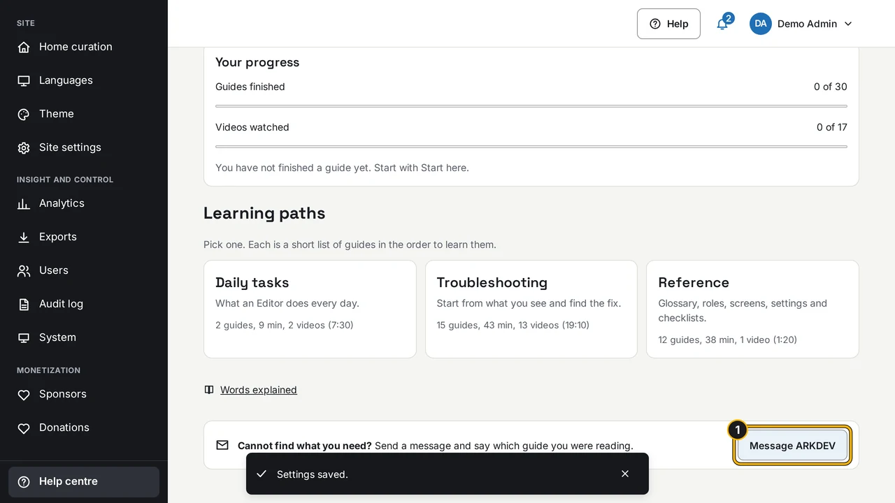

## What you will do
Set the contact that the **Message ARKDEV** button on the Help centre home page opens. You end with staff able to message ARKDEV in one click.

## Before you start
You need the Admin role or above. Ask ARKDEV for the email address or the link they want staff to use. A link must start with https.

## Steps
<!-- kb:steps R13 -->
1. Choose **Site settings** in the side menu.
2. Type "help@example.com" in the **Help centre contact** box.
   Use an email address or a link that starts with https. Use the contact ARKDEV gave you, not the example.
   
3. Click **Save changes**.
4. Choose **Help centre** in the side menu.
5. Scroll to **Message ARKDEV** at the bottom of the page.
   
<!-- /kb:steps -->

## What you should see
The Help centre home page shows the button **Message ARKDEV**. An email address opens the email app, and a link opens in a new tab.

## If something goes wrong
- **The Help centre still says the contact has not been set.** Save the page again, then reload the Help centre. [Who does what](help:R10)
- **The box says the contact is not valid.** Use a full email address, or a link that starts with https.
- **You cannot open Site settings.** The screen needs the Admin role. [Roles and permissions](help:R02)
