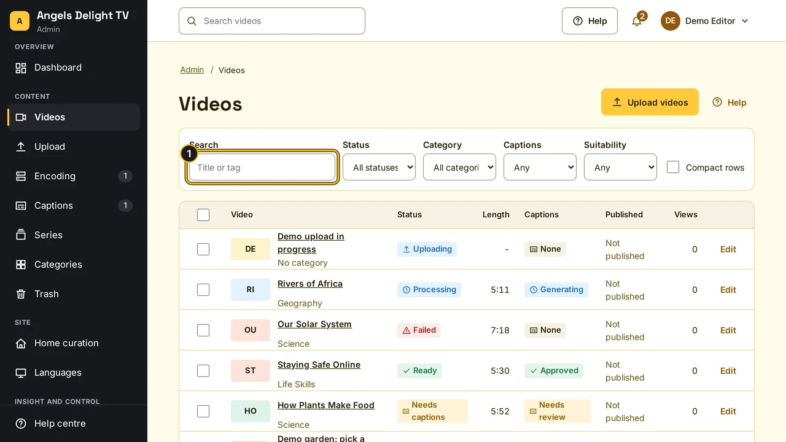
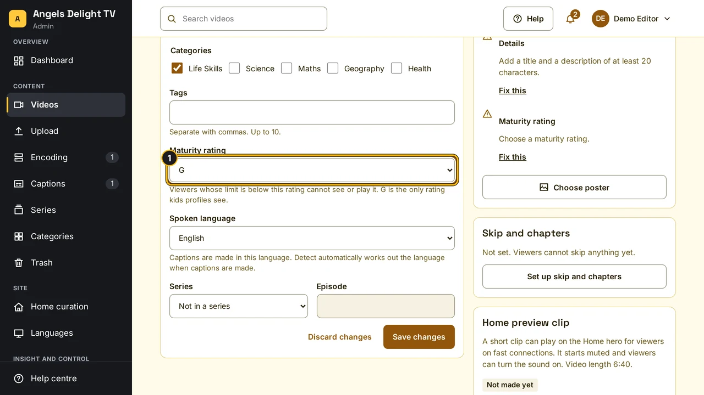
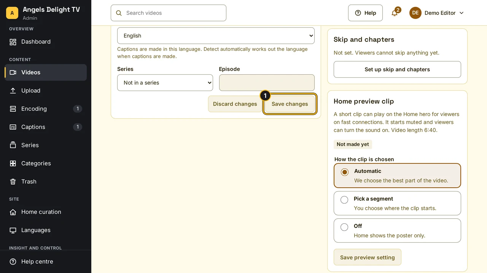

## What you will do
Give one video the **G** rating. Kids profiles and Kids mode only show videos with this rating, so you end with a video that children can watch.

## Before you start
You need to be an Editor, Admin or Super admin. Read [Find your way around](help:S04) if you have not yet.

Choose **G** only when a parent would be happy for a child to watch the video alone. If you are unsure, pick a higher rating. A [Kids profile](glossary:kids-mode) never shows PG, 12, 15 or 18 videos.

What a child sees in Kids mode:
- Only videos rated **G**, and series rated **G**.
- No sponsor adverts.
- No likes or ratings and no notices. Views are counted without naming the child.
- The child cannot open an adult profile without the account password.

## Steps
<!-- kb:steps K01 -->
1. Choose **Videos** in the side menu.
   Editors, Admins and Super admins can all do this.
   
2. Type "Counting" in the **Search** box.
3. Click **Counting Money in Naira** to open the video.
4. Scroll to **Maturity rating**.
   G is the only rating that Kids profiles can see.
5. Select **G** from **Maturity rating**.
   Choose G only when a parent would be happy for a child to watch alone.
   
6. Click **Save changes**.
   
7. Scroll to **Before you publish**.
   A rating is one of the steps a video needs before it can be published.
8. Scroll to **How viewers see it**.
<!-- /kb:steps -->

## What you should see
The message **Changes saved.** appears, and **Maturity rating** shows **G**. The video now appears in Kids profiles once it is published.

## If something goes wrong
- **The Save changes button is grey.** Nothing has changed yet. Pick a different rating first, then save.
- **A video is G but a child cannot see it.** It may still be a draft or unpublished. Publish it, then check again.
