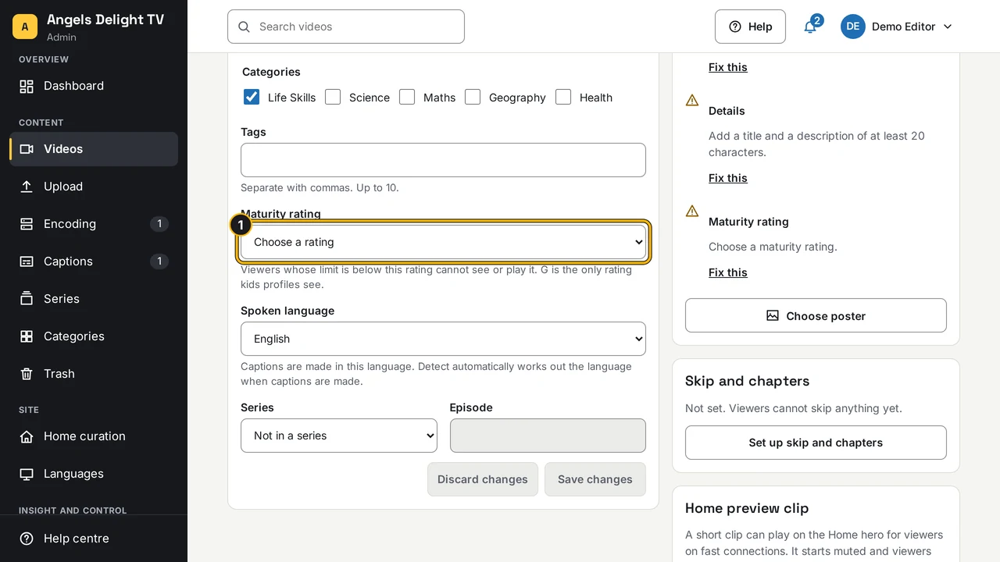
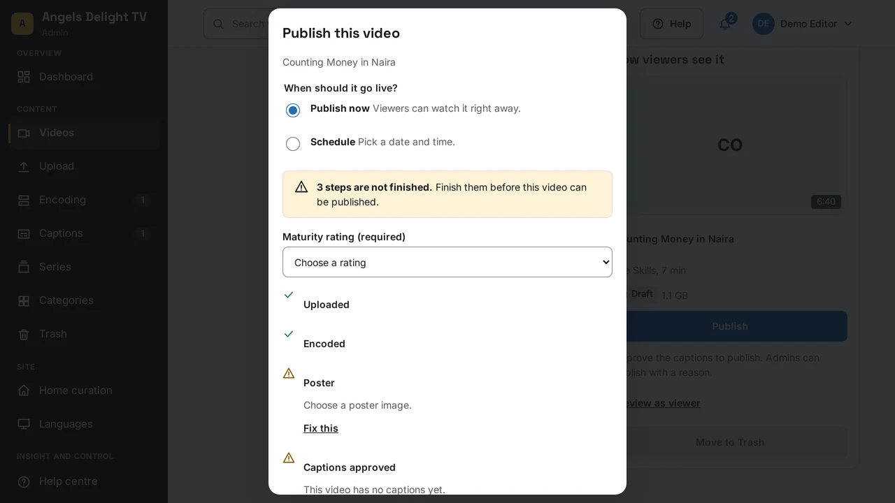
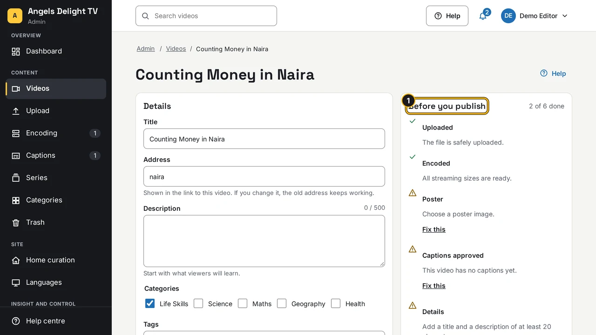

## What you will do
Learn the five maturity ratings and where Publish asks for one. You end by choosing a rating in the Publish box.

## Before you start
You need to be an Editor, Admin or Super admin. Read [Find your way around](help:S04) if you have not yet.

The five ratings, from lowest to highest:

| Rating | In plain words | Who can see it |
|---|---|---|
| **G** | All ages | Everyone, including Kids profiles |
| **PG** | Parental guidance | Profiles set to PG or higher |
| **12** | Ages 12 and up | Profiles set to 12 or higher |
| **15** | Ages 15 and up | Profiles set to 15 or higher |
| **18** | Adults only | Adult profiles set to 18 |

How to choose: think of the youngest person who might watch the video alone. Scary scenes, strong words or grown up subjects push the rating up. If you are torn between two ratings, choose the higher one.

Who sees what:
- A profile sees only videos at or below its own limit. The default limit for a new adult profile is **12**.
- A Kids profile and Kids mode see **G** only.
- Visitors without an account see up to **12** unless the developer has set a different limit. There is no screen for this yet, so ask the developer to change it.
- A video with no rating counts as **18** until you choose one, so it stays hidden from most people.
- A site can rename the five labels. This guide uses the standard ones.

What viewers see: the rating shows as a small label on the title page. **G** shows no label on cards. Viewers with an account can mark a title **Not for me**, **I like this** or **Love this**. Kids profiles cannot rate. After enough people rate a title it can get a **Most liked** label.

## Steps
<!-- kb:steps K02 -->
1. Choose **Videos** in the side menu.
2. Type "Counting" in the **Search** box.
3. Click **Counting Money in Naira** to open the video.
4. Scroll to **Maturity rating**.
   The five ratings run from G, for everyone, up to 18, for adults only.
   
5. Click **Publish**.
   A video cannot go live without a rating. Publish asks for one if it is missing.
   
6. Check that **Maturity rating (required)** is in the box.
7. Select **PG** from **Maturity rating (required)**.
   PG means parental guidance. Kids profiles cannot see it.
8. Click **Cancel**.
   Cancel so that this video stays a draft. The other steps still need doing.
9. Scroll to **Before you publish**.
   
<!-- /kb:steps -->

## What you should see
The Publish box has the rating list filled in and the **Maturity rating** step in the checklist is done. Press **Publish now** once the other steps are done to make the video live.

## If something goes wrong
- **Publish says Choose a maturity rating.** The video has no rating yet. Pick one in the Publish box or in **Maturity rating** on the video screen, then publish again.
- **Publish is grey.** Another step is still open. Read the list in the box and finish each step.
