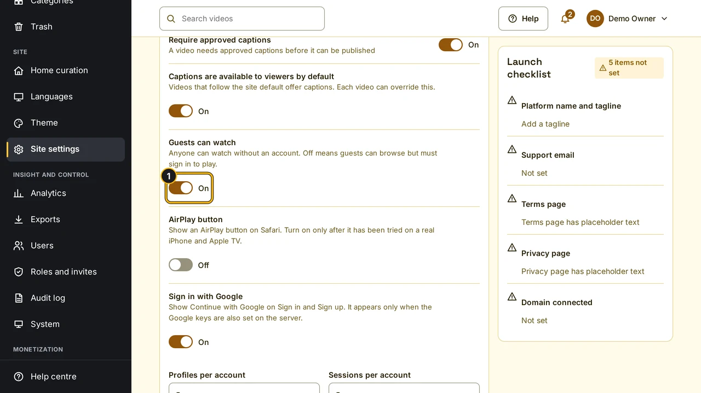
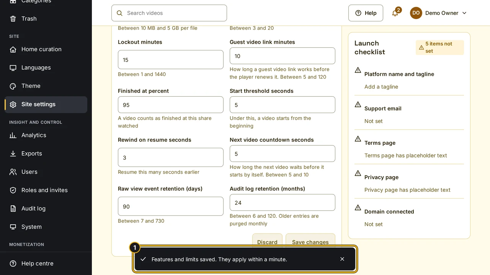

## What you will do
Turn guest watching off, set how long a guest video link lasts and save. You end with the choice live for visitors.

## Before you start
You need to be a Super admin. Think about who you want to reach. Guests keep their watch progress on their own device only. Read [Features and limits: what each switch does](help:C04) first.

## Steps
<!-- kb:steps K03 -->
1. Click **Site settings** in the side menu.
2. Click **Features and limits** at the top.
3. Check the hint under **Guests can watch**.
   On means anyone can watch without an account. Off means visitors can browse but must sign in to play.
   
4. Untick **Guests can watch**.
   Turn it back on the same way. Visitors keep their progress on their own device only.
5. Type "10" in the **Guest video link minutes** box.
   A guest video link works this long before the player renews it. Choose 5 to 120 minutes. The default is 20.
6. Click **Save changes**.
   
<!-- /kb:steps -->

## What you should see
The message **Features and limits saved. They apply within a minute.** appears for a few seconds. With **Guests can watch** off, visitors can browse but must sign in to play.

> [!NOTE]
> There is no screen yet for two guest choices. The default for visitors without an account (General or Kids) and the highest maturity rating a guest can see are set by your developer. Ask them to change either. Guests cannot save to My List, make profiles or use the Kids PIN.

## If something goes wrong
- **The switch is greyed out.** Your role is Admin. Only a Super admin can change it.
- **Guests still play videos.** Changes take up to a minute. Reload the site and try again in a private window.
- **A guest video stops after a while.** The guest video link ended. The player renews it by itself. If it keeps stopping, raise **Guest video link minutes**. Still stuck? [What to send ARKDEV](help:T11)
