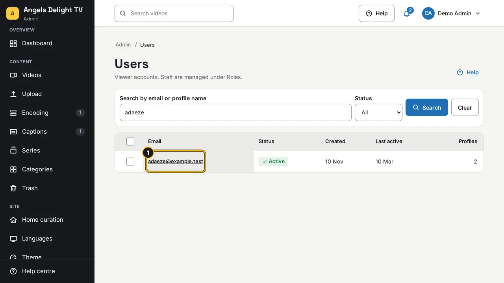
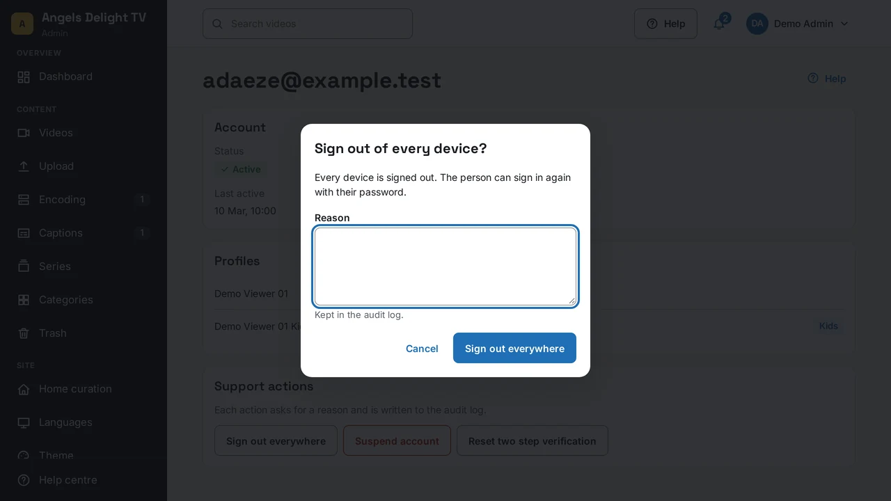
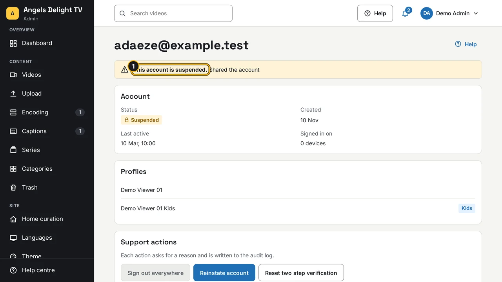

## What you will do
Sign a viewer out of every device, then suspend the account and reinstate it. Use this when a phone is lost, a password is shared or someone breaks the rules.

## Before you start
You need to be an Admin or Super admin. Editors cannot open **Users**.

Which action to use:
- **Sign out everywhere** ends every session. The person can sign in again with their password. Use it for a lost phone or a shared device.
- **Suspend account** signs the person out and stops them signing in. Their profiles and lists are kept. Use it for misuse.
- **Reinstate account** undoes a suspension straight away.

Each action asks for a reason of at least 3 characters. The reason goes into the audit log. See [Read the audit log: who did what](help:K06).

You can also act on many accounts at once. Tick the rows in the Users list and use the buttons that appear above it.

Staff are not in this list. Staff access is managed under **Roles and invites**.

## Steps
<!-- kb:steps K04 -->
1. Choose **Users** in the side menu.
   Users lists viewer accounts. Staff are managed under Roles and invites.
2. Type "adaeze" in the **Search by email or profile name** box.
3. Click **Search**.
   
4. Click **adaeze@example.test** to open the account.
5. Scroll to **Signed in on**.
   This shows how many devices are signed in to the account right now.
6. Click **Sign out everywhere**.
   The person can sign in again with their password.
   
7. Type "Phone was lost" in the **Reason** box.
   The reason is kept in the audit log. Write it so a colleague understands.
8. Click **Sign out everywhere** to confirm.
9. Click **Suspend account**.
   Suspending signs the person out and stops them signing in. Their profiles and lists are kept.
10. Type "Shared the account" in the **Reason** box.
11. Click **Suspend account** to confirm.
   
12. Click **Reinstate account**.
   This is how you undo a suspension. The person can sign in again straight away.
13. Click **Reinstate account** to confirm.
<!-- /kb:steps -->

## What you should see
Each action shows a message such as **Signed out everywhere.** or **Account suspended.** A suspended account shows a banner and the **Reinstate account** button.

## If something goes wrong
- **Sign out everywhere is grey.** No device is signed in, so there is nothing to end. The account page says how many devices.
- **I cannot find the person.** Search by email or by profile name, and set **Status** to **All**. Check the spelling.
