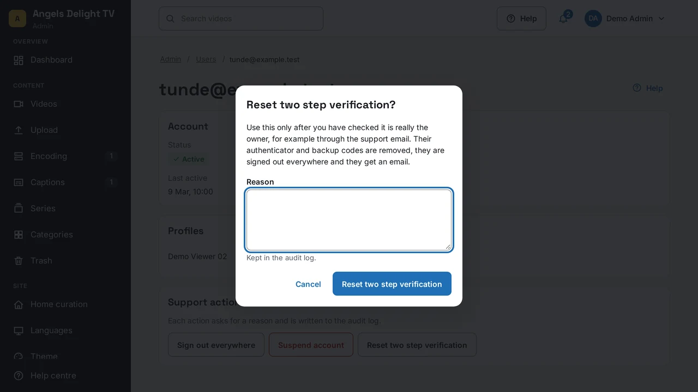

## What you will do
Clear the two step sign in of a viewer who lost their phone and their recovery codes. You end with the person able to sign in with a password and set up two step sign in again.

## Before you start
You need to be an Admin or Super admin.

Viewers can turn on two step sign in themselves. It is optional for them, and they use an authenticator app on their phone. When they turn it on they get ten recovery codes. Each code works once. Most people who lose their phone use a recovery code, so ask them to try one first.

Reset only when all of these are true:
- The person lost their phone or authenticator app.
- They have no recovery code left.
- You are sure they are the owner. For example, they wrote from the email on the account, or you know them.

A reset removes the authenticator and the recovery codes, signs the person out everywhere and sends them an email. If someone else asked, the email warns the owner.

Deleting an account is different. Only a Super admin can do it, and only when the owner asks. See [Delete an account when the owner asks](help:K13). A viewer can also ask for their own data as a file from their account page, and can delete their own account there.

Staff two step sign in is reset on **Roles and invites** by a Super admin, and needs the Super admin's own password or emailed code.

## Steps
<!-- kb:steps K05 -->
1. Choose **Users** in the side menu.
2. Type "tunde" in the **Search by email or profile name** box.
   Check that the email is the one the owner wrote from, before you change anything.
3. Click **Search**.
4. Click **tunde@example.test** to open the account.
5. Scroll to **Support actions**.
   Each action asks for a reason and is written to the audit log.
6. Click **Reset two step verification**.
   Use this only after you are sure the person is the owner, for example by the support email.
   
7. Type "Lost phone and codes, owner confirmed by email" in the **Reason** box.
8. Click **Reset two step verification** to confirm.
   The person is signed out everywhere and gets an email. They set up two step sign in again after they sign in.
<!-- /kb:steps -->

## What you should see
The message **Two step verification reset.** appears. The person gets an email and can sign in with their password only.

## If something goes wrong
- **I do not see Reset two step verification.** Your role may be Editor, or you are on the wrong page. Open the person from **Users**.
- **The person says they did not ask.** Do not reset. Suspend the account first, then check with the owner. See [Suspend an account and sign someone out everywhere](help:K04). Still stuck? [What to send ARKDEV](help:T11)
