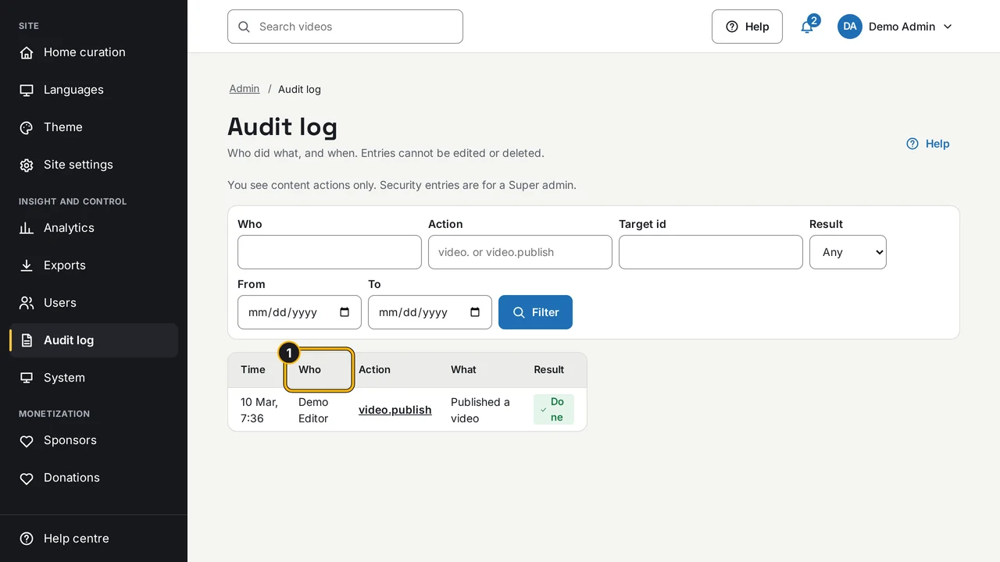
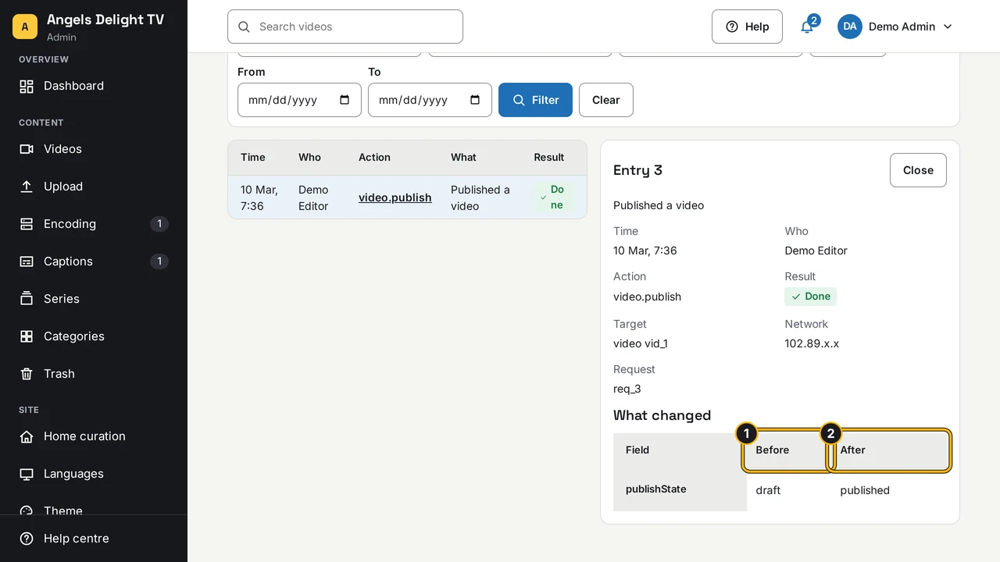

## What you will do
Find out who did something and when. You end by opening one entry to see what it changed.

## Before you start
You need to be an Admin or Super admin. The log cannot be edited or deleted by anyone.

Each row has a time, the person, the action, a short summary and a result:
- **Done** means it worked.
- **Failed** means it went wrong.
- **Blocked** means the person's role was not allowed to do it.

An Admin sees content actions, such as publishing a video or suspending a viewer. A Super admin also sees security entries, such as sign ins and role changes, and can use **Export CSV**.

Open an entry to see **Before** and **After**. Secrets such as passwords and keys are never shown. Entries are kept for 24 months, then removed.

## Steps
<!-- kb:steps K06 -->
1. Choose **Audit log** in the side menu.
   Admins see content actions. Super admins also see security entries.
   
2. Scroll to **Result**.
   Done means it worked. Failed means it went wrong. Blocked means the role was not allowed.
3. Type "video." in the **Action** box.
   Actions are written as a group and a verb, such as video.publish.
4. Click **Filter**.
5. Click **Open details for video.publish at 10 Mar, 7:36** to open the entry.
   
6. Scroll to **Before**.
   Before and After show what changed. A password or a secret is never shown here.
7. Click **Close**.
8. Click **Clear**.
   Clear removes the filter and shows every entry again, newest first.
<!-- /kb:steps -->

## What you should see
The table shows only the entries that match your filter, and the details of one entry show what it changed.

## If something goes wrong
- **No entries match.** Widen the dates or press **Clear**. The Action box matches the start of an action, so video. finds video.publish.
- **I cannot see sign in entries.** Security entries are for Super admins. Ask one to look, or to export the log.
