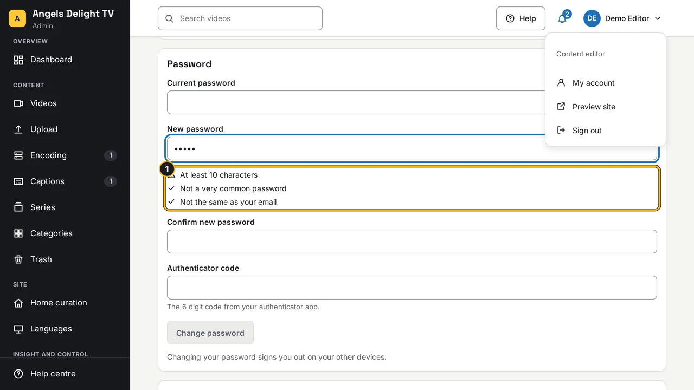
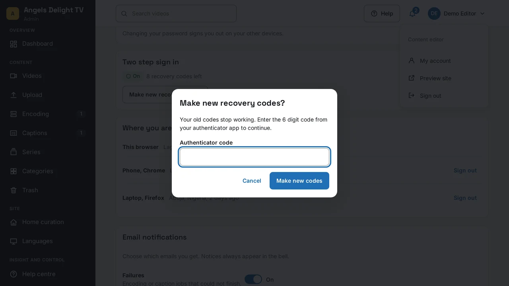
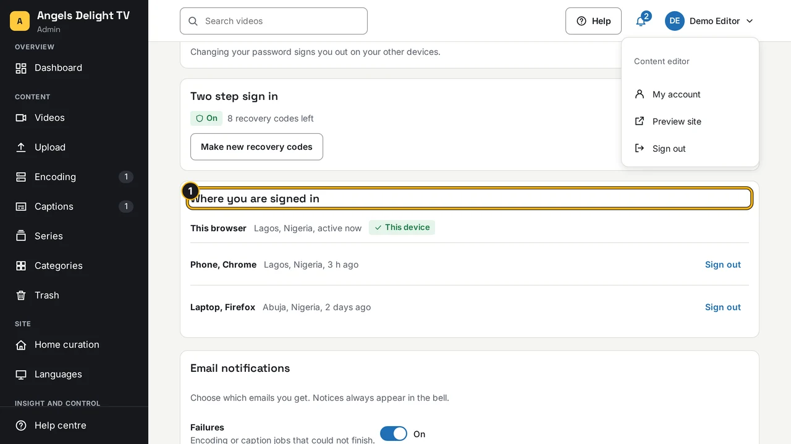

## What you will do
Look at the safety tools on **My account**: password rules, two step sign in, recovery codes and your list of devices. You change nothing.

## Before you start
You need to be an Editor, Admin or Super admin.

Safe habits:
- Use a long password that you use nowhere else. Three unrelated words and a number is easy to remember and hard to guess.
- Never share your account. Ask a Super admin for an invite for the other person.
- Never paste a password, a key or a recovery code into a chat or an email.
- Sign out when you finish on a shared or public computer.
- Before you take a screenshot, check it for emails, codes and keys. Crop or blur them.

Password rules: at least 10 characters, not a very common password, and not the same as your email. The list under **New password** shows each rule as you type.

Staff sessions end after 60 minutes of no use, and after 8 hours in all. A warning shows before that happens. Changing your password signs you out on your other devices.

If you think someone else has your password, change it now, press **Sign out** beside every device you do not know, make new recovery codes and tell a Super admin.

## Steps
<!-- kb:steps K07 -->
1. Click **Account menu**.
2. Click **My account**.
3. Scroll to **Password**.
   Use a long password that you use nowhere else. Three unrelated words and a number work well.
4. Type "river" in the **New password** box.
   This is only to show the rules. Nothing is saved until you press Change password.
   
5. Scroll to **Two step sign in**.
   Two step sign in is on for every staff account. It asks for a code we email you, or one from your app.
6. Click **Make new recovery codes**.
   Recovery codes let you in if you lose your phone. Each code works once. Keep them somewhere safe and private.
   
7. Check that **Your old codes stop working.** is in the box.
8. Click **Cancel**.
   Do not paste recovery codes into chats or emails, and do not take pictures of them.
9. Scroll to **Where you are signed in**.
   Sign out any device you do not know or no longer use. Staff sessions end after 7 days of no use, and after 30 days at most. Remembered devices are listed on this page with **Forget**.
   
<!-- /kb:steps -->

## What you should see
You have seen the password rules, the two step sign in card, the recovery codes box and your devices. Nothing was saved.

## If something goes wrong
- **I lost my phone or cannot get the email.** Authenticator users can use a recovery code. Otherwise ask a Super admin to reset your two step sign in.
- **A device I do not know is in the list.** Press **Sign out** beside it, then change your password. Still stuck? [What to send ARKDEV](help:T11)
