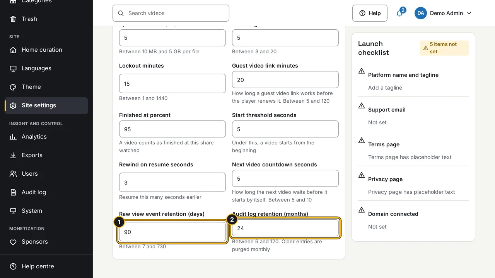
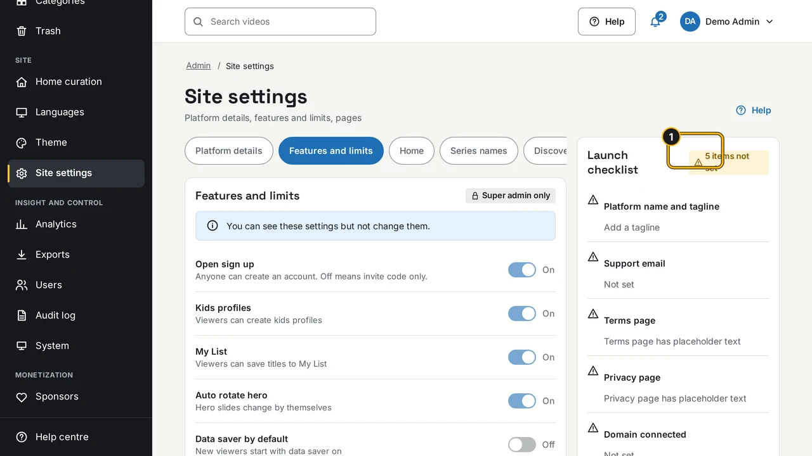

## What you will do
Learn what the platform stores about people and how long it keeps it. You can then answer a question from a viewer in plain words.

## Before you start
You need to be an Admin or Super admin. This guide is a plain summary and not legal advice. Nigeria has a data protection law, the NDPA 2023. Ask a lawyer or your data protection contact before you promise anything to a viewer or a regulator.

**Viewers with an account**
- Email, names, profile details: stored locked with a key that belongs to that account. Deleting the account destroys the key.
- Password and profile PIN: stored scrambled, so nobody can read them, not even staff.
- Two step sign in secret and recovery codes: stored locked.
- Watch progress, My List and ratings: tied to a profile. Ratings are never kept for Kids profiles.
- Sign in history: country, time, result and device type. No address. Kept 90 days.
- Notices: never created for Kids profiles. Kept 60 days.

**Guests, with no account**
- A cookie with a random number, so a guest can resume a video and limits stay fair. It holds no name. Kept 180 days.
- Their Kids mode choice, kept 180 days.
- Where they stopped watching, saved in their own browser only.
- A viewer id for counting views. It is a random code that changes every day and it is never kept for Kids profiles or Kids mode.

**What staff can see**
- The audit log: who did what. Kept for the number of months in **Audit log retention (months)**, 24 by default.
- Detailed view records, kept for the number of days in **Raw view event retention (days)**, 90 by default.
- Technical logs: server logs for 14 days and application logs for 30 days. These can hold a full address for that short time.
- Help centre progress: which guides a staff member marked done. No cookie is used.

**When an account is deleted**
- The profile, lists, history and sign in records are removed after the waiting period.
- Audit entries stay. They hold no name or email.
- Backups clear within 14 days.
- Videos in Trash are deleted for good after 30 days.

**The storage notice and cookies**
- Visitors see a short notice that says what the site keeps on their device. Closing it is remembered for a year.
- The Privacy page lists every cookie and every stored item with its purpose and how long it stays. The list is built from the same file the code uses, so it cannot drift.
- Nothing is kept for adverts, and no tracking from other sites is used.

## Steps
<!-- kb:steps K08 -->
1. Choose **Site settings** in the side menu.
2. Click **Features and limits**.
   Admins can read this tab. Only a Super admin can change it.
3. Scroll to **Raw view event retention (days)**.
   This is how many days detailed view records are kept. The standard is 90.
   
4. Scroll to **Audit log retention (months)**.
   This is how long the audit log is kept. The standard is 24 months.
5. Click **Pages**.
   The Privacy page that visitors read is edited here by an Admin.
   
<!-- /kb:steps -->

## What you should see
You have found the two retention settings and the Pages tab where the Privacy page lives. You can say what is stored, why, and for how long.

## If something goes wrong
- **A viewer asks for a copy of their data.** They download it from their own account page. An admin cannot make the file for them.
- **A viewer asks for deletion and cannot sign in.** Check they own the account, then ask a Super admin. See [Delete an account when the owner asks](help:K13).
