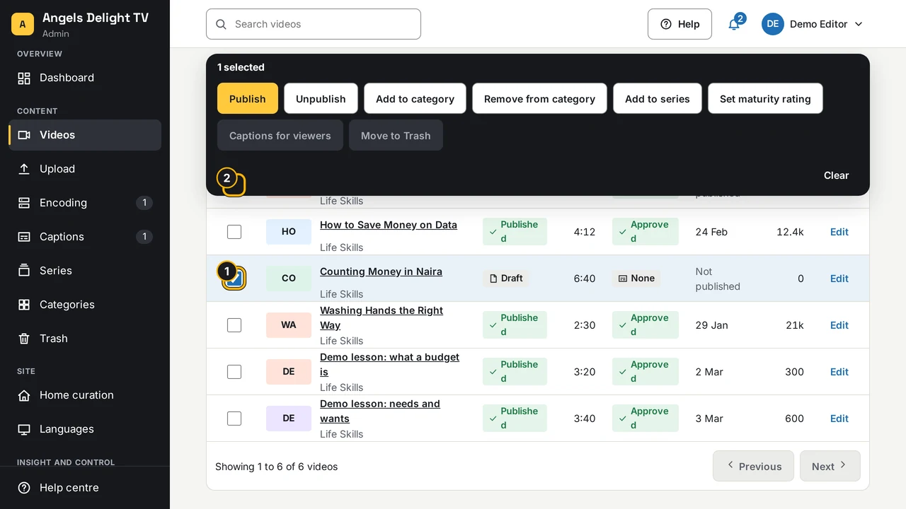
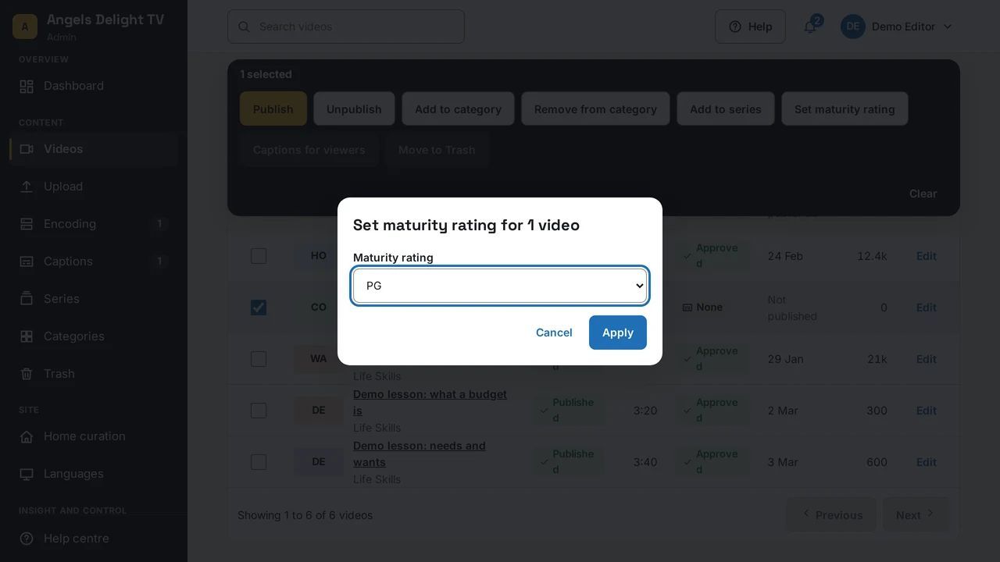
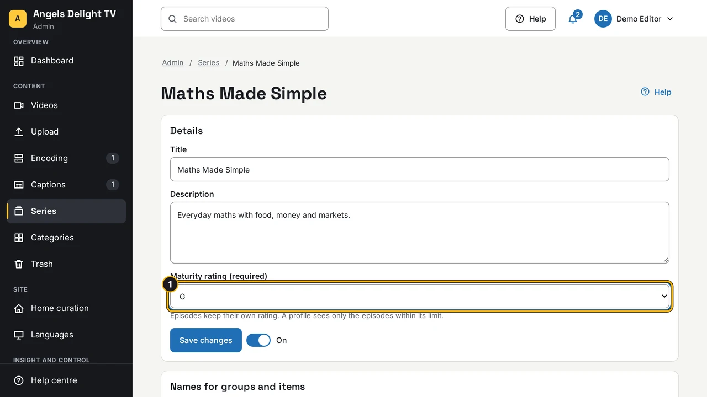

## What you will do
Set the same maturity rating on several videos at once, then on a whole series. You end with the new rating saved on every one.

## Before you start
You need to be an Editor, Admin or Super admin. Read [Maturity ratings and the highest rating guests can see](help:K02) to choose the right rating.

Two things to know:
- The list change is all or nothing. If one video cannot be changed, none are.
- A series has its own rating, and its episodes keep their own. Press **Apply to all** to copy the series rating to every episode.

## Steps
<!-- kb:steps K09 -->
1. Choose **Videos** in the side menu.
2. Select **Life Skills** from **Category**.
3. Tick **Select Counting Money in Naira**.
4. Tick **Select Staying Safe Online**.
   
5. Click **Set maturity rating**.
6. Select **PG** from **Maturity rating**.
   Every ticked video gets this rating. The change is all or nothing.
   
7. Click **Apply**.
   A message with Undo appears for a few seconds. Use it if you chose the wrong rating.
8. Choose **Series** in the side menu.
9. Click **Maths Made Simple** to open the series.
10. Select **G** from **Maturity rating (required)**.
   
11. Click **Save changes**.
12. Click **Apply to all 2 episodes**.
   Episodes keep their own rating unless you do this step.
13. Click **Apply to 2 episodes**.
<!-- /kb:steps -->

## What you should see
A message says the rating was set, with an **Undo** button for a few seconds. The series page says **Rating applied to every episode.**

## If something goes wrong
- **Set maturity rating is grey.** You have not ticked any video yet. Tick one or more rows first.
- **You chose the wrong rating.** Press **Undo** in the message straight away. Later, set the right rating the same way. Still stuck? [What to send ARKDEV](help:T11)
