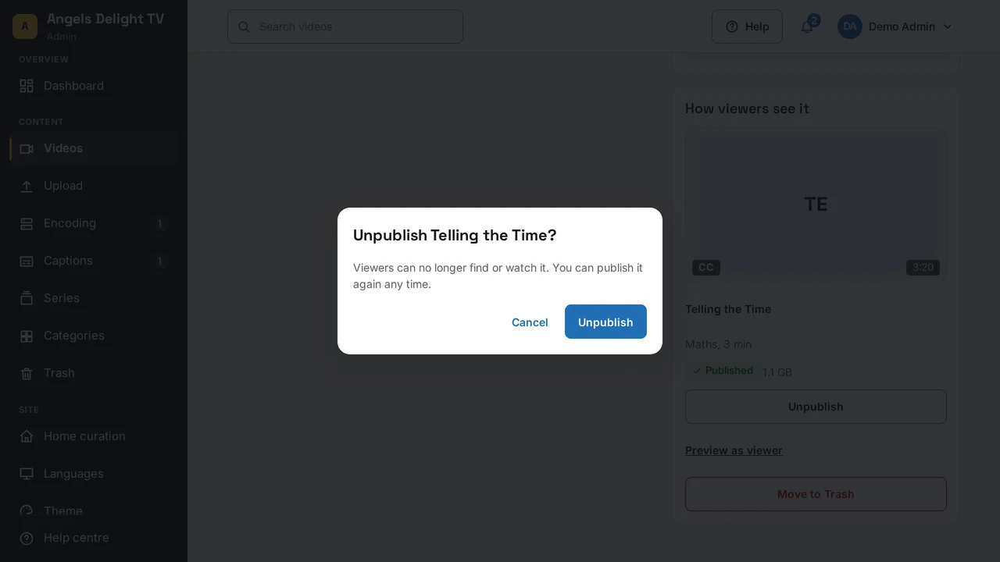
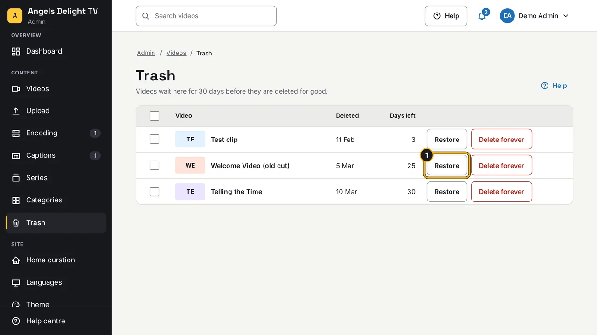

## What you will do
Hide a video from viewers straight away, move it to [Trash](glossary:trash) and bring it back. Use this when someone reports a video or you find a mistake.

## Before you start
You need to be an Admin or Super admin to use **Move to Trash**. An Editor can still **Unpublish** and **Restore**.

Which action to use:
- **Unpublish** hides the video now. The video stays in your list as a draft. Use it for a quick fix.
- **Move to Trash** hides it and starts a 30 day wait. After that it is deleted for good.
- **Delete forever** in Trash removes it at once. You cannot get it back.

Both Unpublish and Trash stop the video showing to viewers right away.

## Steps
<!-- kb:steps K10 -->
1. Choose **Videos** in the side menu.
2. Type "Telling" in the **Search** box.
3. Click **Telling the Time** to open the video.
4. Click **Unpublish**.
   Unpublish hides the video from viewers at once. You can publish it again any time.
   
5. Click **Unpublish** to confirm.
6. Wait until you see **Publish**.
7. Click **Move to Trash**.
   Only Admins and Super admins can do this. The video waits in Trash for 30 days.
8. Click **Move to Trash** to confirm.
9. Choose **Trash** in the side menu.
   
10. Click **Restore Welcome Video (old cut)**.
   A restored video comes back as a draft. Publish it again when you are ready.
11. Check that **Delete forever** is there.
   Delete forever removes a video for good. Use it only when you are sure.
<!-- /kb:steps -->

## What you should see
The video is no longer on the site. It shows in **Trash** with the days it has left. After **Restore** it is back in **Videos** as a draft.

## If something goes wrong
- **Move to Trash is grey.** Only Admins and Super admins can use it. Ask one of them, or use Unpublish.
- **A restored video is not live.** Restored videos come back as drafts. Open it and choose **Publish**.
