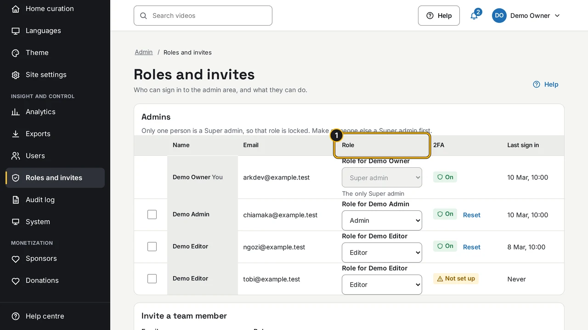
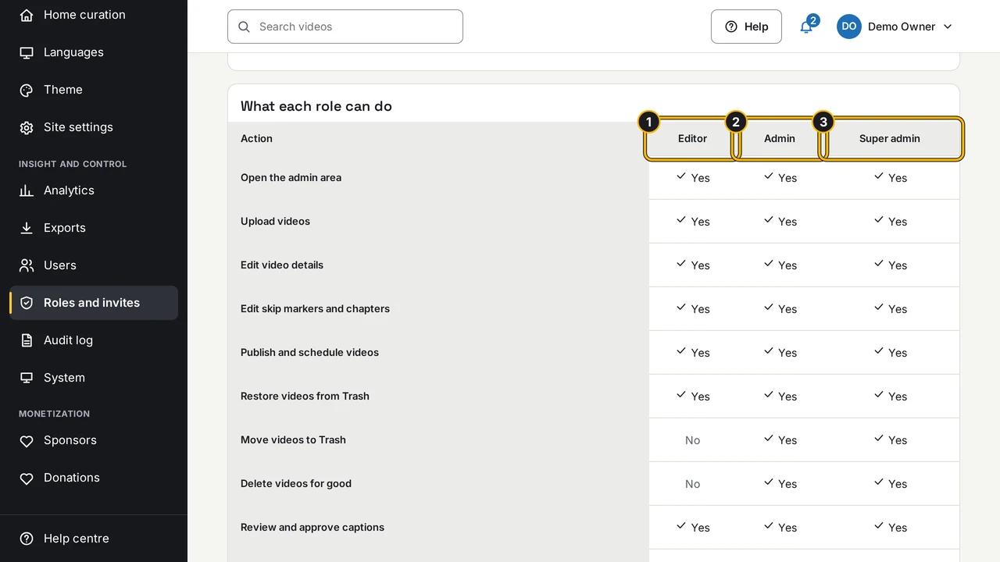

## What you will do
Read the table of what each staff role can do. You end knowing which role to give a new team member.

## Before you start
You need to be a Super admin to open **Roles and invites**. The table below is the same one.

Give people the lowest role that lets them do their job.

| Role | Can do | Cannot do |
|---|---|---|
| **Editor** | Upload, edit and publish videos. Review captions. Manage series, categories and Home. See analytics. Manage sponsor drafts. | Move a video to Trash or delete it for good. See viewer accounts. Change theme or settings. Read the audit log. |
| **Admin** | Everything an Editor does, plus Trash, captions overrides, viewer accounts, suspend, theme, site settings, donations, the audit log (content actions) and system health. | Invite people or change roles. Change features and limits. Delete a viewer account. Export the audit log. |
| **Super admin** | Everything, including Roles and invites, features and limits, deleting a viewer account at the owner's request, security entries in the audit log, exports and failed jobs. | Change their own role. The last Super admin cannot be demoted. |

The fastest way to be sure is the table on the **Roles and invites** screen. It is read only and always matches what the site enforces.

Adding or removing a person happens on the same screen:
- Add a person with **Send invite**. The link works for 7 days and once.
- Change a role from the **Role** list in the **Admins** table. You confirm with your password.
- Cancel an invite that was sent by mistake before the person uses it.
- There is no Remove button for a person who already has access. Lower them to **Editor** and ask the developer to close their account. Do this the same day if someone leaves on bad terms.

Two step sign in is required for every staff account.

## Steps
<!-- kb:steps K11 -->
1. Choose **Roles and invites** in the side menu.
   Only a Super admin can open this screen.
2. Scroll to **Admins**.
   This list holds every person with admin access, with their role and whether two step sign in is on.
   
3. Scroll to **Invite a team member**.
   To add or remove people, read the guides for inviting and changing roles.
4. Scroll to **What each role can do**.
   
5. Scroll to **Move videos to Trash**.
   Editors can upload, edit and publish, but they cannot move a video to Trash.
6. Scroll to **Suspend viewer accounts**.
   Admins and Super admins can suspend a viewer. Editors cannot see viewer accounts at all.
7. Scroll to **Change features and limits**.
   Only Super admins can change features and limits.
8. Scroll to **Export the audit log**.
   Only Super admins can export the audit log or read its security entries.
<!-- /kb:steps -->

## What you should see
You have found the table and read the rows that matter most: Trash, viewer accounts, features and limits, and the audit log.

## If something goes wrong
- **Roles and invites is missing from the menu.** Only Super admins see it. Ask a Super admin.
- **The Role list is grey.** You cannot change your own role, and the only Super admin is locked. Make another person a Super admin first. Still stuck? [What to send ARKDEV](help:T11)
