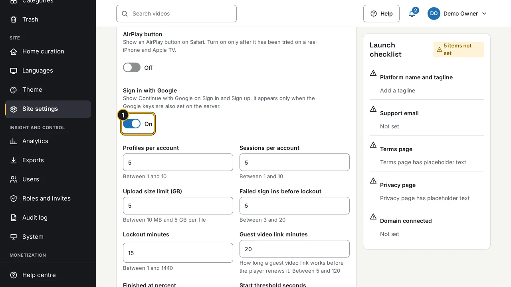
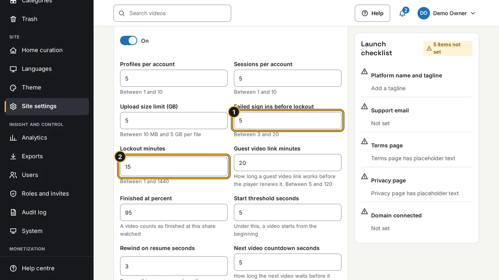

## What you will do
Find the switches and limits that control how viewers sign in. You end knowing what each one does and what the developer must set up.

## Before you start
You need to be a Super admin to change these settings. An Admin can read them.

What viewers can do on their own account page:
- **Two step sign in.** Optional. A viewer scans a code with an authenticator app and then enters a 6 digit code at each sign in. They get ten recovery codes, each usable once.
- **Sign in history.** A list of recent sign ins with the country, time and device type. It never shows an address. Records are kept for 90 days.
- **Devices.** A list of the devices signed in, with a button to sign each one out.
- **New device email.** When someone signs in from a device the site has not seen before, the owner gets an email.

Sign in with Google is optional. The **Sign in with Google** switch shows the button, but the button appears only when the developer has also put the Google keys on the server. Those keys are two secret values from the Google Cloud console, a client id and a client secret. Never paste them into a chat, an email or a screenshot. If the switch is on and the button is missing, the keys are not set.

The limits on this tab protect accounts. Failed sign ins before lockout and Lockout minutes slow down someone guessing a password. Sessions per account caps how many devices stay signed in.

## Steps
<!-- kb:steps K12 -->
1. Choose **Site settings** in the side menu.
2. Click **Features and limits**.
3. Scroll to **Sign in with Google**.
   The button shows only when this switch is on and the Google keys are set on the server by the developer.
   
4. Scroll to **Open sign up**.
   Off means new accounts need an invite code.
5. Scroll to **Failed sign ins before lockout**.
   After this many wrong passwords the account waits before it can try again.
   
6. Scroll to **Lockout minutes**.
7. Scroll to **Sessions per account**.
   This is how many devices one account can be signed in on at once.
<!-- /kb:steps -->

## What you should see
You have found each switch and box and know who sets it. This guide changes nothing.

## If something goes wrong
- **Continue with Google is missing on the sign in page.** The keys are not set on the server, or the switch is off. Ask the developer to check the keys.
- **A viewer is locked out.** They can try again after the lockout minutes. If they lost their phone, see [Reset a viewer's two step sign in and delete an account on request](help:K05). Still stuck? [What to send ARKDEV](help:T11)
