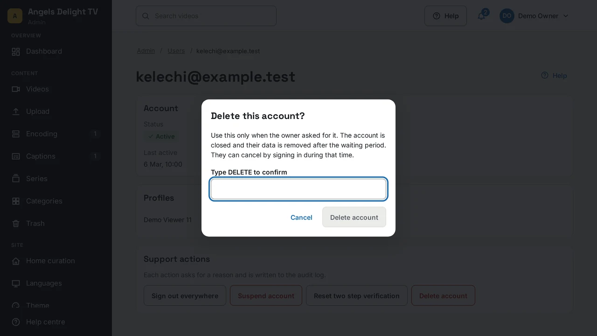

## What you will do
Start the deletion of one viewer account because its owner asked for it. You end with the account closed and a waiting period running.

## Before you start
You need to be a Super admin. Admins cannot see **Delete account**.

Only do this when the owner of the account asked. A viewer can also delete their own account from their account page, which is the better route when the person can sign in. Check that the request really came from the owner, for example from the email on the account.

What happens:
- The account closes now and the person is signed out.
- Their profiles, lists, watch history and sign in records are removed after the waiting period.
- The owner can cancel by signing in during that time.
- The account's audit log entries stay. They hold no name or email.
- Older backups clear by themselves within 14 days.

A person can ask for a copy of their data. They download it from their own account page. An admin cannot make that file for them. If they cannot sign in, reset their access first. See [Reset a viewer's two step sign in and delete an account on request](help:K05).

This guide is not legal advice. Nigeria has a data protection law, the NDPA 2023. Ask a lawyer or the data protection contact how long you must keep records and how fast you must answer a request.

## Steps
<!-- kb:steps K13 -->
1. Choose **Users** in the side menu.
2. Type "kelechi" in the **Search by email or profile name** box.
3. Click **Search**.
4. Click **kelechi@example.test** to open the account.
5. Scroll to **Support actions**.
   Only a Super admin sees Delete account. Admins do not.
6. Click **Delete account**.
   Use this only when the owner of the account asked for it.
   
7. Type "DELETE" in the **Type DELETE to confirm** box.
   The red button stays off until you type the word in capital letters.
8. Click **Delete account** to confirm.
   The account closes now. The data is removed after a waiting period, and the owner can cancel by signing in.
<!-- /kb:steps -->

## What you should see
The message **Deletion started.** appears. The audit log has an entry for the deletion with your name.

## If something goes wrong
- **Delete account is not on the page.** Only a Super admin sees it. Ask one, or sign in with that role.
- **The red button stays grey.** The box needs the word DELETE in capital letters, with no spaces. Still stuck? [What to send ARKDEV](help:T11)
