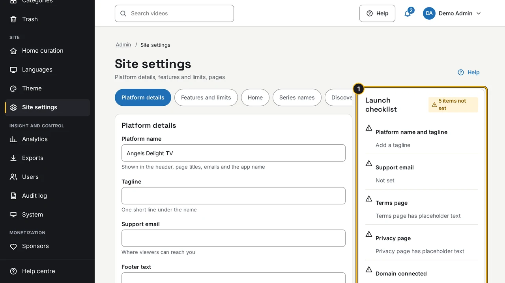
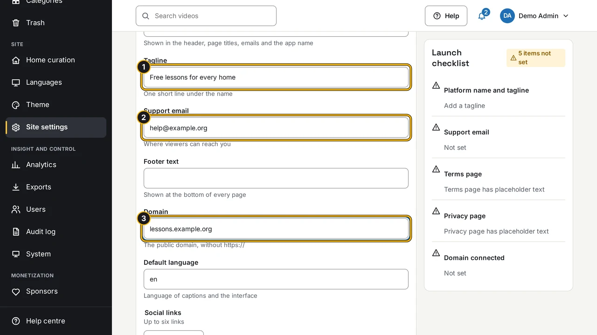
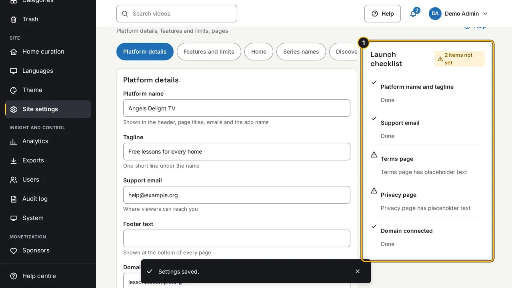

## What you will do
Fill in the basic details of your site and check the Launch checklist. You end with the checklist showing fewer items not set.

## Before you start
You need to be an Admin or a Super admin. Have your tagline, support email and domain ready. Read [Find your way around](help:S04) if you have not yet.

## Steps
<!-- kb:steps C01 -->
1. Click **Site settings** in the side menu.
   Admins and Super admins can open this screen. Editors do not see it.
   
2. Check the **Launch checklist** on the right.
   Each line with a warning sign is something still to set before you launch.
3. Type "Free lessons for every home" in the **Tagline** box.
4. Type "help@example.org" in the **Support email** box.
   Viewers use this address to reach you. Use an address that someone reads every day.
5. Type "lessons.example.org" in the **Domain** box.
   Type the web address without https://. Your developer connects the domain itself.
   
6. Click **Save changes** to keep your edits.
7. Check the **Launch checklist** again.
   The items you filled in now say Done.
   
<!-- /kb:steps -->

## What you should see
The message **Settings saved.** appears. On the **Launch checklist**, the tagline, support email and domain lines say **Done**. The **Terms page** and **Privacy page** lines stay open until you edit those pages in [Edit the legal and About pages](help:C06).

> [!TIP]
> The other boxes on this tab are the **Platform name**, **Footer text**, **Default language** and **Social links**. Each one is explained in the [settings dictionary](help:R04).

## If something goes wrong
- **The Domain box shows a red message.** Type only the web address, for example lessons.example.org, without https://.
- **Save changes is greyed out.** You have not changed anything yet. Edit a box first.
- **You cannot see Site settings in the menu.** Your role is Editor. Ask an Admin to make the change. Still stuck? [What to send ARKDEV](help:T11)
